# Changelog

Each release on GitHub shows its section from this file (the workflow looks for `## <version>`).

## 1.4.0

[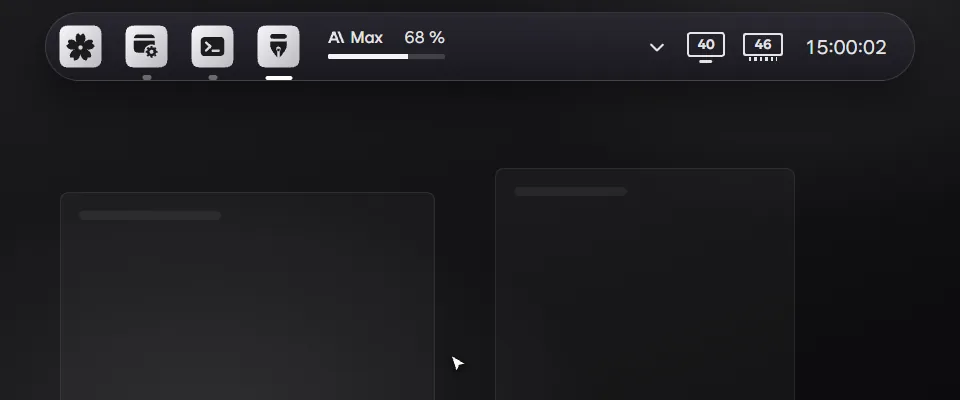](bloom://settings/notices)

- A click on a Claude Code or Codex card can open that session's chat on the taskbar instead of its app. Pick it under Clicking a card in Settings › Work notifications. It needs PillTaskbar 0.2.14 or later.
- Checking for updates in Settings › About checks the add-ons too, and the ones turned on update right away.
- Add-ons now bring their own words and pictures for Settings › Add-ons, so an add-on update alone can change its page. An add-on not yet updated shows its settings by their plain schema names until it is.

### 한국어

- Claude Code와 Codex 카드를 누르면 앱 대신 작업표시줄에서 그 세션의 대화를 열 수 있습니다. 설정 › 작업 알림의 카드를 누르면에서 고르며, PillTaskbar 0.2.14 이상이 필요합니다.
- 설정 › 정보에서 업데이트를 확인하면 애드온도 함께 확인하고, 켜 둔 애드온은 바로 업데이트합니다.
- 설정 › 애드온의 이름, 설명, 그림을 이제 애드온이 직접 싣습니다. 애드온만 업데이트해도 그 페이지가 바뀌고, 아직 업데이트하지 않은 애드온은 그때까지 기본 이름으로 보입니다.

## 1.3.0

[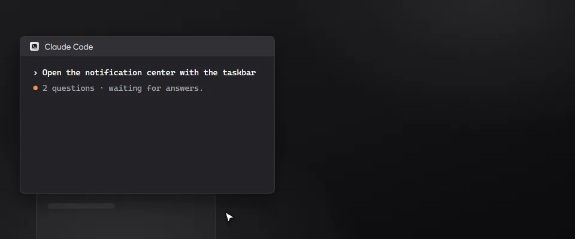](bloom://settings/notices)

- When Claude Code asks you a question, its approval card shows the question and the choices. Pick one or several, or type your own answer, and it goes back to Claude Code.
- Windows notifications: other apps' banners can show as Bloom's cards instead. Turn it on in Settings › Work notifications. It needs PillTaskbar 0.2.13 or later, and a click on the card opens Windows' notification center.
- Settings › Add-ons is easier to read. Choices show as small pictures, every line has a plain name and a short note, and programs to leave out can be picked from the ones running now.
- Fixed: number fields in the add-on settings show their range on one line.

### 한국어

[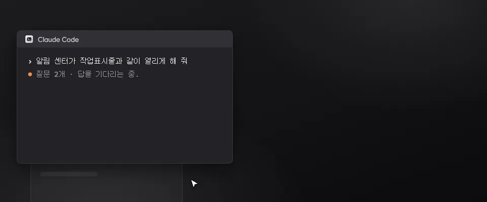](bloom://settings/notices)

- Claude Code가 질문하면 승인 카드에 질문과 선택지가 나옵니다. 하나나 여러 개를 고르거나 직접 답을 적으면 Claude Code로 전해집니다.
- Windows 알림: 다른 앱의 알림 배너를 Bloom 카드로 대신 띄울 수 있습니다. 설정 › 작업 알림에서 켜며, PillTaskbar 0.2.13 이상이 필요합니다. 카드를 누르면 Windows 알림 센터가 열립니다.
- 설정 › 애드온이 읽기 쉬워졌습니다. 선택지는 작은 그림으로 고르고, 줄마다 쉬운 이름과 짧은 설명이 붙고, 제외할 프로그램은 지금 실행 중인 것에서 고릅니다.
- 고침: 애드온 설정의 숫자 칸 범위가 한 줄로 나옵니다.

## 1.2.1

- Fixed: an add-on's setting slider can be dragged all the way to either end without stopping or jumping back to its start.
- Fixed: Settings › Taskbar shows the settings a newer add-on adds.
- Fixed: reinstalling an add-on of the same version no longer fails while Windows still holds its old files. The add-on starts right away.

### 한국어

- 고침: 애드온 설정 슬라이더를 끝까지 끌어도 멈추거나 처음 값으로 돌아가지 않습니다.
- 고침: 설정 › 작업표시줄에 새 버전 애드온이 더한 설정이 나옵니다.
- 고침: 같은 버전 애드온을 다시 설치할 때 Windows가 옛 파일을 붙잡고 있어도 실패하지 않고 바로 시작합니다.

## 1.2.0

[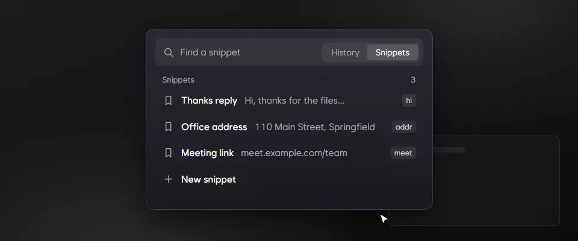](bloom://settings/shortcuts)

- Snippets: drag one up or down in the Snippets tab to change the order.
- Update history: Settings › About lists every version since 1.0.0. Pick one to see what changed. The notes come from GitHub when you open them, so Bloom no longer carries them.
- In Settings, the mouse's back button goes from a sub-page, such as an add-on's page, to the page above it.
- Fixed: at a larger size, a snippet's right-click menu stays inside the clipboard view instead of running past its left edge.

### 한국어

[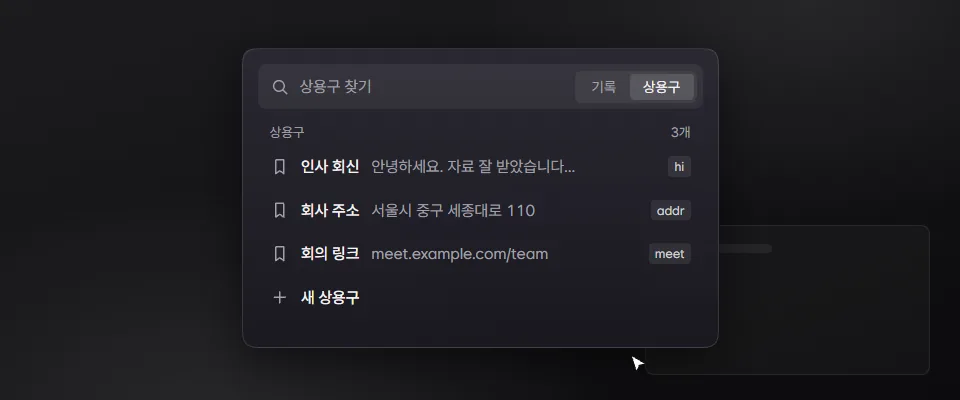](bloom://settings/shortcuts)

- 상용구: 상용구 탭에서 항목을 위아래로 끌어 순서를 바꿉니다.
- 업데이트 기록: 설정 › 정보에서 1.0.0부터의 버전을 골라 바뀐 점을 봅니다. 기록은 열 때 GitHub에서 불러오므로 Bloom 안에 더는 담지 않습니다.
- 설정의 하위 페이지(애드온 페이지 등)에서 마우스 뒤로 버튼을 누르면 위 페이지로 돌아갑니다.
- 고침: 크기를 키워도 상용구 우클릭 메뉴가 클립보드 화면 왼쪽 밖으로 잘리지 않습니다.

## 1.1.0

- Snippets: the clipboard view (Ctrl+Alt+V) has a Snippets tab next to History. Click a saved text or press Enter to paste it into the window in front.
- Keep a copied text with Ctrl+K › Save as a snippet. Settings › Shortcuts can give the Snippets tab a key of its own.
- Menus open and move without lag when GPU drawing is off.
- Icons sit in the middle of their tiles.

### 한국어

[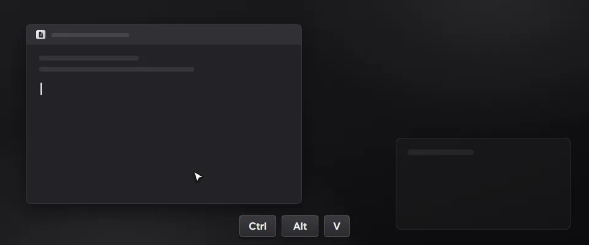](bloom://settings/shortcuts)

- 상용구: 클립보드 화면(Ctrl+Alt+V)의 기록 옆에 상용구 탭이 생겼습니다. 저장한 글을 누르거나 Enter를 누르면 앞의 창에 붙여넣습니다.
- 복사한 글은 Ctrl+K › 상용구로 저장으로 남깁니다. 설정 › 단축키에서 상용구 탭을 바로 여는 키를 정할 수 있습니다.
- GPU로 그리기를 꺼도 메뉴가 끊김 없이 열리고 움직입니다.
- 아이콘이 칸 가운데에 놓입니다.

## 1.0.0

[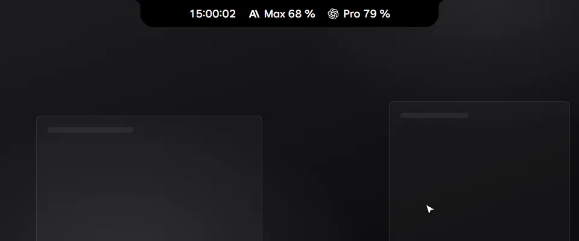](bloom://settings/addon:pill-taskbar)

- Taskbar add-on: point at the island to open the pill taskbar. Folders get fourteen icons that follow the taskbar's light or dark look.

[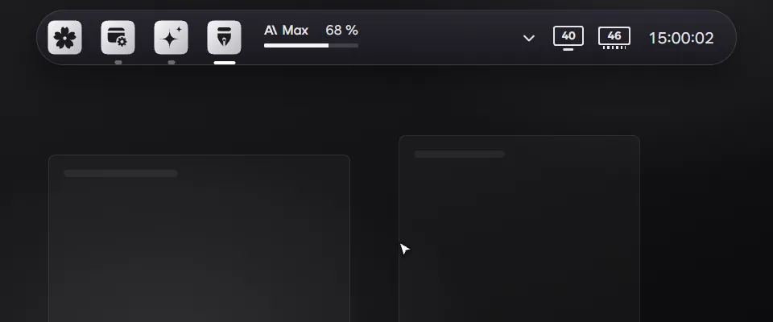](bloom://settings/addon:memory-clean)

- Memory Clean add-on: a RAM module next to the clock shows the use. Click it and Clean now frees memory.

[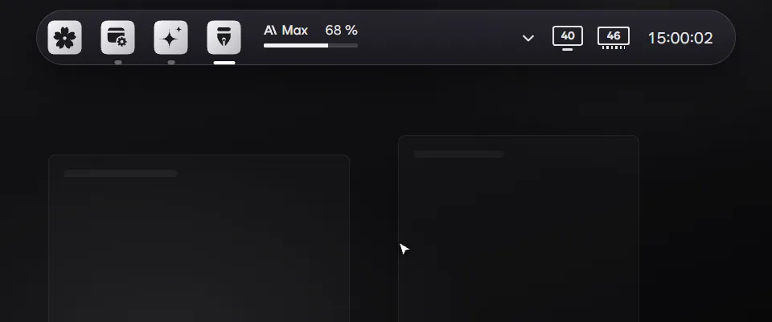](bloom://settings/addon:brightness)

- Monitor Brightness add-on: a monitor next to the clock shows the brightness. One slider moves every monitor, and the wheel over the icon changes it too.

[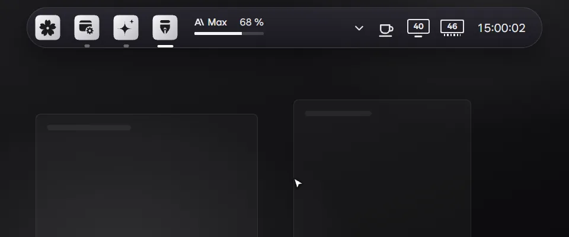](bloom://settings/addon:keep-awake)

- Coffee add-on: a coffee cup next to the clock keeps the computer and the screen awake, until turned off or for a set time. Right-click the cup to turn it on or off.

[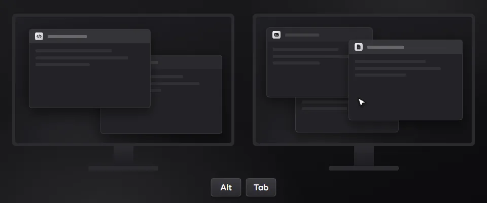](bloom://settings/addon:alt-tab-per-monitor)

- Alt+Tab per monitor add-on: Alt+Tab opens on the monitor under the cursor, with only that monitor's windows.
- In Bloom, click a picture to open that add-on in Settings › Add-ons.
- Screen recording: pick an area with Bloom Lens and record it to MP4, with system sound and the microphone.
- Settings › Add-ons: an overview with a moving picture of each add-on, and a page for each.
- Add-ons run as programs of their own and follow Bloom's theme and glass setting.
- Add-ons update themselves from their latest release, without waiting for a new Bloom.
- Hide a result from search and home with Ctrl+K › Hide from search. Settings › Hidden items brings it back.
- My AI commands: saved prompts with steps and schedules. The notification center keeps finished tasks, limits, approvals and command results in one place.
- Bloom uses less memory.
- Fixed: Bloom Lens draws the picked area and its bar on every monitor, clear of the island.

### 한국어

- 작업표시줄 애드온: 아일랜드에 포인터를 올리면 알약 작업표시줄이 펼쳐집니다. 폴더 아이콘 14종이 생겼고, 작업표시줄의 라이트·다크에 맞춰 바뀝니다.

- 메모리 정리 애드온: 시계 옆 램 모듈에 사용량이 나옵니다. 누르고 지금 정리를 누르면 메모리를 비웁니다.

- 모니터 밝기 애드온: 시계 옆 모니터 모양에 밝기가 나옵니다. 슬라이더 하나로 모든 모니터를 함께 바꾸고, 아이콘 위에서 휠을 돌려도 바뀝니다.

- 커피 애드온: 시계 옆 커피잔으로 PC와 화면이 잠들지 않게 합니다. 끌 때까지나 정한 시간 동안 깨어 있고, 컵을 오른쪽 클릭하면 켜고 끕니다.

- 모니터별 Alt+Tab 애드온: Alt+Tab이 커서가 있는 모니터에 뜨고 그 모니터의 창만 보입니다.
- Bloom에서 그림을 누르면 설정 › 애드온의 그 애드온으로 갑니다.
- 화면 녹화: Bloom Lens로 범위를 골라 시스템 소리, 마이크와 함께 MP4로 녹화합니다.
- 설정 › 애드온: 애드온마다 움직이는 그림이 있는 개요와 애드온별 페이지가 생겼습니다.
- 애드온이 따로 된 프로그램으로 돌고, Bloom의 테마와 유리 효과를 따릅니다.
- 애드온은 새 Bloom을 기다리지 않고 자기 최신 릴리스로 스스로 업데이트됩니다.
- Ctrl+K › 검색에서 숨기기로 결과를 검색과 홈에서 숨깁니다. 설정 › 숨긴 항목에서 되돌립니다.
- 내 AI 명령: 자주 쓰는 프롬프트를 단계와 일정과 함께 저장합니다. 알림 센터가 작업 완료, 한도, 승인 대기, 명령 결과를 한곳에 모읍니다.
- Bloom이 메모리를 덜 씁니다.
- 고침: Bloom Lens가 고른 범위와 막대를 모든 모니터에, 아일랜드를 피해 그립니다.
