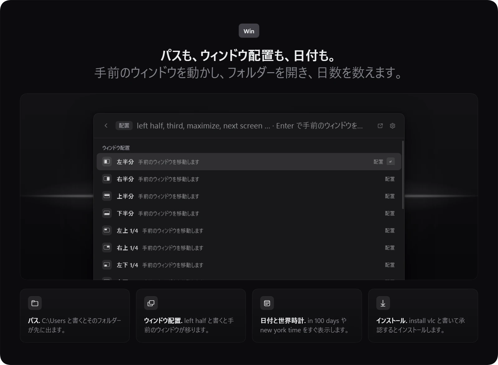

<p align="center"></p>

<p align="center">Bloom は Windows 用のネイティブ ランチャーです。1 本の検索欄から、アプリの起動、計算、ファイル検索、AI チャット、画面の翻訳ができます。</p>

<p align="center">
  <a href="#ダウンロード">ダウンロード</a> | <a href="#機能">機能</a> | <a href="#アドオン">アドオン</a> | <a href="#ショートカット">ショートカット</a> | <a href="#ai-機能について">AI とプライバシー</a> | <a href="README.md">English</a> | <a href="README.ko.md">한국어</a> | <a href="README.zh-CN.md">简体中文</a>
</p>

<p align="center">
  
</p>

<p align="center"><sub>.NET 10 のネイティブ WPF アプリ、WebView なし、English と 한국어 と 日本語 と 简体中文 に対応、MIT ライセンス</sub></p>

## Bloom を選ぶ理由

- キー 1 つで開き、1 本の検索欄でいろいろなことに答えます。
- AI は自分の Claude Code や Codex のサインイン、または自分で追加した API キーで動きます。
- オフにした機能はメニューから外れ、ショートカットキーを空け、メモリを使いません。

## ダウンロード

**[Windows 版 Bloom を入手](https://github.com/hyeon1035298/Bloom/releases/latest)** して、最新リリースの `BloomLauncher-win-Setup.exe` を実行してください。

PowerShell で次のコマンドを実行しても、同じセットアップをダウンロードして起動できます ([install.ps1](install.ps1))。

```powershell
irm https://raw.githubusercontent.com/hyeon1035298/Bloom/main/install.ps1 | iex
```

- Windows 10 または 11 の 64 ビット版が必要です。PC に .NET 10 Desktop Runtime がなければセットアップが入れ、そのときだけ Windows が許可を求めます。
- Bloom は自分のアカウントだけに `%LOCALAPPDATA%\BloomLauncher` へインストールされ、スタートメニューにショートカットができます。
- 削除するには 設定 › データ › Bloom をアンインストール を使います。`%APPDATA%\Bloom` のデータも消すかどうかを確認します。Windows の 設定 › アプリ から削除した場合、データは残ります。
- Bloom にはコード署名がないため、SmartScreen が「Windows によって PC が保護されました」と表示することがあります。「詳細情報」を選んでから「実行」を押してください。
- Bloom は起動後に一度、このリポジトリの最新リリースを確認します。新しいバージョンはバックグラウンドでダウンロードされ、次の起動時か「再起動してアップデート」ですぐに入ります。確認とそのスイッチは 設定 › バージョン情報 にあります。

## 機能

### 1 本の検索欄


- アプリ、Windows の設定ページ、Bloom のコマンドは、名前の一部や頭文字で開けます (`gc` で Google Chrome)。韓国語の初声 (`ㅁㅁㅈ` で 메모장) や、韓国語入力のまま打った英単語にも対応します。
- 計算、単位、為替は入力に合わせて更新され、Enter で答えをコピーします。`45000*1.1`、`5!`、`5.9 ft to cm`、`100 usd` などを試してください。
- タイマーとリマインダーは `timer 5m`、`laundry in 30 min`、`remind me at 3pm to call` のような普通の言い方で設定できます。カレンダーとホームの「今週」に表示されます。
- 絵文字と記号は英語か韓国語の名前で探せます (`:heart`、`arrow`、`celsius`)。
- それ以外の入力はブラウザーでウェブ検索になり、キーワードを付けるとサイト内を検索します (`yt cats`、`gh bloom`)。サイトショートカットは自分でも作れます。
- [Everything](https://www.voidtools.com/) が入っていれば、ファイルを名前ですぐに見つけてプレビューできます。ない場合は Windows の最近使ったファイルを検索します。
- 開いているウィンドウはタイトルで見つかり、Enter で切り替わります。
- どの結果でも Ctrl+K でできることの一覧が出ます。ファイルならエクスプローラーと同じように名前の変更、移動、コピーができます。`?` だけを入力すると、Bloom が受け付ける入力の種類がすべて表示されます。

### パス、ウィンドウ、日付、インストール



- `C:\Users`、`~\Downloads`、`%APPDATA%` のようにパスを入力すると、そのフォルダーと中身が表示されます。Enter でエクスプローラーで開きます。
- `left half`、`right third`、`top-left quarter`、`maximize`、`center`、`next screen` で手前のウィンドウを動かします。タスクバーには重なりません。
- 日付と世界時計は `in 100 days`、`days until christmas`、`2026-01-01 ~ 2026-12-25`、`tokyo 3pm` に答えます。
- `install vlc` は winget と Microsoft Store を検索し、確認してからバックグラウンドでインストールして、結果をカードで知らせます。
- Ctrl+K › ショートカットを設定 で、アプリ、フォルダー、ファイル、サイト、コマンド、ウィンドウ配置にそれぞれ専用のグローバル ショートカットキーを付けられます。
- アプリを右クリックするか Ctrl+K を押すと、アンインストールできます。

### AI チャット


- 質問を入力して Tab を押すと、ランチャーの中でクイック AI が答えます。Shift+Tab は新しいチャットを始め、Esc で戻っても回答は続きます。
- AI チャット ウィンドウ (Ctrl+Alt+C) は過去のチャットをグループで残し、ファイルや画像を添付できます。
- 回答には、この PC でサインイン済みの Claude Code か Codex の CLI、入っていれば [omp](https://github.com/can1357/oh-my-pi)、または OpenAI、Anthropic、Gemini、OpenRouter、DeepSeek、xAI、OpenCode Go の API キーを使います。キーは Windows で暗号化され、それぞれの提供元にだけ送られます。
- 「昨日もらった見積書の PDF をドキュメントに移して」のような PC の作業も任せられます。何かを変える操作は、そのたびにチャットのカードで許可か拒否を待ちます。
- 「買い物リストをメモに書いて」「25 分のタイマー」「明日 15 時に会議」は、Bloom のメモ、タイマー、カレンダーに入ります。
- AI アクション (Ctrl+Alt+A) は、どのアプリでも選んだテキストを要約、翻訳、推敲、書き換えして貼り戻します。
- 作業の通知は、Claude Code や Codex の作業が始まったとき、終わったとき、承認を待つとき、上限に近づいたときにカードと音で知らせます。カードをクリックするとその作業のウィンドウに移り、「通知カードで承認」をオンにすると Claude Code の要求をカードで許可か拒否できます。

### ホーム


検索欄が空のときはホームが表示されます。お気に入り、AI の使用量、今週、タイマー、最近使ったもの、メモ、プレーヤー、コマンドが並びます。

- AI の使用量カードには、Claude と ChatGPT の 5 時間と週間の上限、Claude の Fable の週間の上限が出ます。カードには各社のロゴとプランのバッジが付き、サインインが切れると「再サインイン」が出ます。
- 同じ種類のアカウントを 設定 › AI アカウント で複数追加できます。それぞれ CLI 自身のログインでサインインし、アカウントが勝手に切り替わることはありません。
- 4 つのトークンのブロックは、この PC にある Claude Code と Codex の記録からトークンを数え、API 料金に換算した額、グラフ、よく使ったモデルとセッションを表示します。最初はオフです。
- お気に入りは Ctrl+1 から Ctrl+9 で開き、フォルダーにまとめられます。
- Ctrl+E でホームを編集します。ブロックをドラッグしたり隠したりでき、「+ ブロックを追加」で戻せます。ランチャーを広くすると 2 列になります。

### Bloom Lens とカラーピッカー


- Bloom Lens (Ctrl+Alt+L) は画面の一部をドラッグで選び、1 から 7 のキーで何をするかを選びます。
  - `1` AI に聞く、`2` 翻訳、`3` Windows OCR でテキストをコピー、`4` 範囲の変化に合わせてリアルタイム翻訳
  - `5` 範囲を画像として最前面に固定、`6` クリップボードとスクリーンショット フォルダーにキャプチャ、`7` カラーパレットを作る
- 翻訳 (Ctrl+Alt+T) とテキストのコピー (Ctrl+Alt+O) には専用のショートカットキーがあります。
- カラーピッカーは拡大鏡で画面から色を取り、HEX、RGB、HSL と、白い文字や黒い文字とのコントラストを表示します。
- カラーパレットは範囲の主な色を取り出します。既定は 5 色で、− と + で 3 から 10 色まで変えられます。計算はこの PC の中で行い、AI は使いません。

### 横に付くツール


- Ctrl+J で、メモ、タイマー、電卓、クリップボード履歴、ショートカットを小さなウィンドウで開きます。
- ツールをランチャーの横に置くとくっつき、ランチャーと一緒に動いたり隠れたりします。引き離すと単独のウィンドウになります。
- メモはチェックリスト付きの Markdown です。検索欄で `note buy milk` と入力すると、すぐに 1 件残せます。
- クリップボード履歴 (Ctrl+Alt+V) はコピーしたテキスト、画像、ファイルを残し、残したいものは固定できます。
- Ctrl+P でランチャーを最前面に固定します。端をドラッグするとサイズが変わり、Ctrl+= と Ctrl+- で Bloom 全体を 80 から 150 % に拡大縮小できます。
- .md ファイルは Bloom の文書ウィンドウで開き、入力するそばから保存されます。

### Bloom Space Cleaner


- Bloom Space Cleaner はドライブやフォルダーをマップで表示し、ブロックの大きさが中身の大きさを表します。
- ブロックをクリックすると中に入れます。横の一覧から大きいファイルをごみ箱に送れます。
- ドライブのルートより下で、Windows フォルダーの外だけを扱います。消したものはすべてごみ箱から戻せます。

### 設定


- 設定には「一般」と「ランチャー」から「アドオン」「データ」「バージョン情報」まで 12 のページがあります。検索欄に設定の名前を入力すると、その設定に移動します。
- アクセント色は好きな色にできます。ピッカーはダークとライトの両方のテーマでのコントラストを表示し、アクセント色はオンになっているものにだけ使われます。
- 「データ」のページは、Bloom がこの PC に保存しているものを大きさと一緒に一覧にし、項目ごとの削除や Bloom のリセットができます。
- 「機能」のページで使わない機能をオフにできます。保存したデータは残ります。
- カスタムコマンドは、キーワードでスクリプトを実行したり、スニペットを貼り付けたり (`{date}`、`{clipboard}`)、検索欄の入力を連続操作として実行したりします (`notepad ; volume 30 ; yt lofi`)。
- 見た目はダーク、ライト、システムのテーマに合わせられ、アニメーションとガラスの設定もあります。GPU による描画は試験的な機能で、最初はオフです。
- 表示言語は English、한국어、日本語、简体中文 で、既定では Windows に合わせます。検索の言葉、時刻、単位は、どの言語でも英語か韓国語で入力します。
- 設定を 1 つのファイルに書き出せば、別の PC に移せます。設定 › バージョン情報 › 問題の報告 は、バージョンと最近のログを名前とメールアドレスを隠してコピーし、GitHub の issue ページを開きます。Bloom が自分で何かを送ることはありません。

## アドオン


アドオンは、Bloom がダウンロードして確認し、起動してファイルでやり取りする別のプログラムです。アドオンのコードは Bloom に入っておらず、Bloom は MIT のままです。下の 2 つのアドオンは GPL-3.0 で、それぞれ専用のソースリポジトリがあります。

### タスクバー (PillTaskbar)

PillTaskbar は Windows 11 のタスクバーを、中央に置かれたガラスのピル型に変えます。オンの間は 設定 › アドオン にその設定が並びます。

- タスクバーのフォルダーでは、フォルダーを作る、名前を変える、アイコンを付ける、アプリを入れたり出したりする、並べ替える、グループを解除する、といった操作ができます。アプリを別のアプリの上にドラッグしてしばらく置いても、フォルダーができます。
- 自動の実行中フォルダーは、ピン留めせずに起動したアプリをまとめます。
- 見た目では、サイズ、背景、Bloom の花のスタートボタン (押すと Bloom が開きます) を設定できます。
- ピルの端には、トレイ、24 時間か 12 時間表示の時計、再生中の曲が並びます。
- AI の使用量は、アカウントごとに 5 時間、週間、Fable の週間のどれか 1 つを、ラベルとアイコンの色と一緒に表示します。
- 自動非表示アイランドはタスクバーを隠し、画面上部中央に黒か白のアイランドを表示します。

最初の起動時に、タスクバーのシンボルファイル (約 70 MB) を Microsoft のシンボルサーバーからダウンロードします。エクスプローラーが落ち続けるときは、Bloom がアドオンをオフにしてそのことを知らせます。

### モニターごとの Alt+Tab

モニターが 2 台以上あるとき、Alt+Tab と Win+Alt+Tab がカーソルのあるモニターに開き、そのモニターのウィンドウだけを並べます。

### アドオンのインストールと確認

- 設定 › アドオン で、それぞれ「ダウンロード」ボタン 1 つでダウンロードでき、進み具合が表示されます。
- zip がこの Bloom に固定された SHA-256 と一致し、すべてのファイルが `addon.json` と合うときだけインストールします。ダウンロードに失敗したときは何も残さず、理由を表示します。
- 新しい Bloom が新しいバージョンを固定すると、同じ行に「更新」が出ます。
- アドオンは最初はオフで、初めてオンにするときにそのアドオンが何をするかを説明します。
- Windhawk で同じ Mod が動いている場合は、状態の行にそのことと対処法が出ます。
- Bloom の起動中に Shift を押し続けると、その回はアドオンを起動しません。アドオンと「Windows と一緒に起動」の両方がオンのときは、自分のアカウントのサインイン タスクが Bloom を早めに起動します。

### 自分のアドオン

`%LOCALAPPDATA%\Bloom\user-addons` に置いたアドオンは、再起動後に 設定 › アドオン に表示されます。最初はオフで、初めてオンにするときに Bloom が作ったものでも確認したものでもないと警告します。そのファイルも、自身の `addon.json` にある SHA-256 で確認されます。

## ショートカット

| キー | 動作 |
| --- | --- |
| `Win` または `Alt+Space` | Bloom を開く (管理者として実行中のアプリの上で `Win` を使うには 設定 › 一般 › 管理者アプリの上でも Win キーを使用) |
| `Tab` / `Shift+Tab` | 検索欄の内容を AI に聞く (同じチャット / 新しいチャット) |
| `Ctrl+K` | 選んだ結果でできることの一覧 |
| `Ctrl+1` … `Ctrl+9` | お気に入り |
| `Ctrl+J` | ツール (メモ、タイマー、電卓、クリップボード履歴、ショートカット) |
| `Ctrl+P` | ランチャーを最前面に固定 |
| `Ctrl+E` | ホームを編集 |
| `Ctrl+,` | 設定 |
| `?` | 空の検索欄で、Bloom が受け付ける入力を種類別に表示 |
| `Ctrl+=` / `Ctrl+-` / `Ctrl+0` | 拡大、縮小、100 % |
| `Esc` | 戻る、テキストを消す、閉じるの順 (クイック AI の回答は続く) |
| `Ctrl+.` | クイック AI の回答を止める |
| `Ctrl+Alt+C` | AI チャット ウィンドウ |
| `Ctrl+Alt+A` | AI アクション |
| `Ctrl+Alt+L` | Bloom Lens |
| `1` … `7` | Bloom Lens で、AI に聞く、翻訳、テキストのコピー、リアルタイム翻訳、固定、キャプチャ、カラーパレット |
| `←` `→` / `−` `+` / `Enter` | カラーパレットで、色を選ぶ、色を減らす、増やす、HEX をコピー |
| `Ctrl+Alt+T` / `Ctrl+Alt+O` | 画面の翻訳、画面のテキストをコピー |
| `Ctrl+Alt+V` | クリップボード履歴 |

グローバル ショートカットキーは 設定 › ショートカット で変更やオフができます。項目をクリックしてキーを押すか、Backspace でオフにします。ウィンドウの切り替え、絵文字、カラーピッカー、画面について AI に聞く、リアルタイム翻訳、キャプチャにもショートカットキーを付けられます。これらは最初はオフです。

## AI 機能について

Bloom の AI は、この PC にインストールしてサインイン済みの公式 CLI か、自分で追加した API キーを使います。サインイン情報はそれぞれの CLI が持ち、使用量と利用規約は自分のアカウントのものです。どちらもなければ AI の機能だけがオフになります。

- Claude は [Claude Code](https://docs.anthropic.com/en/docs/claude-code) CLI (`claude`) を使います。
- ChatGPT は [Codex CLI](https://github.com/openai/codex) (`codex`) を使います。
- omp は任意で、[oh-my-pi](https://github.com/can1357/oh-my-pi) CLI (`omp`) を使います。
- API キーは Windows で暗号化されてこの PC に残り、それぞれの提供元にだけ送られます。

AI に届くのは自分が送ったものだけです。質問、添付ファイル、Bloom Lens で選んだ画面の範囲、翻訳するテキスト、PC のツールが返した結果がそれにあたります。Claude がファイルを読み書きするのは、そのチャットのフォルダー (`%LOCALAPPDATA%\Bloom\ai\files\<chat>`) の中だけです。Codex と omp は自分ではファイルを扱わないため、テキストの添付はメッセージに入れ、作られたファイルは回答から保存します。

<details>
<summary>PC の操作、MCP サーバー、使用量の取得、トークンの記録、更新の確認</summary>

#### pc ツール

Bloom は `pc` というツールを 1 つ、この PC のこの Windows ユーザーだけが開ける MCP サーバー (`Bloom.exe --mcp`、名前付きパイプ) で提供します。5 つのグループは 設定 › PC の操作 · MCP でそれぞれオンとオフを切り替えます。

- アプリ、ファイル (Everything)、最近使ったファイル、ウィンドウ、タイマーと予定、メモ、カスタムコマンドを調べます。調べるだけの操作は確認なしで実行します。
- アプリ、ファイル、サイトを開き、`volume 30` のような検索欄の入力やカスタムコマンドを実行します。
- Bloom のメモに書き、タイマーを始め、カレンダーに予定を入れます。
- ファイルの名前を変え、移動、コピーし、ごみ箱に送ります。
- クリップボードを読み書きします。

調べる操作以外は、チャットのカードで許可か拒否を待ち、結果は回答の下に ✓ か ✕ で残ります。Claude Code は `--permission-prompt-tool stdio` で確認を求めます。Codex と omp は自分では確認を求められないため、Bloom の MCP サーバーが実行の直前に同じカードを出します。

ツールの定義で、1 回の要求ごとに入力トークンが約 250 から 500 増えます。グループをオフにすると減ります。Codex には `-c mcp_servers.bloom…` でチャットの実行ごとにだけサーバーを渡します。omp には `%LOCALAPPDATA%\Bloom\ai\omp-work` の下にあるチャット専用の `.omp/mcp.json` で渡し、omp 自身の設定には何も書きません。

#### ほかの MCP サーバー

Claude Code、Claude Desktop、Cursor、VS Code、Windsurf、Codex で設定済みの MCP サーバーと、Claude Code で開いたプロジェクトの `.mcp.json` にあるサーバーは、同じページにそれぞれスイッチ付きで並びます。最初はオフで、オンにしたものだけを読み込みます (`--strict-mcp-config`)。その操作もすべて同じカードで確認を求め、ChatGPT では Bloom の中継 (`Bloom.exe --mcp-proxy`) がそれを受け持ちます。設定は毎回元のファイルから読みます。

#### 使用量の取得

AI の使用量は、モデルを呼び出さない `claude -p /usage` と、`codex app-server` の上限の取得から、1 アカウントずつ得ます。追加したアカウントは `%LOCALAPPDATA%\Bloom\accounts` の下にそれぞれのフォルダーを持ちます (`CLAUDE_CONFIG_DIR` または `CODEX_HOME`)。任意の軽量な ChatGPT モードでは、Codex 自身が状態を読むエンドポイントに、そのアカウントの Codex のサインインで HTTPS の要求を 1 回送ります。これは公式の API ではありません。Bloom がトークンを更新するのは自分で作ったフォルダーの中だけで、`~/.codex` では更新しません。Bloom が Claude のサインイン情報を読むことはありません。

設定 › AI アカウント › 使用量をファイルに書き出す (最初はオフ) は、使用率、リセットの時刻、自分で付けたアカウント名、アカウントごとのタスクバーの選択を `%LOCALAPPDATA%\Bloom\export\ai-usage.json` に書き出します。タスクバーのアドオンのような、この PC のほかのプログラムが使うためのものです。メールアドレスやサインイン情報は入りません。

#### 記録とトークンの集計

作業の通知は、この PC にある Claude Code と Codex の記録 (`~/.claude/sessions`、`~/.codex/sessions`) を読みます。記録はこの PC から出ません。

トークンのブロックは、この PC にあるすべてのアカウントの Claude Code と Codex の記録を読みます。Bloom が `%LOCALAPPDATA%\Bloom\tokens` に残すのは、モデル、思考レベル、セッションごとの 1 時間単位の合計と、各セッションのタイトルと最後のフォルダー名だけです。メッセージやフルパスは残しません。最初の集計ではすべての記録をバックグラウンドで一度読み、その後は増えた分だけを読みます。Claude Code は 30 日で記録を消すため、それより長い期間は Bloom が集計を始めた日から埋まっていきます。費用は同じトークンを各社の API 料金で使った場合の額で、実際に支払った額ではありません。設定 › AI アカウント › 価格表を編集 で `prices.json` を開いて変えられます。

#### 更新の確認

更新の確認では GitHub の API (`api.github.com`) にこのリポジトリの最新リリースを問い合わせ、新しいバージョンを GitHub からダウンロードします。要求に含まれるのはリポジトリの情報だけです。確認は 設定 › バージョン情報 でオフにできます。

</details>

## インストールとビルド

<details>
<summary>ソースからのビルド、データフォルダー、リリース</summary>

使うだけなら [ダウンロード](#ダウンロード) のセットアップを使ってください。ビルドには Windows 10 または 11 と [.NET 10 SDK](https://dotnet.microsoft.com/download) が必要です。`tools\package.ps1` では、Win キー ヘルパーのために C++ ビルドツール (Visual Studio の「C++ によるデスクトップ開発」) も必要です。

```powershell
dotnet build src\Bloom\Bloom.csproj -c Release
# またはインストール用のコピーを作る
powershell -File tools\package.ps1   # → dist\app
powershell -File tools\install.ps1   # → %LOCALAPPDATA%\Programs\Bloom、スタートメニューのショートカット
```

データは `%APPDATA%\Bloom` と `%LOCALAPPDATA%\Bloom` にあります。開発中は `Bloom.exe --data <folder>` で別のデータフォルダーを使い、`--lang ko|en` で言語を固定できます。自動更新はセットアップでインストールした場合だけ動くので、`tools\install.ps1` で作ったコピーは手で更新してください。

リリースするには、`src/Bloom/Bloom.csproj` の `<Version>` を上げ、`CHANGELOG.md` の `## <Version>` に変更点を書いて push し、GitHub で Actions › Release › Run workflow を実行します。`addons/catalog.json` のすべてのアドオンをダウンロードして確認し、テスト、ビルドのあと、[Velopack](https://velopack.io) でセットアップと更新パッケージを作り、`v<Version>` として公開します。

</details>

## コードの構成

<details>
<summary>フォルダー、決まりごと、テスト、lint</summary>

`src/Bloom` の下では、1 つのフォルダーが 1 つの機能です。大きなクラスはトピックごとに `partial` ファイルに分けています。

| フォルダー | 中身 |
| --- | --- |
| `App/` | `Host` (起動、ショートカットキー、コマンド、Lens、タイマー、カスタムコマンド、ファイル操作)、作業の通知 (`Notices`)、更新 (`Updates`、Velopack)、起動オプション、トレイ、Win キーのフックと管理者アプリ用のヘルパー (`src/WinKeyHelper`、NativeAOT) |
| `App/Engine/` | 検索欄に表示する内容。ルートの検索とホームのブロックから各ビュー (ファイル、クリップボード、カレンダー、タイマー、色) まで |
| `App/Mcp/` | MCP サーバー、中継、`pc` ツール |
| `App/Qa/` | 画面外キャプチャによる QA (`--capture <folder> --qa-set <set> --data <folder> --lang en`) |
| `Addons/` | 別プログラムとしてのアドオン。固定したカタログとダウンロード (`AddonCatalog`、`AddonDownload`)、`addon.json` の確認 (`AddonManifest`)、ハッシュを確認した実行用コピー (`AddonStore`)、ホストプロセスの起動と停止 (`AddonRunner`)、共通の名前 (`AddonProtocol`)。Bloom がアドオンのコードを読み込むことはない |
| `Core/` | 保存データ (設定、お気に入り、使用履歴、学習、タイマー、メモ、色)、JSON の保存、韓国語の検索、マッチング、表示言語 (`Lang`) |
| `Search/` | アプリ一覧、計算 (計算、単位、為替)、Everything、開いているウィンドウ、最近使ったファイル、絵文字と記号、システム項目、カスタムコマンド、結果のモデル |
| `Ai/` | Claude Code、Codex、omp の CLI セッションとチャット、単発の質問、翻訳、AI アクション、使用量 (`AiUsage`)、作業の記録 (`ClaudeWatch`、`CodexWatch`) |
| `Ai/Api/` | API キーのチャット、その提供元、ほかのサーバー用の MCP クライアント |
| `Ocr/` | 画面範囲の選択、Windows OCR、翻訳ウィンドウ、色の取得 |
| `Music/` | ミニプレーヤー、プレイリスト、ほかのアプリで再生中の曲 |
| `Clip/`、`Space/`、`Browser/` | クリップボード履歴、ディスク容量のマップ、ブラウザーへの受け渡し |
| `Native/` | Win32 の呼び出し (System32 の DLL のみ)、WinRT の呼び出し、システムの切り替え (`SystemControl`)、エクスプローラー式のファイル操作 (`ShellFiles`) |
| `Ui/Launcher/` | ランチャー ウィンドウ。各ビューのチップ、ヒント、結果は `Launcher.ViewSpecs.cs` |
| `Ui/Chat/`、`Ui/Player/` | AI チャット ウィンドウとミニプレーヤーのウィンドウ |
| `Ui/Settings/` | 設定ウィンドウ。アドオンのページとタスクバーのフォルダーの編集画面を含む |
| `Ui/Tools/` | ツール ウィンドウ、その配置、くっつきと吸着 (`ToolDock`)、メモ、タイマー、電卓、クリップボード |
| `Ui/Controls/`、`Ui/Theme/` | 共通コントロール (G2 の角の `SmoothBorder`、`Dropdown`、`PopupMenu`、`AccentPicker`) とテーマ (アニメーションの `Motion`) |
| `tests/Bloom.Tests` | テストフレームワークを使わないコンソール実行の自動テスト |

新しい機能は、結果の `Engine.<feature>.cs`、`Launcher.ViewSpecs.cs` のビュー 1 行、必要なら保存用の `Core/<feature>.cs` に分けます。
画面のテキストはすべて `Tr("한국어", "English")` で書きます。日本語と簡体字中国語は、英語のテキストをキーにした `src/Bloom/Assets/Lang/ja.tsv` と `zh.tsv` から来ます。`python tools/lang.py check` で足りないものを、`todo ja` で未翻訳のテキストを一覧にします。検索のキーワードと解析用のデータは韓国語と英語のままです。
画面のテキストは [docs/COPY.md](docs/COPY.md) に従います。
QA と開発の実行では、実データと分けて必ず `--data <一時フォルダー>` を使います。

```powershell
# テスト (終了コード = 失敗の数)
dotnet run --project tests\Bloom.Tests
# lint (アナライザーと書式)、警告ゼロ
dotnet build src\Bloom\Bloom.csproj -c Debug --no-incremental -p:AnalysisLevel=latest-recommended -p:EnforceCodeStyleInBuild=true
dotnet build tests\Bloom.Tests\Bloom.Tests.csproj -c Debug --no-incremental -p:AnalysisLevel=latest-recommended -p:EnforceCodeStyleInBuild=true
dotnet format whitespace src\Bloom\Bloom.csproj --verify-no-changes
dotnet format whitespace tests\Bloom.Tests\Bloom.Tests.csproj --verify-no-changes
```

時間を区切って応答性を調べるには、Release ビルドを `--data <isolated-folder> --no-hook --no-tray --qa-responsive 3` で実行します。`responsiveness.json` と `responsiveness.txt` が書き出されます。

</details>

## ライセンス

Bloom は MIT ライセンスです。[LICENSE](LICENSE) を参照してください。

為替レートは [Rates By Exchange Rate API](https://www.exchangerate-api.com) から取得しています。

タスクバーのアドオン PillTaskbar ([ソース](https://github.com/hyeon1035298/PillTaskbar_BloomAddon)) とモニターごとの Alt+Tab のアドオン ([ソース](https://github.com/hyeon1035298/AltTabPerMonitor_BloomAddon)) は GPL-3.0 の別プログラムで、Bloom 自体は MIT のままです。

`src/Bloom/Assets/Logos` にある OpenAI と Anthropic のロゴは各社の商標で、MIT ライセンスの対象外です。Bloom は AI の使用量のアカウントがどのサービスのものかを示すためだけに表示しています。

Bloom は非公式の個人プロジェクトで、Anthropic、OpenAI、voidtools、Raycast とは関係ありません。
