<p align="center">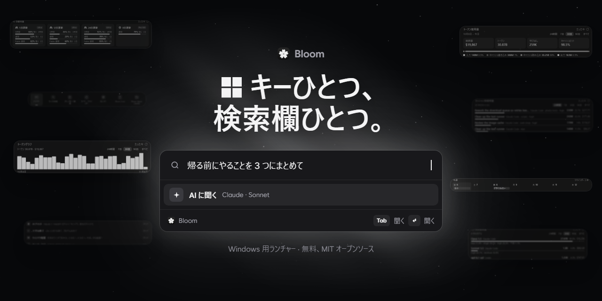</p>

<p align="center">Windows 用のランチャーです。検索欄にやりたいことを入力して Enter ですぐに開くか、Tab を押して AI に質問できます。</p>

<p align="center">
  <a href="#ダウンロード">ダウンロード</a> | <a href="#機能">機能</a> | <a href="#アドオン">アドオン</a> | <a href="#ショートカット">ショートカット</a> | <a href="#ai-機能について">AI とプライバシー</a> | <a href="README.md">English</a> | <a href="README.ko.md">한국어</a> | <a href="README.zh-CN.md">简体中文</a>
</p>

<p align="center">
  
</p>

<p align="center"><sub>.NET 10 のネイティブ WPF アプリ、WebView なし、English と 한국어 と 日本語 と 简体中文 に対応、MIT ライセンス</sub></p>

## Bloom を選ぶ理由

- Win キーひとつで開く検索欄から、アプリの起動、計算、ファイル検索をまとめてこなせます。
- この PC でサインイン済みの Claude Code や Codex、または自分で登録した API キーをつないで、すぐに AI 機能を使えます。
- 使わない機能をオフにするとメニューやショートカットからきれいに消え、メモリも消費しません。

## ダウンロード

**[Windows 版 Bloom を入手](https://github.com/hyeon1035298/Bloom/releases/latest)** 最新リリースから `BloomLauncher-win-Setup.exe` をダウンロードして実行してください。

下の PowerShell コマンドでも同じインストーラーを取得してセットアップできます。

```powershell
irm https://raw.githubusercontent.com/hyeon1035298/Bloom/main/install.ps1 | iex
```

- Windows 10、11（64 ビット）で動作します。PC に .NET 10 Desktop Runtime が入っていない場合は、インストール時に自動で一緒に入ります。
- `%LOCALAPPDATA%\BloomLauncher` フォルダーにインストールされ、スタートメニューにショートカットが作成されます。
- まだコード署名を行っていないため、インストール時に「Windows によって PC が保護されました」と表示された場合は 詳細情報 › 実行 をクリックしてください。
- 起動後に新しいバージョンがあるか一度確認し、次回の起動時に自動で更新を適用します。自動確認は 設定 › バージョン情報 でオフにできます。
- アンインストールは 設定 › データ › Bloom をアンインストール から行えます。これまで使っていたデータも一緒に消すかどうかをここで選べます。
- AI 機能を使うには Claude Code、Codex、omp のいずれかへのサインイン、または API キーが必要です。高速ファイル検索ツールの [Everything](https://www.voidtools.com/) が入っていれば、PC 全体のファイルを一瞬で探せます。

## 機能

### 1 本の検索欄

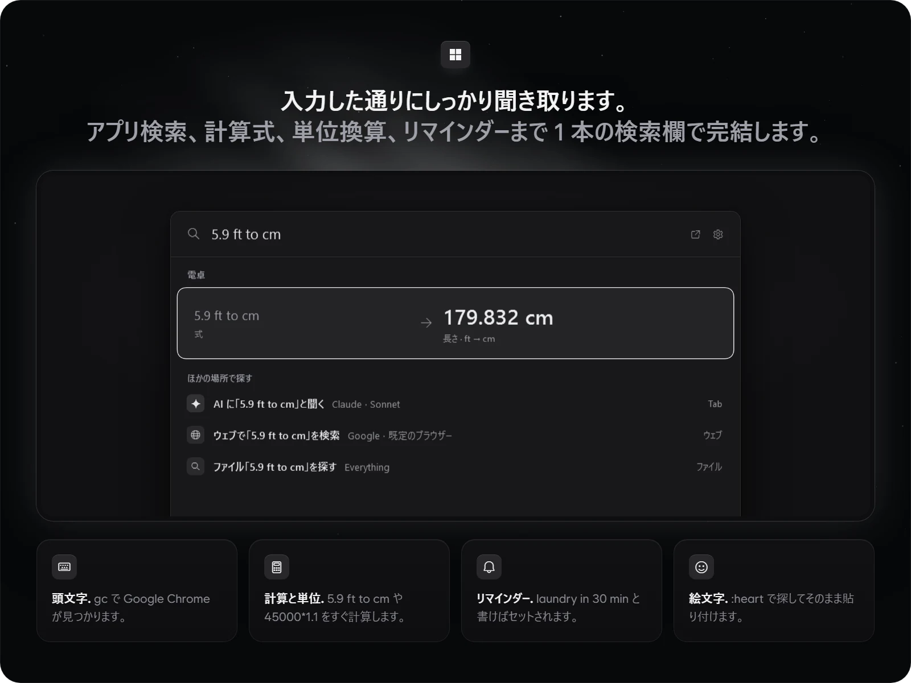

- インストール済みのアプリ、Windows の設定、Bloom のコマンドをすばやく探せます。英語の頭文字（`gc`）だけで探せるほか、韓国語入力では初声（`ㅁㅁㅈ`）や IME の切り替え忘れ（`초개ㅡㄷ`）にも対応しています。
- `45000*1.1`、`5.9 ft to cm`、`100 usd` のように計算式や単位、通貨を入力するとその場で計算し、Enter を押せば結果をクリップボードにコピーします。
- `timer 5m` や `laundry in 30 min` のように普段の言葉で入力するだけで、タイマーやリマインダーをセットできます。
- `:heart` のように入力して絵文字を探したり、`yt cats` のように先頭にキーワードを付けて目的のサイトを直接検索したりできます。
- Everything がインストールされていれば、PC 内のあらゆるファイルを名前ですぐに見つけ出せます。
- 検索結果で Ctrl+K を押すとその項目に対して行える操作の一覧が開き、空の検索欄に `?` を入力すると使える入力例をひと目で確認できます。
- `C:\Users` のようにフォルダーのパスを入力すると、エクスプローラーをわざわざ開かなくてもその場で中身を確認できます。
- `left half`、`maximize`、`next screen` のように入力して、今見ているウィンドウを画面半分に寄せたり別のモニターへ移したりできます。
- `in 100 days` や `tokyo 3pm` のように入力して、日付の計算や世界各地の時刻の確認ができます。
- `install vlc` と入力すると winget と Microsoft Store からアプリを探し出し、確認のうえでそのままインストールします。
- Ctrl+K › ショートカットを設定 から、よく使うアプリ、フォルダー、Web サイト、ウィンドウ配置に自分だけのグローバルショートカットキーを割り当てられます。

### AI チャット

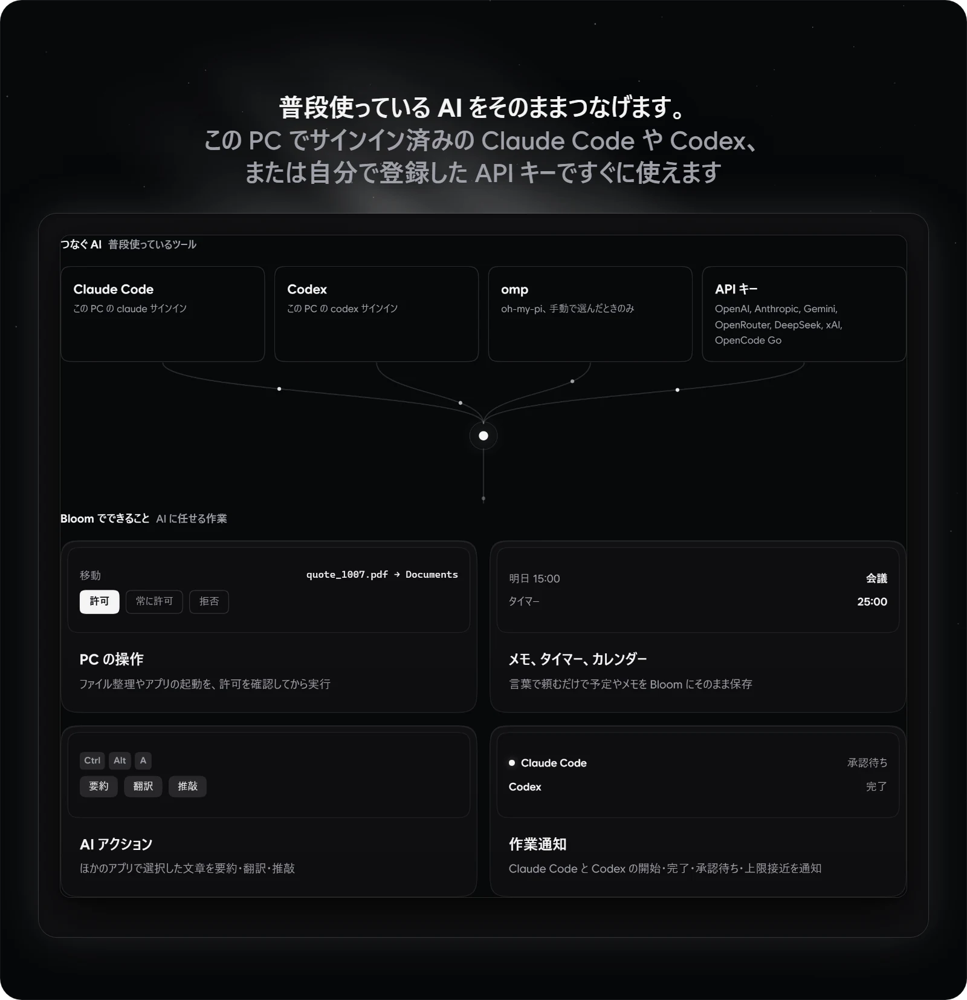

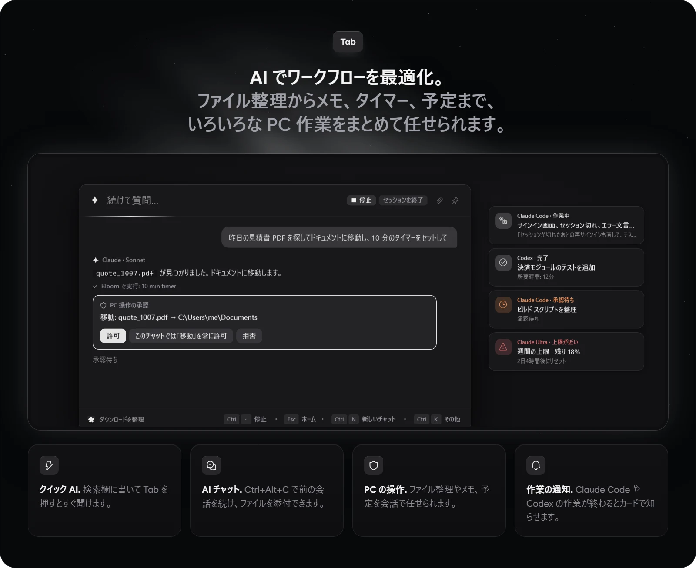

- 検索欄に聞きたいことを書いて Tab を押すと、クイック AI がその場ですぐに答えます。Shift+Tab を押せば、前の文脈を引きずらずに新しいチャットで質問できます。
- 会話を長く続けたいときや、ファイル・画像を添付したいときは、別ウィンドウで開く AI チャットのウィンドウ（Ctrl+Alt+C）を使えます。
- ファイル整理のような PC 上の作業も AI に任せられます。ファイルを移動したり何かを変更したりする操作は、実行前に許可カードを表示して必ず確認を求めます。
- 「明日の午後 3 時に会議」のように話しかけると、Bloom のカレンダーに予定を登録してくれます。メモやタイマーも同じように言葉で手軽に残せます。
- ほかのアプリで文章を選択して AI アクション（Ctrl+Alt+A）を押すと、要約・翻訳・推敲を行って元の場所にそのまま貼り付けます。
- 作業通知をオンにしておくと、Claude Code や Codex に任せた作業が完了したとき、承認待ちのとき、利用上限が近づいたときにカードで知らせてくれます。
- API キーは OpenAI、Anthropic、Gemini、OpenRouter、DeepSeek、xAI、OpenCode Go に対応しており、Windows の暗号化機能でこの PC 内にのみ安全に保管されます。

### ホーム

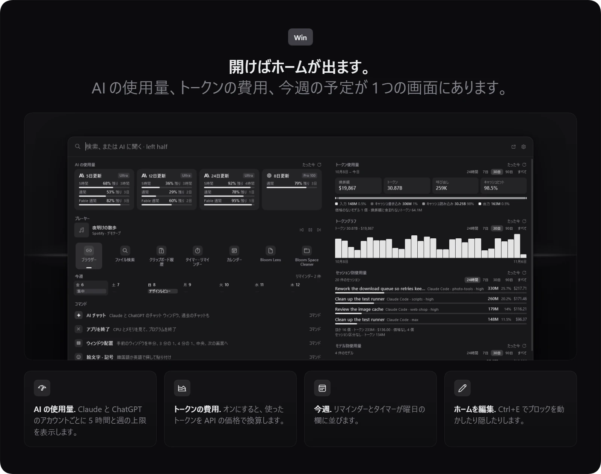

- 検索欄が空のときは、下側にお気に入り、AI の使用量、今週の予定、タイマー、メモ、メディアプレーヤーが並んだホーム画面が表示されます。
- AI の使用量ブロックには、Claude と ChatGPT のアカウントごとに 5 時間枠と週間枠がどれだけ残っているかが表示されます。複数のアカウントを登録して並べて見ることもできます。
- トークンのブロックは、この PC に残っている Claude Code と Codex の利用ログを集計し、API 料金に換算するといくらになるかを表示します。初期設定ではオフになっており、必要なときにオンにできます。
- Ctrl+E を押すと、ホームに並ぶブロックの順番を入れ替えたり、使わないブロックを隠したり戻したりできます。

### Bloom Lens とカラーピッカー

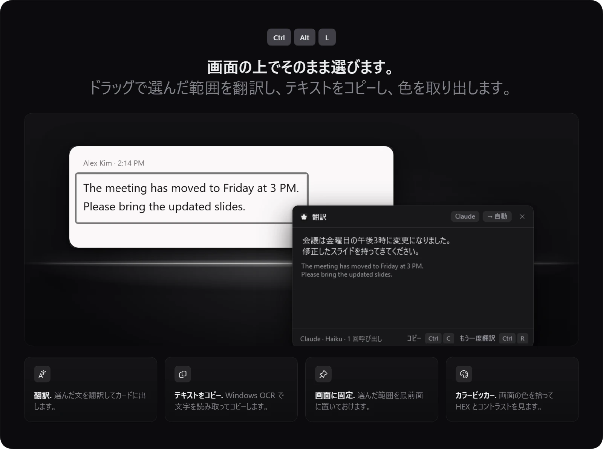

- Bloom Lens（Ctrl+Alt+L）で画面の一部をドラッグして選んだら、数字キーでやりたい操作を選びます。`1` 質問、`2` 翻訳、`3` 文字のコピー、`4` リアルタイム翻訳、`5` 画面に固定、`6` キャプチャ、`7` カラーパレットに対応しています。
- よく使う翻訳（Ctrl+Alt+T）と文字のコピー（Ctrl+Alt+O）には、ワンステップで直接実行できる専用のショートカットキーも用意されています。
- カラーピッカーで画面上の色をクリックすると、HEX、RGB、HSL のカラーコードと文字の読みやすさ（コントラスト比）を一緒に確認できます。
- カラーパレットは選択した範囲から主要な色を抽出します。AI を使わず、この PC 上ですぐに計算します。

### 横に付くツール

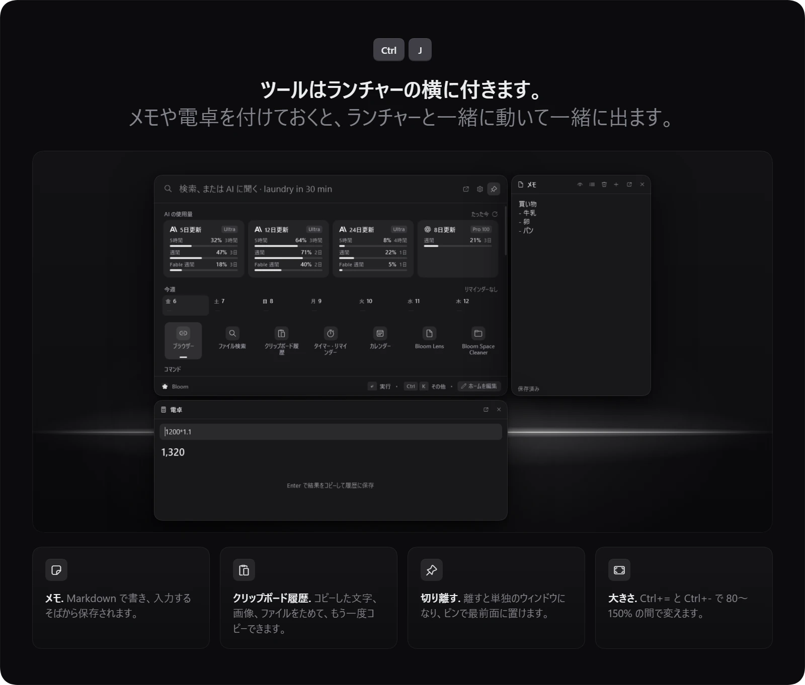

- Ctrl+J を押すと、メモ、タイマー、電卓、クリップボード履歴、ショートカット一覧の小さなウィンドウを開けます。
- ツールウィンドウをランチャーの近くに置くと磁石のように横にくっついて一緒に動き、引き離せば独立したウィンドウとして置いておけます。
- メモは Markdown 記法に対応しており、ウィンドウを開かずに検索欄へ `note buy milk` と入力してサッと書き留めることもできます。
- クリップボード履歴（Ctrl+Alt+V）は、これまでにコピーした文章や画像、ファイルをまとめて残しておき、いつでも取り出して再利用できます。
- Ctrl+P でランチャーを常に最前面に固定でき、Ctrl+= / Ctrl+- でランチャーの大きさを 80〜150% の間で調整できます。

### Bloom Space Cleaner

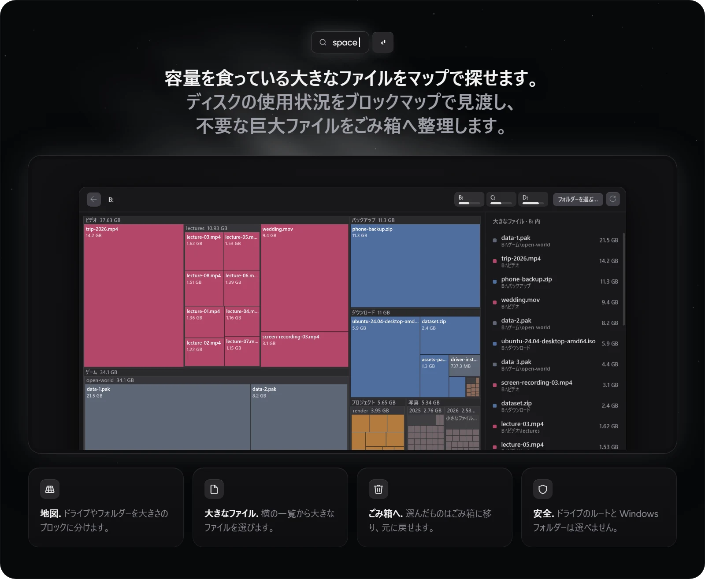

- ドライブやフォルダーの中でどのファイルやフォルダーがどれだけ容量を占めているかを、大きさに比例したブロックマップでひと目でわかるように表示します。
- ブロックをクリックして下の階層へ掘り下げていき、大きいファイルの一覧から不要なものを選んでそのままごみ箱へ送れます。
- 誤って大事なシステム領域を消してしまわないよう、ドライブのルートと Windows フォルダーは選択できないようになっており、消したファイルもごみ箱からいつでも元に戻せます。

### 設定

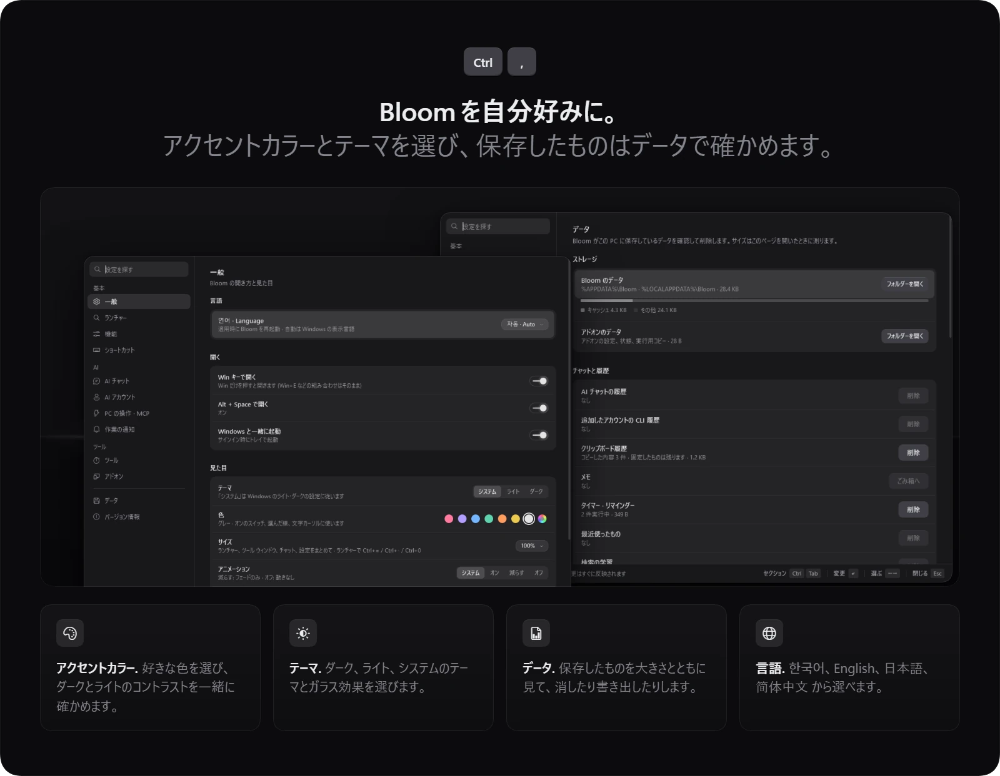

- 設定画面を隅々まで探さなくても、検索欄に設定の名前を入力すれば目的のページがすぐに開きます。
- 好きなアクセントカラーを自由に選べ、ダーク・ライトの両テーマで文字が読みやすいかコントラストも同時に確認できます。
- 使わない機能をオフにするとメニューとショートカットからすっきり外れますが、それまでに保存したデータは消えずにそのまま残ります。
- データのページでは、項目ごとに保存されているデータと容量を確認し、必要なものだけを選んで削除したりバックアップとして書き出したりできます。
- カスタムコマンドに、よく使うスクリプトや定型文（スニペット）、複数の操作をつなげた連続実行（`notepad ; volume 30 ; yt lofi`）を登録しておけば、キーワードひとつでまとめて実行できます。
- 表示言語は English、한국어、日本語、简体中文 から選べます。
- 問題の報告を押すと、ログからユーザー名とメールアドレスを伏せたうえでクリップボードにコピーし、GitHub の Issue ページを開きます。Bloom が勝手に外部へデータを送信することはありません。

## アドオン

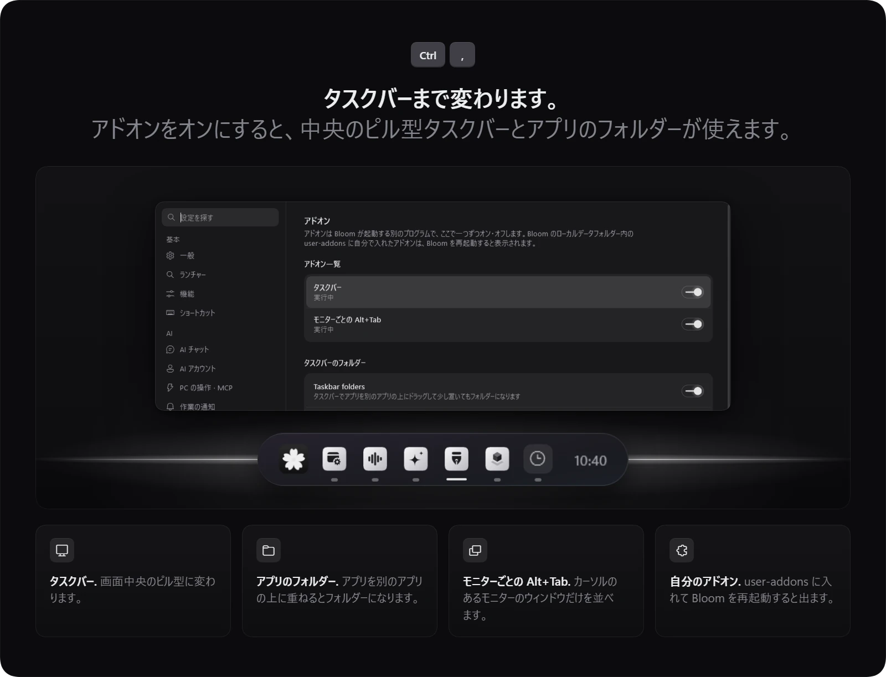

アドオンは、Bloom の中からダウンロードして確認・実行できる別プログラムです。アドオンのコードは Bloom 本体には含まれておらず、現在提供している公式アドオン 5 種はいずれも GPL-3.0 ライセンスのもとで個別のリポジトリに公開されています。

### タスクバー (PillTaskbar)

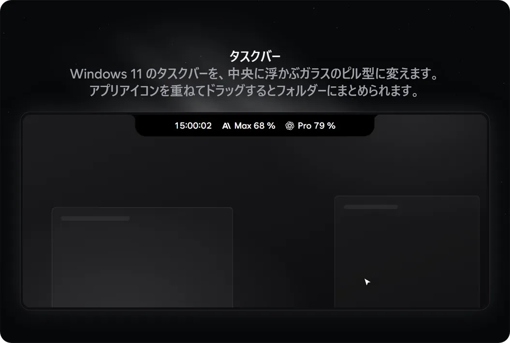

- Windows 11 の標準タスクバーを、画面中央に浮かぶ半透明ガラスのピル（カプセル）型に変えます。
- タスクバー上のアプリアイコンを別のアイコンに重ねてドラッグするとフォルダーにまとめられ、設定 › アドオン からフォルダー名や中身を編集できます。
- スタートボタンは Bloom の花のボタンに変わり、システムトレイの手前に再生中の曲名が表示されます。
- 登録しているアカウントごとに、AI の残り使用量バーをタスクバーに並べて表示できます。
- 自動非表示アイランドをオンにすると、普段はタスクバーが隠れ、画面上部の中央に小さなアイランドバーが表示されます。
- 初回起動時に一度だけ、実行に必要なシンボルファイル（約 70 MB）を Microsoft のシンボルサーバーからダウンロードします。

### モニターごとの Alt+Tab

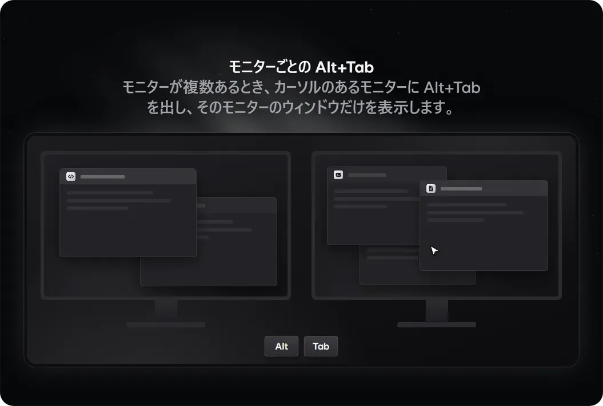

モニターを複数使っているとき、Alt+Tab を押すとマウスカーソルがある方のモニターにウィンドウ切り替え一覧が開き、そのモニターにあるウィンドウだけを絞り込んで表示します。

### メモリ整理

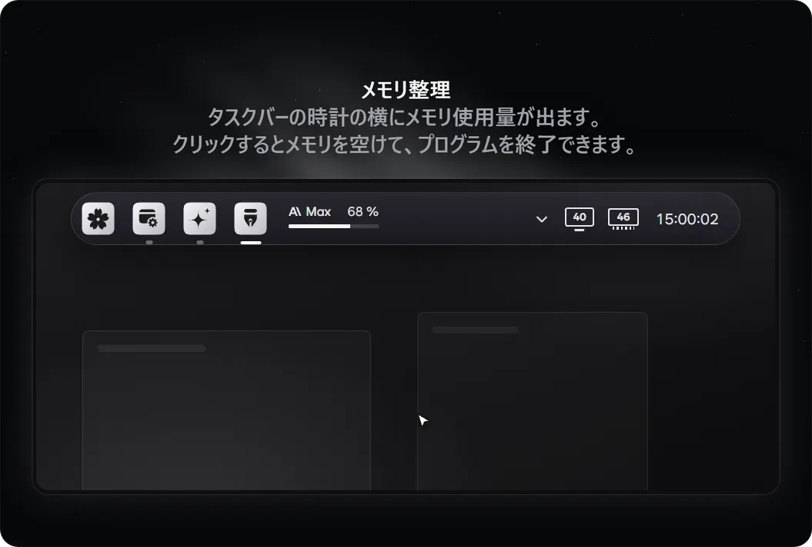

- タスクバーの時計の横の RAM モジュールにメモリ使用率が出ます。クリックするとウィンドウが開き、ボタンひとつでメモリを空けます。
- メモリを多く使っているプログラムを選んで終了することもできます。

### モニターの明るさ調整

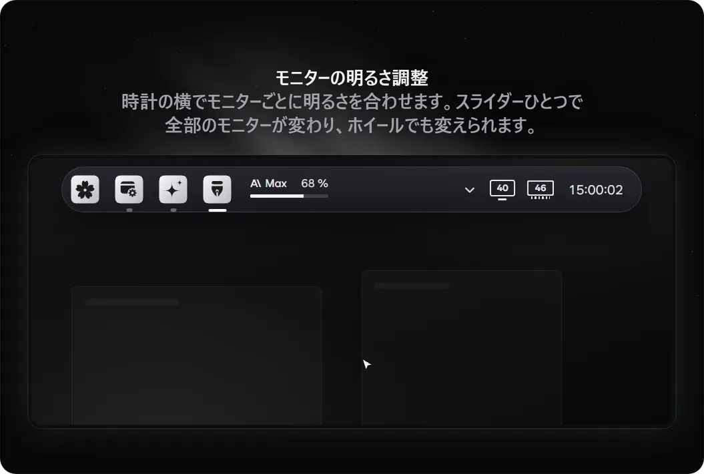

- 時計の横のモニターアイコンに明るさが出ます。スライダーひとつで全部のモニターが変わり、アイコンの上でホイールを回しても変わります。
- ショートカットで明るさを変え、席を外したときは画面を暗くできます。

### コーヒー

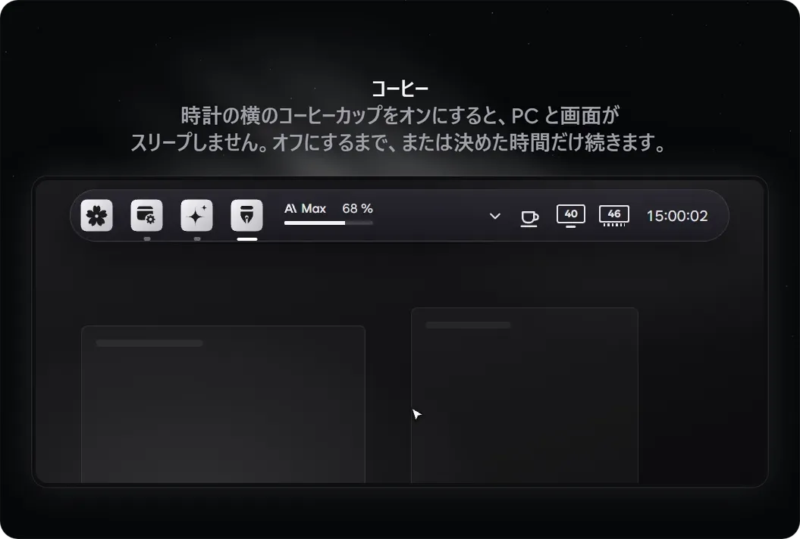

- 時計の横のコーヒーカップをオンにすると、PC と画面がスリープしません。
- オフにするまで、または決めた時間だけオンにできます。カップを右クリックするとすぐにオンとオフを切り替えます。

### アドオンのインストールと確認

- 設定 › アドオン からボタンひとつで手軽にダウンロードできます。
- ダウンロードしたファイルが、アプリ内に記録された SHA-256 ハッシュ値と一致するときだけインストールします。
- ダウンロードしたばかりのアドオンはすぐには起動せずオフの状態で登録され、オンにするときにどんな動作をするプログラムなのかを先に案内します。
- アドオンをオンにしたときと Bloom の起動時に、新しいバージョンが出ていないか確認します。
- 万が一アドオンが原因で問題が起きた場合は、Bloom の起動時に Shift を押し続けてください。その起動ではすべてのアドオンをスキップして起動します。

### 自分のアドオン

自作のアドオンは `%LOCALAPPDATA%\Bloom\user-addons` フォルダーに入れて Bloom を再起動すると、設定 › アドオン の一覧に表示されます。最初はオフの状態で登録され、起動時に `addon.json` に記載された SHA-256 ハッシュでファイルが改ざんされていないか確認します。

## ショートカット

| キー | 動作 |
| --- | --- |
| `Win` または `Alt+Space` | Bloom を開く (管理者として実行中のアプリの上で `Win` を使うには 設定 › 一般 › 管理者アプリの上でも Win キーを使用) |
| `Tab` / `Shift+Tab` | 検索欄の内容を AI に聞く (同じチャット / 新しいチャット) |
| `Ctrl+K` | 選んだ結果でできることの一覧 |
| `Ctrl+1` … `Ctrl+9` | お気に入り |
| `Ctrl+J` | ツール (メモ、タイマー、電卓、クリップボード履歴、ショートカット) |
| `Ctrl+P` | ランチャーを最前面に固定 |
| `Ctrl+E` | ホームを編集 |
| `Ctrl+,` | 設定 |
| `?` | 空の検索欄で、Bloom が受け付ける入力を種類別に表示 |
| `Ctrl+=` / `Ctrl+-` / `Ctrl+0` | 拡大、縮小、100 % |
| `Esc` | 戻る、テキストを消す、閉じるの順 (クイック AI の回答は続く) |
| `Ctrl+.` | クイック AI の回答を止める |
| `Ctrl+Alt+C` | AI チャット ウィンドウ |
| `Ctrl+Alt+A` | AI アクション |
| `Ctrl+Alt+L` | Bloom Lens |
| `1` … `7` | Bloom Lens で、AI に聞く、翻訳、テキストのコピー、リアルタイム翻訳、固定、キャプチャ、カラーパレット |
| `←` `→` / `−` `+` / `Enter` | カラーパレットで、色を選ぶ、色を減らす、増やす、HEX をコピー |
| `Ctrl+Alt+T` / `Ctrl+Alt+O` | 画面の翻訳、画面のテキストをコピー |
| `Ctrl+Alt+V` | クリップボード履歴 |

グローバル ショートカットキーは 設定 › ショートカット で変更やオフができます。項目をクリックしてキーを押すか、Backspace でオフにします。ウィンドウの切り替え、絵文字、カラーピッカー、画面について AI に聞く、リアルタイム翻訳、キャプチャにもショートカットキーを付けられます。これらは最初はオフです。

## AI 機能について

Bloom の AI は、この PC にインストールしてサインイン済みの公式 CLI か、自分で追加した API キーを使います。サインイン情報はそれぞれの CLI が持ち、使用量と利用規約は自分のアカウントのものです。どちらもなければ AI の機能だけがオフになります。

- Claude は [Claude Code](https://docs.anthropic.com/en/docs/claude-code) CLI (`claude`) を使います。
- ChatGPT は [Codex CLI](https://github.com/openai/codex) (`codex`) を使います。
- omp は任意で、[oh-my-pi](https://github.com/can1357/oh-my-pi) CLI (`omp`) を使います。
- API キーは Windows で暗号化されてこの PC に残り、それぞれの提供元にだけ送られます。

AI に届くのは自分が送ったものだけです。質問、添付ファイル、Bloom Lens で選んだ画面の範囲、翻訳するテキスト、PC のツールが返した結果がそれにあたります。Claude がファイルを読み書きするのは、そのチャットのフォルダー (`%LOCALAPPDATA%\Bloom\ai\files\<chat>`) の中だけです。Codex と omp は自分ではファイルを扱わないため、テキストの添付はメッセージに入れ、作られたファイルは回答から保存します。

<details>
<summary>PC の操作、MCP サーバー、使用量の取得、トークンの記録、更新の確認</summary>

#### pc ツール

Bloom は `pc` というツールを 1 つ、この PC のこの Windows ユーザーだけが開ける MCP サーバー (`Bloom.exe --mcp`、名前付きパイプ) で提供します。5 つのグループは 設定 › PC の操作 · MCP でそれぞれオンとオフを切り替えます。

- アプリ、ファイル (Everything)、最近使ったファイル、ウィンドウ、タイマーと予定、メモ、カスタムコマンドを調べます。調べるだけの操作は確認なしで実行します。
- アプリ、ファイル、サイトを開き、`volume 30` のような検索欄の入力やカスタムコマンドを実行します。
- Bloom のメモに書き、タイマーを始め、カレンダーに予定を入れます。
- ファイルの名前を変え、移動、コピーし、ごみ箱に送ります。
- クリップボードを読み書きします。

調べる操作以外は、チャットのカードで許可か拒否を待ち、結果は回答の下に ✓ か ✕ で残ります。Claude Code は `--permission-prompt-tool stdio` で確認を求めます。Codex と omp は自分では確認を求められないため、Bloom の MCP サーバーが実行の直前に同じカードを出します。

ツールの定義で、1 回の要求ごとに入力トークンが約 250 から 500 増えます。グループをオフにすると減ります。Codex には `-c mcp_servers.bloom…` でチャットの実行ごとにだけサーバーを渡します。omp には `%LOCALAPPDATA%\Bloom\ai\omp-work` の下にあるチャット専用の `.omp/mcp.json` で渡し、omp 自身の設定には何も書きません。

#### ほかの MCP サーバー

Claude Code、Claude Desktop、Cursor、VS Code、Windsurf、Codex で設定済みの MCP サーバーと、Claude Code で開いたプロジェクトの `.mcp.json` にあるサーバーは、同じページにそれぞれスイッチ付きで並びます。最初はオフで、オンにしたものだけを読み込みます (`--strict-mcp-config`)。その操作もすべて同じカードで確認を求め、ChatGPT では Bloom の中継 (`Bloom.exe --mcp-proxy`) がそれを受け持ちます。設定は毎回元のファイルから読みます。

#### 使用量の取得

AI の使用量は、モデルを呼び出さない `claude -p /usage` と、`codex app-server` の上限の取得から、1 アカウントずつ得ます。追加したアカウントは `%LOCALAPPDATA%\Bloom\accounts` の下にそれぞれのフォルダーを持ちます (`CLAUDE_CONFIG_DIR` または `CODEX_HOME`)。任意の軽量な ChatGPT モードでは、Codex 自身が状態を読むエンドポイントに、そのアカウントの Codex のサインインで HTTPS の要求を 1 回送ります。これは公式の API ではありません。Bloom がトークンを更新するのは自分で作ったフォルダーの中だけで、`~/.codex` では更新しません。Bloom が Claude のサインイン情報を読むことはありません。

設定 › AI アカウント › 使用量をファイルに書き出す (最初はオフ) は、使用率、リセットの時刻、自分で付けたアカウント名、アカウントごとのタスクバーの選択を `%LOCALAPPDATA%\Bloom\export\ai-usage.json` に書き出します。タスクバーのアドオンのような、この PC のほかのプログラムが使うためのものです。メールアドレスやサインイン情報は入りません。

#### 記録とトークンの集計

作業の通知は、この PC にある Claude Code と Codex の記録 (`~/.claude/sessions`、`~/.codex/sessions`) を読みます。記録はこの PC から出ません。

トークンのブロックは、この PC にあるすべてのアカウントの Claude Code と Codex の記録を読みます。Bloom が `%LOCALAPPDATA%\Bloom\tokens` に残すのは、モデル、思考レベル、セッションごとの 1 時間単位の合計と、各セッションのタイトルと最後のフォルダー名だけです。メッセージやフルパスは残しません。最初の集計ではすべての記録をバックグラウンドで一度読み、その後は増えた分だけを読みます。Claude Code は 30 日で記録を消すため、それより長い期間は Bloom が集計を始めた日から埋まっていきます。費用は同じトークンを各社の API 料金で使った場合の額で、実際に支払った額ではありません。設定 › AI アカウント › 価格表を編集 で `prices.json` を開いて変えられます。

#### 更新の確認

更新の確認では GitHub の API (`api.github.com`) にこのリポジトリの最新リリースを問い合わせ、新しいバージョンを GitHub からダウンロードします。要求に含まれるのはリポジトリの情報だけです。確認は 設定 › バージョン情報 でオフにできます。

</details>

## インストールとビルド

<details>
<summary>ソースからのビルド、データフォルダー、リリース</summary>

使うだけなら [ダウンロード](#ダウンロード) のセットアップを使ってください。ビルドには Windows 10 または 11 と [.NET 10 SDK](https://dotnet.microsoft.com/download) が必要です。`tools\package.ps1` では、Win キー ヘルパーのために C++ ビルドツール (Visual Studio の「C++ によるデスクトップ開発」) も必要です。

```powershell
dotnet build src\Bloom\Bloom.csproj -c Release
# またはインストール用のコピーを作る
powershell -File tools\package.ps1   # → dist\app
powershell -File tools\install.ps1   # → %LOCALAPPDATA%\Programs\Bloom、スタートメニューのショートカット
```

データは `%APPDATA%\Bloom` と `%LOCALAPPDATA%\Bloom` にあります。開発中は `Bloom.exe --data <folder>` で別のデータフォルダーを使い、`--lang ko|en` で言語を固定できます。自動更新はセットアップでインストールした場合だけ動くので、`tools\install.ps1` で作ったコピーは手で更新してください。

リリースするには、`src/Bloom/Bloom.csproj` の `<Version>` を上げ、`CHANGELOG.md` の `## <Version>` に変更点を書いて push し、GitHub で Actions › Release › Run workflow を実行します。`addons/catalog.json` のすべてのアドオンをダウンロードして確認し、テスト、ビルドのあと、[Velopack](https://velopack.io) でセットアップと更新パッケージを作り、`v<Version>` として公開します。

</details>

## コードの構成

<details>
<summary>フォルダー、決まりごと、テスト、lint</summary>

`src/Bloom` の下では、1 つのフォルダーが 1 つの機能です。大きなクラスはトピックごとに `partial` ファイルに分けています。

| フォルダー | 中身 |
| --- | --- |
| `App/` | `Host` (起動、ショートカットキー、コマンド、Lens、タイマー、カスタムコマンド、ファイル操作)、作業の通知 (`Notices`)、更新 (`Updates`、Velopack)、起動オプション、トレイ、Win キーのフックと管理者アプリ用のヘルパー (`src/WinKeyHelper`、NativeAOT) |
| `App/Engine/` | 検索欄に表示する内容。ルートの検索とホームのブロックから各ビュー (ファイル、クリップボード、カレンダー、タイマー、色) まで |
| `App/Mcp/` | MCP サーバー、中継、`pc` ツール |
| `App/Qa/` | 画面外キャプチャによる QA (`--capture <folder> --qa-set <set> --data <folder> --lang en`) |
| `Addons/` | 別プログラムとしてのアドオン。固定したカタログとダウンロード (`AddonCatalog`、`AddonDownload`)、`addon.json` の確認 (`AddonManifest`)、ハッシュを確認した実行用コピー (`AddonStore`)、ホストプロセスの起動と停止 (`AddonRunner`)、共通の名前 (`AddonProtocol`)。Bloom がアドオンのコードを読み込むことはない |
| `Core/` | 保存データ (設定、お気に入り、使用履歴、学習、タイマー、メモ、色)、JSON の保存、韓国語の検索、マッチング、表示言語 (`Lang`) |
| `Search/` | アプリ一覧、計算 (計算、単位、為替)、Everything、開いているウィンドウ、最近使ったファイル、絵文字と記号、システム項目、カスタムコマンド、結果のモデル |
| `Ai/` | Claude Code、Codex、omp の CLI セッションとチャット、単発の質問、翻訳、AI アクション、使用量 (`AiUsage`)、作業の記録 (`ClaudeWatch`、`CodexWatch`) |
| `Ai/Api/` | API キーのチャット、その提供元、ほかのサーバー用の MCP クライアント |
| `Ocr/` | 画面範囲の選択、Windows OCR、翻訳ウィンドウ、色の取得 |
| `Music/` | ミニプレーヤー、プレイリスト、ほかのアプリで再生中の曲 |
| `Clip/`、`Space/`、`Browser/` | クリップボード履歴、ディスク容量のマップ、ブラウザーへの受け渡し |
| `Native/` | Win32 の呼び出し (System32 の DLL のみ)、WinRT の呼び出し、システムの切り替え (`SystemControl`)、エクスプローラー式のファイル操作 (`ShellFiles`) |
| `Ui/Launcher/` | ランチャー ウィンドウ。各ビューのチップ、ヒント、結果は `Launcher.ViewSpecs.cs` |
| `Ui/Chat/`、`Ui/Player/` | AI チャット ウィンドウとミニプレーヤーのウィンドウ |
| `Ui/Settings/` | 設定ウィンドウ。アドオンのページとタスクバーのフォルダーの編集画面を含む |
| `Ui/Tools/` | ツール ウィンドウ、その配置、くっつきと吸着 (`ToolDock`)、メモ、タイマー、電卓、クリップボード |
| `Ui/Controls/`、`Ui/Theme/` | 共通コントロール (G2 の角の `SmoothBorder`、`Dropdown`、`PopupMenu`、`AccentPicker`) とテーマ (アニメーションの `Motion`) |

新しい機能は、結果の `Engine.<feature>.cs`、`Launcher.ViewSpecs.cs` のビュー 1 行、必要なら保存用の `Core/<feature>.cs` に分けます。
画面のテキストはすべて `Tr("한국어", "English")` で書きます。日本語と簡体字中国語は、英語のテキストをキーにした `src/Bloom/Assets/Lang/ja.tsv` と `zh.tsv` から来ます。`python tools/lang.py check` で足りないものを、`todo ja` で未翻訳のテキストを一覧にします。検索のキーワードと解析用のデータは韓国語と英語のままです。
画面のテキストは [docs/COPY.md](docs/COPY.md) に従います。
QA と開発の実行では、実データと分けて必ず `--data <一時フォルダー>` を使います。

```powershell
# lint (アナライザーと書式)、警告ゼロ
dotnet build src\Bloom\Bloom.csproj -c Debug --no-incremental -p:AnalysisLevel=latest-recommended -p:EnforceCodeStyleInBuild=true
dotnet format whitespace src\Bloom\Bloom.csproj --verify-no-changes
```

時間を区切って応答性を調べるには、Release ビルドを `--data <isolated-folder> --no-hook --no-tray --qa-responsive 3` で実行します。`responsiveness.json` と `responsiveness.txt` が書き出されます。

</details>

## ライセンス

Bloom は MIT ライセンスです。[LICENSE](LICENSE) を参照してください。

為替レートは [Rates By Exchange Rate API](https://www.exchangerate-api.com) から取得しています。

タスクバーのアドオン PillTaskbar ([ソース](https://github.com/hyeon1035298/PillTaskbar_BloomAddon)) とモニターごとの Alt+Tab のアドオン ([ソース](https://github.com/hyeon1035298/AltTabPerMonitor_BloomAddon)) は GPL-3.0 の別プログラムで、Bloom 自体は MIT のままです。

`src/Bloom/Assets/Logos` にある OpenAI と Anthropic のロゴは各社の商標で、MIT ライセンスの対象外です。Bloom は AI の使用量のアカウントがどのサービスのものかを示すためだけに表示しています。

Bloom は非公式の個人プロジェクトで、Anthropic、OpenAI、voidtools、Raycast とは関係ありません。
