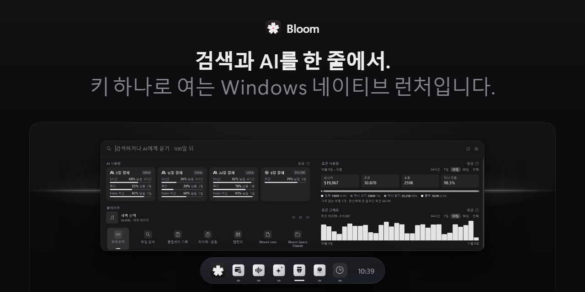
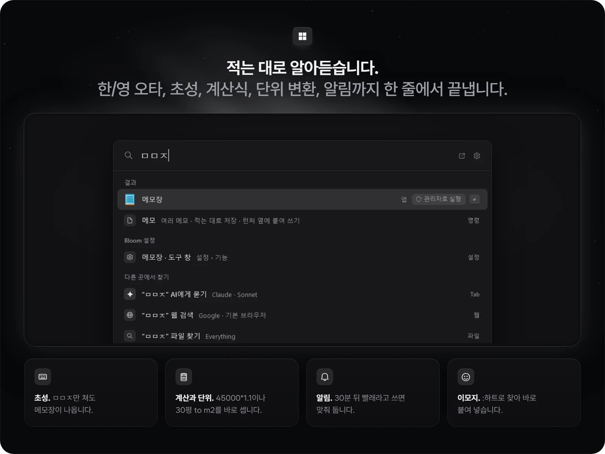
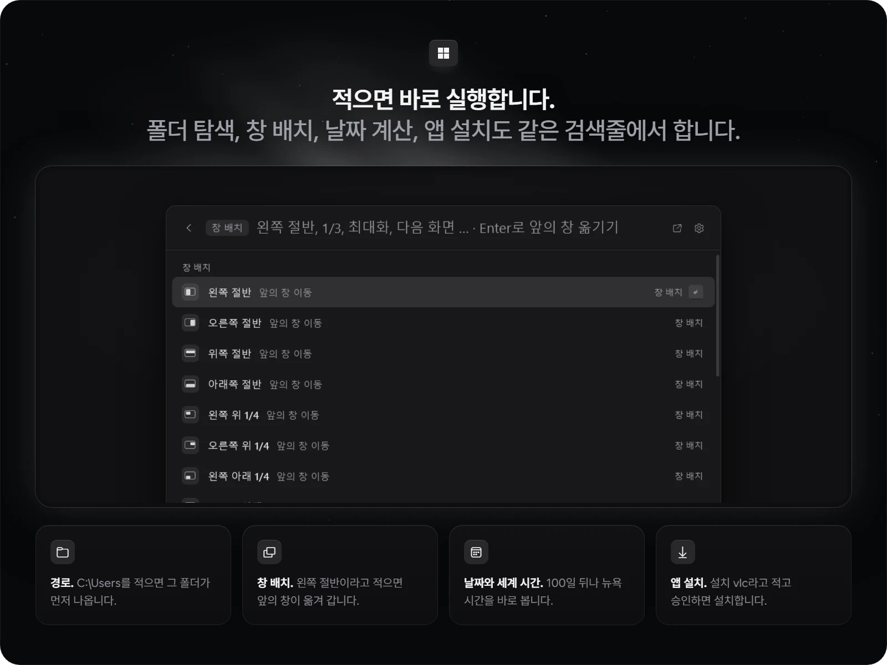
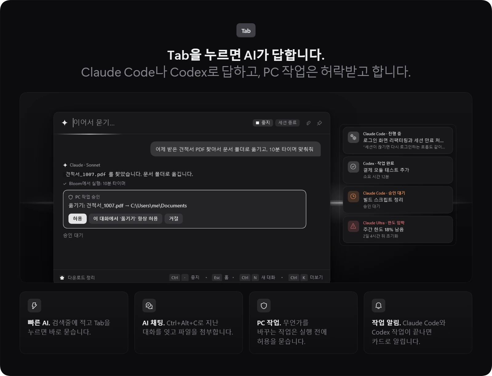
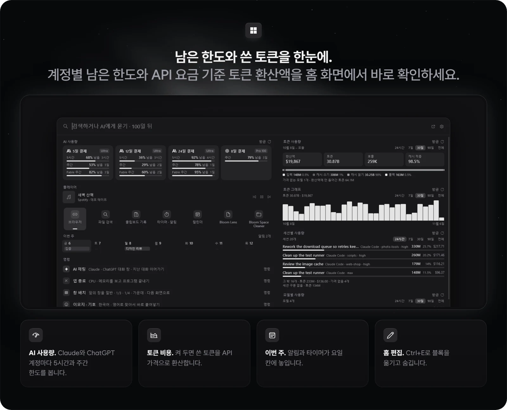
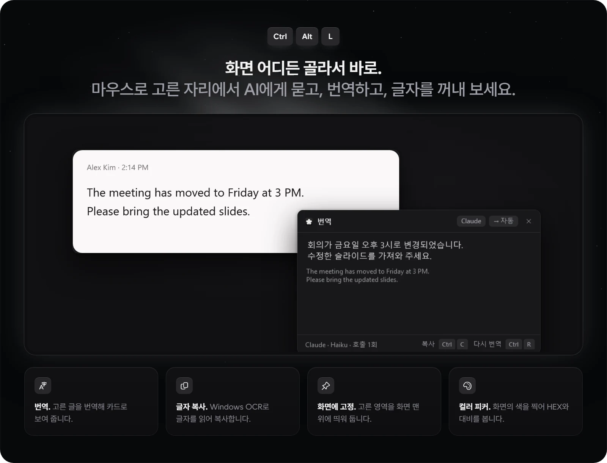
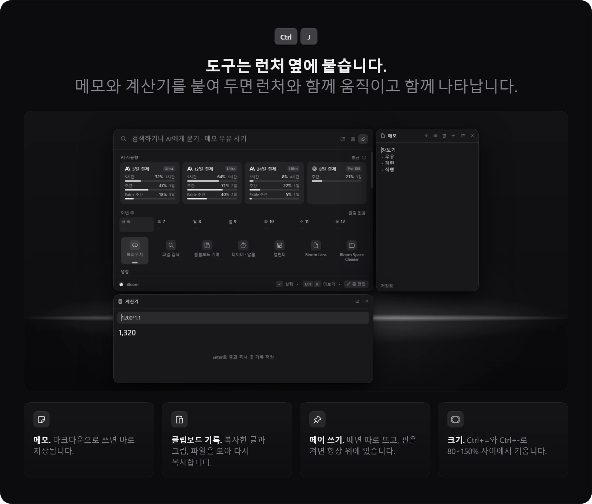
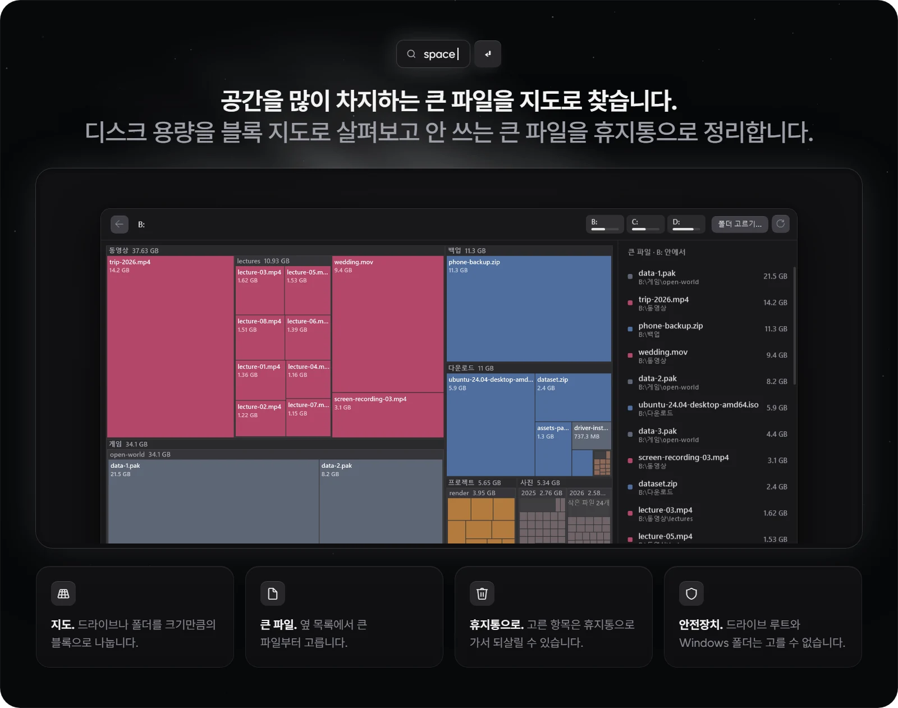
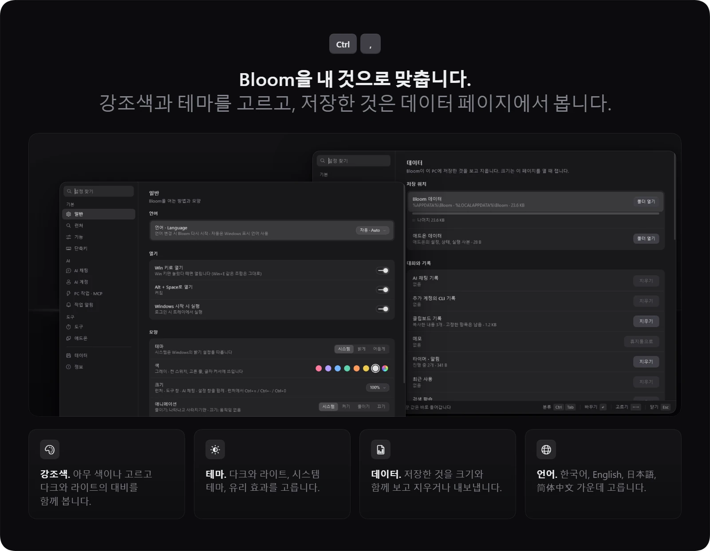
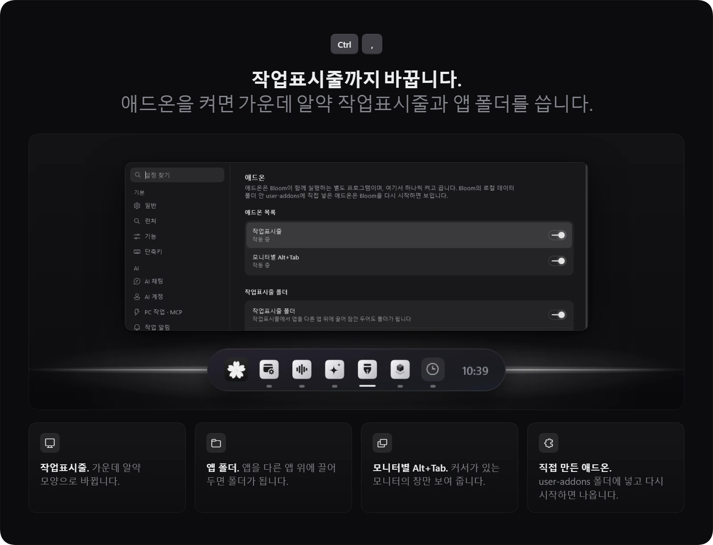

<p align="center"></p>

<p align="center">Bloom은 Windows용 네이티브 런처입니다. 키 하나로 열고, 검색줄 한 줄로 앱 실행과 계산, 파일 찾기, AI 채팅, 화면 번역을 합니다.</p>

<p align="center">
  <a href="#다운로드">다운로드</a> | <a href="#기능">기능</a> | <a href="#애드온">애드온</a> | <a href="#단축키">단축키</a> | <a href="#ai-기능에-대해">AI와 개인정보</a> | <a href="README.md">English</a> | <a href="README.ja.md">日本語</a> | <a href="README.zh-CN.md">简体中文</a>
</p>

<p align="center">
  
</p>

<p align="center"><sub>네이티브 WPF (.NET 10), WebView 없음, 한국어와 English, 日本語, 简体中文, MIT</sub></p>

## Bloom을 쓰는 이유

- Win 키 하나로 열고, 검색줄 한 줄이 앱과 파일, 계산, 단위, 알림, 이모지, 웹 검색에 답합니다.
- AI는 이 PC에서 로그인한 Claude Code나 Codex, 또는 직접 넣은 API 키로 씁니다.
- 끈 기능은 메뉴와 단축키에서 빠지고 그 기능의 메모리도 쓰지 않습니다.

## 다운로드

**[Windows용 Bloom 받기](https://github.com/hyeon1035298/Bloom/releases/latest)** 최신 릴리스의 `BloomLauncher-win-Setup.exe`를 받아 실행하세요.

PowerShell에서는 같은 설치 파일을 받아 실행하는 [install.ps1](install.ps1)을 쓸 수 있습니다.

```powershell
irm https://raw.githubusercontent.com/hyeon1035298/Bloom/main/install.ps1 | iex
```

- Windows 10/11 64비트에서 실행됩니다. .NET 10 Desktop Runtime이 없으면 설치 프로그램이 함께 설치하며, 이때 Windows가 권한 승인을 묻습니다.
- 현재 Windows 계정의 `%LOCALAPPDATA%\BloomLauncher`에 설치되고 시작 메뉴 바로 가기가 생깁니다.
- 제거는 설정 › 데이터 › Bloom 삭제에서 합니다. 이때 `%APPDATA%\Bloom`의 대화와 설정, 즐겨찾기를 함께 지울지 고릅니다. Windows 설정 › 앱에서 제거하면 데이터는 남습니다.
- 아직 코드 서명이 없어서 SmartScreen이 "Windows의 PC 보호"를 띄울 수 있습니다. 추가 정보 › 실행을 누르세요.
- Bloom은 실행 후 한 번 이 저장소의 최신 릴리스를 확인합니다. 새 버전은 백그라운드에서 받아 다음 실행 때 적용하며, 설정 › 정보에서 직접 확인하거나 자동 확인을 끌 수 있습니다.
- AI 기능에는 Claude Code, Codex, omp CLI 중 하나의 로그인이나 지원하는 서비스의 API 키가 필요합니다. [Everything](https://www.voidtools.com/)을 설치하면 PC 전체에서 파일을 찾습니다.
- 화면 언어와 관계없이 검색어와 시간, 단위는 한국어나 영어로 입력합니다.

## 기능

### 검색줄 하나로



- 시작 메뉴 앱과 Windows 설정 페이지, Bloom 명령을 찾습니다. 초성(`ㅁㅁㅈ`는 메모장), 한/영 전환 없이 친 글자(`초개ㅡㄷ`는 Chrome), 영어 이름의 첫 글자(`gc`는 Google Chrome)로도 찾습니다.
- 계산과 단위, 환율은 `45000*1.1`, `3억 5천만 × 2`, `5!`, `84m2 to 평`, `5km to mi`, `100 usd`처럼 적습니다. Enter를 누르면 결과가 복사됩니다.
- 타이머와 알림은 `10분 타이머`, `30분 뒤 빨래`, `내일 9시 업로드 리마인더`처럼 적습니다. 알림은 달력과 홈의 이번 주에도 나오고, 때가 되면 소리와 함께 카드가 뜹니다.
- 이모지와 기호는 `:하트`, `arrow`, `섭씨`처럼 이름으로 찾아 붙여 넣습니다.
- 웹 검색은 Google, 네이버, Bing, DuckDuckGo로 하고, 사이트 바로 가기는 `yt 고양이`, `n 날씨`, `map 성수역`처럼 단축어 뒤에 검색어를 붙입니다. 사이트 바로 가기는 직접 만들 수 있습니다.
- Everything이 있으면 파일을 이름으로 찾고 영상, 사진, 문서, 폴더로 좁혀 미리 봅니다. 없으면 Windows의 최근 파일에서 찾습니다.
- 열린 창을 이름으로 찾아 넘어가고 Ctrl+W로 닫습니다. `볼륨 30`, `다크 모드`, 화면 잠금 같은 시스템 명령도 같은 줄에 적습니다.
- 어떤 결과에서든 Ctrl+K를 누르면 그 항목으로 할 수 있는 일이 나옵니다. 검색줄에 `?`만 적으면 Bloom이 알아듣는 표현을 종류별로 보여 줍니다.

### 경로, 창 배치, 날짜, 앱 설치



- `C:\Users`, `~\Downloads`, `%APPDATA%` 같은 경로를 적으면 그 폴더와 안의 항목이 먼저 나옵니다. Enter는 탐색기에서 열고, Tab은 고른 폴더 안을 검색합니다.
- `왼쪽 절반`, `오른쪽 1/3`, `왼쪽 위 1/4`, `최대화`, `다음 화면으로`를 적으면 앞에 있던 창이 그 자리로 옮겨 갑니다.
- 날짜와 세계 시간은 `100일 뒤`, `크리스마스까지`, `2026-03-01부터`, `뉴욕 시간`, `도쿄 오후 3시`처럼 적습니다.
- `설치 vlc`처럼 적으면 winget과 Microsoft Store에서 찾습니다. Enter로 승인하면 백그라운드에서 설치하고 결과를 카드로 알립니다.
- 앱, 폴더, 파일, 사이트, 명령, 창 배치에 Ctrl+K › 단축키 지정으로 전역 단축키를 붙입니다. 붙인 단축키는 설정 › 단축키에 모여 있습니다.
- 앱을 오른쪽 클릭하거나 Ctrl+K를 누른 뒤 제거…를 고르면 승인 후 그 프로그램의 제거 창이 열립니다.

### AI 채팅



이 PC에 설치하고 로그인한 Claude Code나 Codex CLI로 답합니다. [omp](https://github.com/can1357/oh-my-pi)를 고를 수도 있고, 설정 › AI 계정에 넣은 API 키(OpenAI, Anthropic, Gemini, OpenRouter, DeepSeek, xAI, OpenCode Go)로도 답합니다.

- 검색줄에 적은 뒤 Tab을 누르면 빠른 AI로 묻습니다. Shift+Tab은 새 대화로 묻습니다. Esc로 홈에 돌아가도 답은 계속 만들어지고, Ctrl+.로 멈춥니다.
- AI 채팅 창(Ctrl+Alt+C)에서는 지난 대화를 이어 가고 그룹으로 묶으며, 파일과 사진을 끌어다 놓거나 Ctrl+V로 첨부합니다.
- "어제 받은 견적서 PDF 문서 폴더로 옮겨 줘"처럼 PC 작업을 맡깁니다. 무언가를 바꾸는 작업은 실행 전에 허용, 이 대화에서 항상 허용, 거절을 묻고, 결과는 답 아래에 ✓나 ✕로 남습니다.
- "메모에 장보기 목록 적어 줘", "내일 오후 3시 회의 잡아 줘"라고 하면 Bloom의 메모와 타이머, 캘린더에 저장되고 채팅 옆에 그 창이 열립니다.
- AI 빠른 동작(Ctrl+Alt+A)은 다른 앱에서 고른 글을 요약, 번역, 맞춤법, 다듬기, 답장 초안 등으로 바꿔 그 자리에 붙여 넣습니다. 직접 쓴 지시도 쓸 수 있습니다.
- 작업 알림은 Claude Code와 Codex 작업의 시작, 완료, 승인 대기와 한도 임박을 화면 구석의 카드와 소리로 알립니다. 카드를 누르면 그 작업의 터미널이나 편집기 창으로 갑니다.
- 설정 › 작업 알림에서 알림 카드에서 승인을 켜면 Claude Code의 승인 요청에 카드에서 바로 답합니다. 기본은 꺼져 있습니다.

### 홈



- 빈 검색줄 아래에 즐겨찾기(Ctrl+1…9), AI 사용량, 이번 주, 타이머, 메모, 플레이어, 명령 같은 블록이 나옵니다.
- AI 사용량 카드는 계정마다 회사 로고와 요금제 배지를 달고 5시간과 주간 한도를 보여 줍니다. Claude는 Fable 주간 한도도 한 줄 더 나옵니다. 로그인이 끊기면 다시 로그인 단추가 나옵니다.
- 설정 › AI 계정에서 Claude와 ChatGPT 계정을 여러 개 추가합니다. 계정마다 CLI의 공식 로그인을 쓰고, 계정이 저절로 바뀌지 않으며, 원하는 이름과 로고 파일을 붙일 수 있습니다.
- 토큰 블록 4개(토큰 사용량, 토큰 그래프, 모델별 사용량, 세션별 사용량)는 이 PC의 Claude Code와 Codex 기록에 남은 토큰을 셉니다. API 가격으로 환산한 금액도 보여 주며, 처음에는 꺼져 있습니다.
- Ctrl+E로 홈을 편집합니다. 블록을 끌어 옮기고, 숨기고, 열 끝의 + 블록 추가로 다시 넣습니다. 런처가 넓으면 홈이 두 열로 나뉩니다.

### Bloom Lens와 컬러 피커



- Bloom Lens(Ctrl+Alt+L)는 화면 영역을 끌어 고른 뒤 번호로 할 일을 정합니다. `1` AI에게 묻기, `2` 번역, `3` 글자 복사, `4` 실시간 번역, `5` 화면에 고정, `6` 캡처, `7` 컬러 팔레트입니다.
- 번역(Ctrl+Alt+T)과 글자 복사(Ctrl+Alt+O)는 바로 가는 단축키가 있습니다. 글자 복사는 Windows OCR을 씁니다.
- 캡처는 클립보드에 복사되고, Windows 캡처 도구와 같은 스크린샷 폴더에도 저장됩니다.
- 컬러 피커는 돋보기로 화면의 색을 찍거나 색 코드를 붙여 넣어 HEX, RGB, HSL과 흰 글자, 검은 글자와의 대비를 보여 줍니다. 그 색으로 만든 그라데이션도 추천합니다.
- 컬러 팔레트는 고른 영역의 주요 색을 5개(− +로 3~10개) 뽑아 색마다 HEX와 RGB, 비율을 보여 줍니다. 이 PC에서 계산하며 AI 사용량을 쓰지 않습니다.

### 옆에 붙는 도구



- Ctrl+J로 메모, 타이머, 계산기, 클립보드 기록, 단축키 창을 엽니다.
- 도구 창을 런처 옆에 놓으면 런처와 함께 움직이고 함께 나타납니다. 떼면 따로 떠 있는 창이 되고, 핀을 켜면 항상 위에 있습니다.
- 메모는 마크다운으로 쓰고 입력하는 대로 저장됩니다. 검색줄에 `메모 우유 사기`라고 적어도 메모가 됩니다.
- 클립보드 기록(Ctrl+Alt+V)은 복사한 글과 그림, 파일을 모아 두고, 누르면 다시 복사합니다.
- 📌(Ctrl+P)을 켜면 다른 창을 눌러도 런처가 맨 위에 남습니다. 런처는 테두리를 끌어 크기를 바꾸고, Ctrl+= / Ctrl+- / Ctrl+0으로 80~150% 사이에서 키웁니다.
- .md 파일은 Bloom 문서 창에서 열어 보고 고칩니다. 설정 › 기능에서 Bloom을 .md의 기본 앱으로 정할 수 있습니다.

### Bloom Space Cleaner



- 드라이브나 폴더의 용량을 크기만큼의 블록으로 나눈 지도로 보여 줍니다.
- 블록을 눌러 안으로 들어가고, 옆의 큰 파일 목록에서 고른 항목을 휴지통으로 옮깁니다.
- 드라이브 루트와 Windows 폴더는 고를 수 없고, 휴지통으로 보낸 것은 되살릴 수 있습니다.

### 설정



- 설정은 일반, 런처, 단축키, AI 채팅, AI 계정, PC 작업 · MCP, 기능, 도구, 작업 알림, 애드온, 데이터, 정보의 12쪽입니다. 설정 이름을 검색줄에 적어도 찾아 엽니다.
- 강조색은 아무 색이나 고를 수 있고, 고르는 창이 그 색의 대비를 다크와 라이트에서 함께 보여 줍니다. 강조색은 켜진 것에만 쓰입니다.
- 데이터 페이지에서 Bloom이 이 PC에 저장한 것을 크기와 함께 보고 지웁니다. 모두 초기화하거나, 설정과 즐겨찾기, 앱 이름, 사이트 바로 가기를 파일 하나로 내보내 다른 PC에서 불러올 수도 있습니다.
- 설정 › 기능에서 기능을 끄면 검색 결과, 명령 목록, 홈, 즐겨찾기에서 빠지고 단축키가 풀립니다. 저장된 데이터는 남습니다.
- 사용자 명령은 단축어 하나로 스크립트를 실행하거나, 스니펫을 붙여 넣거나, 여러 줄을 묶음으로 차례로 실행합니다(`메모장 ; 볼륨 30 ; yt lofi`).
- 다크와 라이트, 시스템 테마, 애니메이션, 유리 효과, 실험적인 GPU로 그리기를 고릅니다. 화면 언어는 한국어, English, 日本語, 简体中文 가운데 고르고, 바꾸면 Bloom이 다시 시작합니다.
- 설정 › 정보 › 문제 보고는 버전과 Windows, 최근 로그를 사용자 이름과 이메일 주소를 가린 채 복사하고 GitHub 이슈 작성 페이지를 엽니다. Bloom이 직접 보내는 것은 없습니다.

## 애드온



애드온은 Bloom이 받아서 확인하고 실행하는 별도 프로그램입니다. Bloom은 애드온을 실행하고 파일로 주고받기만 하며, 애드온의 코드는 Bloom에 들어 있지 않습니다. Bloom은 MIT 그대로이고, 지금 있는 애드온 2개는 GPL-3.0이며 소스 저장소가 따로 있습니다.

### 작업표시줄 (PillTaskbar)

- Windows 11 작업표시줄을 화면 가운데에 뜬 유리 알약 모양으로 바꿉니다. 작업표시줄은 Bloom의 라이트와 다크 테마를 따릅니다.
- 작업표시줄 폴더는 새 폴더, 이름 바꾸기, 아이콘, 앱 넣기와 빼기, 순서, 폴더 풀기를 설정 › 애드온에서 합니다. 작업표시줄에서 앱을 다른 앱 위에 끌어 잠깐 두어도 폴더가 됩니다.
- 실행 중 폴더를 켜면 고정하지 않고 켠 앱 가운데 어느 폴더에도 없는 앱을 저절로 모읍니다.
- 크기와 배경을 고르고, 시작 단추를 Bloom의 꽃 버튼으로 바꿉니다. 꽃 버튼을 누르면 Bloom이 열리고 닫힙니다.
- 트레이에 남길 아이콘을 고르고, 시계는 24시간이나 12시간으로 보입니다. 재생 중인 곡의 앨범 아트와 제목, 이전과 재생, 다음 단추를 트레이 앞에 둘 수 있습니다.
- AI 사용량은 계정마다 5시간, 주간, Fable 주간 가운데 하나를 막대로 보여 주고, 이름표와 아이콘 색은 홈 카드와 같이 씁니다.
- 숨김 아일랜드를 켜면 작업표시줄이 자동으로 숨고 화면 위 가운데에 아일랜드가 생깁니다. 아일랜드는 검정이나 흰색입니다.
- 처음 켤 때 작업표시줄 기호 파일(약 70 MB)을 Microsoft 기호 서버에서 받습니다.

### 모니터별 Alt+Tab

모니터가 여럿일 때 Alt+Tab과 Win+Alt+Tab이 마우스 커서가 있는 모니터에 뜨고 그 모니터의 창만 보여 줍니다. Windhawk 모드 Alt+Tab per monitor를 Windhawk 없이 실행하는 프로그램입니다.

### 받기와 확인

- 애드온은 설치 파일에 들어 있지 않습니다. 설정 › 애드온에서 단추 하나로 GitHub 릴리스에서 받고, 받는 동안 진행률을 보여 줍니다.
- zip이 이 Bloom에 고정된 SHA-256과 같고 모든 파일이 addon.json과 맞을 때만 설치합니다. 받다가 실패하면 아무것도 남기지 않고 이유와 다시 받기를 보여 줍니다.
- 새 Bloom이 더 새 버전을 고정하면 같은 줄에 업데이트가 나옵니다.
- 받은 애드온은 꺼져 있고, 처음 켤 때 무엇을 하는지 먼저 알려 줍니다. Windhawk에서 같은 모드가 켜져 있으면 상태 줄이 그렇다고 알리고 어떻게 하면 되는지 적습니다.
- Bloom이 켜질 때 Shift를 누르고 있으면 그 실행에서는 애드온을 켜지 않습니다.
- 애드온이 켜져 있고 Windows 시작 시 실행도 켜져 있으면, 사용자 계정의 로그인 작업이 Bloom을 더 일찍 띄워 로그인 뒤 작업표시줄이 금방 바뀝니다.

### 직접 넣는 애드온

`%LOCALAPPDATA%\Bloom\user-addons`에 넣은 애드온은 Bloom을 다시 시작하면 설정 › 애드온에 자기 스위치와 함께 나옵니다. 처음에는 꺼져 있고, 켤 때 Bloom이 만들거나 확인한 것이 아닌 별도 프로그램이라고 알립니다. 파일은 그 애드온의 addon.json에 적힌 SHA-256과 맞춰 봅니다.

## 단축키

| 키 | 하는 일 |
| --- | --- |
| `Win` · `Alt+Space` | Bloom 열기 (관리자 권한 앱 위에서 `Win`은 설정 › 일반 › 관리자 앱 위에서도 Win 키 사용) |
| `Tab` / `Shift+Tab` | 검색줄의 글로 빠른 AI에게 묻기 / 새 대화로 묻기 |
| `Ctrl+K` | 고른 결과로 할 수 있는 일 |
| `Ctrl+1` … `Ctrl+9` | 즐겨찾기 |
| `Ctrl+J` | 도구 (메모 · 타이머 · 계산기 · 클립보드 기록 · 단축키) |
| `Ctrl+P` | 런처를 맨 위에 고정 |
| `Ctrl+E` | 홈 편집 |
| `Ctrl+,` | 설정 |
| `Ctrl+W` | 창 전환에서 고른 창 닫기 |
| `?` | 빈 검색줄에서 Bloom이 알아듣는 표현을 종류별로 표시 |
| `Ctrl+=` · `Ctrl+-` · `Ctrl+0` | 크게 · 작게 · 100% |
| `Esc` | 뒤로 → 글자 지우기 → 닫기 (빠른 AI의 답은 계속 만들어짐) |
| `Ctrl+.` | 빠른 AI 답 멈추기 |
| `Ctrl+Shift+M` · `Ctrl+M` | AI 채팅에서 AI 바꾸기 · 모델 고르기 |
| `Ctrl+Alt+C` | AI 채팅 창 |
| `Ctrl+Alt+A` | AI 빠른 동작 |
| `Ctrl+Alt+L` | Bloom Lens |
| `1` … `7` | Bloom Lens에서 AI에게 묻기 · 번역 · 글자 복사 · 실시간 번역 · 화면에 고정 · 캡처 · 컬러 팔레트 |
| `← →` · `−` `+` · `Enter` | 컬러 팔레트에서 색 고르기 · 색 개수 줄이기 · 늘리기 · HEX 복사 |
| `Ctrl+Alt+T` · `Ctrl+Alt+O` | 화면 번역 · 화면 글자 복사 |
| `Ctrl+Alt+V` | 클립보드 기록 |
| Bloom이 켜질 때 `Shift` | 이번 실행에서 애드온 켜지 않기 |

전역 단축키는 설정 › 단축키에서 바꾸거나 끕니다. 입력 칸을 고른 뒤 쓸 키를 누르고, Backspace로 지웁니다. Ctrl, Alt, Shift, Win과 함께 누르는 키를 쓸 수 있고, F1~F24와 PrintScreen, Pause, 미디어 키는 단독으로도 씁니다. 창 전환, 이모지, 컬러 피커, 바로 AI에게 묻기, 실시간 번역, 캡처에도 단축키를 붙일 수 있으며 기본은 꺼져 있습니다.

## AI 기능에 대해

AI 기능은 이 PC에 설치하고 로그인한 공식 CLI를 씁니다. 로그인 정보는 그 CLI가 관리하고, 사용량과 이용 약관은 로그인한 계정의 기준을 따릅니다. CLI가 없으면 AI 기능만 꺼지고 나머지는 그대로 동작합니다.

- Claude는 [Claude Code](https://docs.anthropic.com/en/docs/claude-code) CLI(`claude`)를 씁니다.
- ChatGPT는 [Codex CLI](https://github.com/openai/codex)(`codex`)를 씁니다.
- omp는 [oh-my-pi](https://github.com/can1357/oh-my-pi) CLI(`omp`)이며, 직접 고를 때만 씁니다.
- API 키는 Windows가 암호화해 이 PC에만 저장하고, 각 키는 그 서비스로만 보냅니다.

AI에게는 사용자가 직접 보낸 것(질문, 첨부한 파일, Bloom Lens로 고른 화면, 번역할 글)과 PC 작업 도구가 돌려준 결과만 전달됩니다. Claude는 대화별 폴더 `%LOCALAPPDATA%\Bloom\ai\files\<대화>` 안에서 파일을 읽고 씁니다. ChatGPT(Codex)와 omp에서는 텍스트 첨부를 메시지에 넣고, 만든 파일은 답에서 꺼내 저장합니다.

### PC 작업과 승인

Bloom은 이 PC 안에서만 열리는 MCP 서버(`Bloom.exe --mcp`, 이 Windows 사용자만 여는 named pipe)로 `pc` 도구 하나를 AI에게 줍니다. 할 수 있는 일은 5묶음이고, 설정 › PC 작업 · MCP에서 묶음마다 켜고 끕니다.

| 묶음 | 하는 일 |
| --- | --- |
| 찾아보기 | 앱, 파일(Everything), 최근 파일, 창, 타이머와 일정, 메모, 사용자 명령 조회. 승인 없이 실행 |
| 열기 · 실행 | 앱, 파일, 사이트 열기, 검색줄 한 줄 실행(`볼륨 30`, `yt lofi`), 사용자 명령 실행 |
| 메모 · 타이머 · 일정 | Bloom 메모에 적기, 타이머, 캘린더 일정 |
| 파일 정리 | 이름 바꾸기, 옮기기, 복사, 휴지통 |
| 클립보드 | 읽기, 넣기 |

조회가 아닌 작업은 채팅 안의 허용, 이 대화에서 항상 허용, 거절 단추로 정합니다. 이 PC에 이미 등록된 다른 MCP 서버도 같은 페이지에 서버마다 스위치로 나오며 기본은 꺼져 있고, 켠 서버의 도구도 실행 전에 승인 카드를 띄웁니다. 도구를 쓰면 요청마다 입력 토큰이 약 250~500개 늘어나고, 묶음을 끄면 줄어듭니다.

<details>
<summary>CLI별 연결 방식, 사용량 조회, 토큰 기록, 업데이트 확인</summary>

**Claude Code**는 Bloom이 고른 MCP 서버만 쓰도록 `--strict-mcp-config`로 실행하고, 승인은 `--permission-prompt-tool stdio`로 채팅에 띄웁니다. 도구 정의가 하나라 늘어나는 입력 토큰은 요청마다 약 500개입니다.

**Codex**는 대화마다 실행할 때 `-c mcp_servers.bloom…`으로만 Bloom 도구를 더합니다. Codex의 실행 모드에는 자체 승인 질문이 없어서 Bloom의 MCP 서버가 작업 직전에 승인 카드를 띄우고 기다립니다. Codex는 필요한 도구 설명만 불러오므로 늘어나는 입력 토큰은 요청마다 약 250개입니다. Bloom의 Codex는 Bloom 전용 설정으로 실행되어 사용자의 `config.toml`이 Bloom 채팅에 영향을 주지 않습니다.

**omp**도 `--no-ui`로 실행되어 스스로 묻지 못하므로 Bloom의 MCP 서버가 같은 카드를 띄웁니다. Bloom 도구와 켜 둔 다른 서버는 `%LOCALAPPDATA%\Bloom\ai\omp-work` 아래 대화별 폴더의 `.omp/mcp.json`에만 적고, omp 자체 설정은 건드리지 않습니다.

**다른 MCP 서버**는 Claude Code, Claude 데스크톱, Cursor, VS Code, Windsurf, Codex의 설정과 Claude Code로 연 프로젝트의 `.mcp.json`에서 찾습니다. 서버 설정은 실행할 때마다 원래 파일에서 읽습니다. ChatGPT에서는 서버 앞에 Bloom 중계(`Bloom.exe --mcp-proxy`)를 두어 승인을 받습니다.

**AI 사용량**은 `claude -p /usage`(모델 호출 없음)와 `codex app-server`의 한도 조회로 계정마다 차례로 확인합니다. 추가한 계정은 `%LOCALAPPDATA%\Bloom\accounts`의 폴더를 `CLAUDE_CONFIG_DIR`와 `CODEX_HOME`으로 씁니다. ChatGPT의 가벼운 방식을 고르면 그 계정의 Codex 로그인으로 Codex 상태 화면이 읽는 주소에 HTTPS 요청을 한 번 보냅니다. 이 주소는 공식 API가 아니며, 토큰 갱신은 Bloom이 만든 폴더에서만 하고 `~/.codex`에서는 하지 않습니다. Bloom은 Claude 로그인 정보를 읽지 않습니다.

**사용량 파일 내보내기**(설정 › AI 계정, 기본 꺼짐)를 켜면 사용 퍼센트와 리셋 시각, 직접 붙인 계정 이름을 이 PC의 다른 프로그램이 읽도록 `%LOCALAPPDATA%\Bloom\export\ai-usage.json`에 씁니다. 작업표시줄 애드온은 이 파일을 읽습니다. 이메일과 로그인 정보는 들어 있지 않습니다.

**작업 알림**은 이 PC의 Claude Code와 Codex 기록(`~/.claude/sessions`, `~/.codex/sessions`)을 읽고, 기록은 이 PC에 남습니다.

**토큰 블록**은 이 PC에 있는 모든 계정의 Claude Code와 Codex 기록을 읽습니다(Claude 폴더마다 `projects`, Codex 폴더마다 `sessions`와 `archived_sessions`). Bloom은 `%LOCALAPPDATA%\Bloom\tokens`에 모델과 effort, 세션별 시간 합계, 그리고 세션마다 Claude Code나 Codex가 붙인 제목과 마지막 폴더 이름만 둡니다. 메시지 내용과 전체 경로는 저장하지 않습니다. 처음에는 기록 전체를 백그라운드에서 낮은 우선순위로 한 번 읽고, 그다음부터는 늘어난 부분만 읽습니다. Codex가 이미 압축한 기록(`.zst`)은 읽지 않습니다. Claude Code는 30일 지난 기록을 지우므로 30일보다 긴 기간은 Bloom이 세기 시작한 날부터 채워집니다. 환산액은 같은 토큰을 각 회사의 API 가격으로 냈을 때의 금액이며(내장 가격표, 2026-11-02 확인) 실제로 낸 돈이 아닙니다. 가격은 설정 › AI 계정 › 가격표 고치기에서 `prices.json`으로 바꿉니다.

**업데이트 확인**은 GitHub API(`api.github.com`)에서 이 저장소의 최신 릴리스를 조회하고 새 버전을 GitHub에서 받습니다. 이 요청에는 저장소 정보만 쓰며 설정과 파일, 대화는 이 PC에 남습니다.

</details>

## 설치와 빌드

<details>
<summary>직접 빌드하기, 데이터 폴더, 릴리스</summary>

직접 빌드하려면 Windows 10/11과 [.NET 10 SDK](https://dotnet.microsoft.com/download)가 필요합니다. `tools\package.ps1`은 Win 키 도우미 때문에 C++ 빌드 도구(Visual Studio의 'C++를 사용한 데스크톱 개발')도 필요합니다.

```powershell
dotnet build src\Bloom\Bloom.csproj -c Release
# 또는 설치본 만들기
powershell -File tools\package.ps1   # → dist\app
powershell -File tools\install.ps1   # → %LOCALAPPDATA%\Programs\Bloom, 시작 메뉴 바로 가기
```

데이터는 `%APPDATA%\Bloom`과 `%LOCALAPPDATA%\Bloom`에 저장됩니다. 개발용 실행은 `Bloom.exe --data <폴더>`로 다른 데이터 폴더를 쓰고, `--lang ko|en`으로 언어를 고정합니다. 자동 업데이트는 설치 파일로 설치한 Bloom에서만 동작하며, `tools\install.ps1`로 만든 설치본은 직접 업데이트해야 합니다.

릴리스는 `src/Bloom/Bloom.csproj`의 `<Version>`을 올리고 `CHANGELOG.md`의 `## <Version>` 제목 아래에 바뀐 점을 적어 푸시한 뒤, GitHub에서 Actions › Release › Run workflow를 실행합니다. 워크플로가 테스트와 빌드를 거쳐 [Velopack](https://velopack.io) 설치 파일과 업데이트 패키지를 만들고 `v<Version>` 릴리스를 게시합니다. `addons/catalog.json`의 SHA-256이 비었거나 틀리면 릴리스하지 않습니다.

</details>

## 코드 구조

<details>
<summary>폴더 구성, 개발 규칙, 테스트와 Lint</summary>

`src/Bloom`은 기능별 폴더로 나뉩니다. 큰 클래스는 `partial`로 주제별 파일에 나눕니다.

| 폴더 | 내용 |
| --- | --- |
| `App/` | `Host`(시작, 단축키, 명령, Lens, 사용자 명령 실행, 파일 동작 연결), 작업 알림(`Notices`), 업데이트(`Updates`, Velopack), 로그인 작업(`LogonTask`), 문제 보고, 트레이, Win 키 훅 |
| `App/Engine/` | 검색줄에 보일 결과 만들기. 루트 검색, 홈 블록, 항목 변환, 보기별 결과(파일, 클립보드, 캘린더, 타이머, 색, winget 등) |
| `App/Mcp/` | MCP 서버와 중계, `pc` 도구(`BloomTools`) |
| `App/Qa/` | 화면 밖 캡처 QA (`--capture <폴더> --data <폴더> --lang en`) |
| `Addons/` | 애드온 목록(`AddonCatalog`, `addons/catalog.json`), 받기와 SHA-256 확인(`AddonDownload`), addon.json 읽기(`AddonManifest`), 실행과 재시작(`AddonRunner`), 파일로 주고받기(`AddonProtocol`), 작업표시줄 상태 |
| `Core/` | 저장되는 것(설정, 즐겨찾기, 사용 기록, 입력어 학습, 타이머, 메모, 색)과 JSON 저장, 한글 검색, 매칭, 데이터 지우기, 화면 언어(`Lang`) |
| `Search/` | 앱 목록, 계산기(식, 단위, 환율), Everything, 열린 창, 최근 파일, 이모지와 기호, 시스템 항목, 사용자 명령 |
| `Ai/` | Claude Code, Codex, omp CLI 세션, API 키 대화(`Api/`), 대화와 그룹(`Chats`), 번역, AI 빠른 동작, 사용량(`AiUsage`), 토큰 집계, 작업 기록 읽기(`ClaudeWatch`, `CodexWatch`) |
| `Music/` | 미니 플레이어(재생 대기열, 재생목록, 앨범 아트, 다른 앱의 재생 중인 곡) |
| `Ocr/` | 화면 영역 고르기, Windows OCR, 번역 창, 색 찍기 |
| `Clip/`, `Space/`, `Browser/` | 클립보드 기록, Bloom Space Cleaner, 브라우저로 넘기기 |
| `Native/` | Win32 호출(System32의 DLL만), WinRT 호출, 시스템 토글(`SystemControl`), 탐색기 방식 파일 작업(`ShellFiles`) |
| `Ui/` | 런처 창(`Launcher/`, 보기마다의 칩과 안내, 결과는 `Launcher.ViewSpecs.cs` 한 곳에), AI 채팅 창(`Chat/`), 설정 창(`Settings/`, 애드온 페이지와 작업표시줄 폴더 편집 포함), 도구 창(`Tools/`), 플레이어(`Player/`), 공용 컨트롤(`Controls/`, G2 모서리 `SmoothBorder`, `AccentPicker` 등), 테마(`Theme/`) |
| `Assets/` | 아이콘, 회사 로고(`Logos/`), 이모지와 기호 목록(`symbols.tsv`), 일본어와 중국어 화면 문구(`Lang/`) |
| `src/WinKeyHelper` | 관리자 권한 앱 위에서 Win 키를 받는 도우미 (NativeAOT) |
| `tests/Bloom.Tests` | 자동 테스트. 테스트 프레임워크 없이 콘솔로 실행 |

새 기능은 `Engine.<기능>.cs`(결과)와 `Launcher.ViewSpecs.cs`의 보기 한 줄, 필요하면 `Core/<기능>.cs`(저장)로 나눕니다. 화면 문구는 모두 `Tr("한국어", "English")`로 쓰고, 일본어와 간체 중국어는 영어 문장을 키로 쓰는 `src/Bloom/Assets/Lang/ja.tsv`와 `zh.tsv`에서 불러옵니다. `python tools/lang.py check`로 빠진 키를, `todo ja`로 번역할 문구를 확인합니다. 검색 키워드와 파서 데이터는 한국어와 영어를 함께 둡니다. 화면 문구는 [docs/COPY.md](docs/COPY.md)를 따릅니다. QA와 개발 실행은 늘 `--data <임시 폴더>`로 실제 데이터와 나눕니다.

```powershell
# 테스트 (종료 코드 = 실패 수)
dotnet run --project tests\Bloom.Tests
# Lint (분석기와 서식), 경고 0
dotnet build src\Bloom\Bloom.csproj -c Debug --no-incremental -p:AnalysisLevel=latest-recommended -p:EnforceCodeStyleInBuild=true
dotnet build tests\Bloom.Tests\Bloom.Tests.csproj -c Debug --no-incremental -p:AnalysisLevel=latest-recommended -p:EnforceCodeStyleInBuild=true
dotnet format whitespace src\Bloom\Bloom.csproj --verify-no-changes
dotnet format whitespace tests\Bloom.Tests\Bloom.Tests.csproj --verify-no-changes
```

</details>

## 라이선스

Bloom은 MIT 라이선스입니다([LICENSE](LICENSE)).

환율은 [Rates By Exchange Rate API](https://www.exchangerate-api.com)를 씁니다.

작업표시줄 애드온 PillTaskbar([소스](https://github.com/hyeon1035298/PillTaskbar_BloomAddon))와 모니터별 Alt+Tab 애드온([소스](https://github.com/hyeon1035298/AltTabPerMonitor_BloomAddon))은 GPL-3.0인 별도 프로그램이며 Bloom 설치 파일에 들어 있지 않습니다. Bloom 자체는 MIT 그대로입니다.

AI 사용량에 나오는 OpenAI와 Anthropic 로고는 각 회사의 상표이며 MIT 라이선스에 포함되지 않습니다.

Bloom은 Anthropic, OpenAI, voidtools, Raycast와 관련 없는 비공식 개인 프로젝트입니다.
