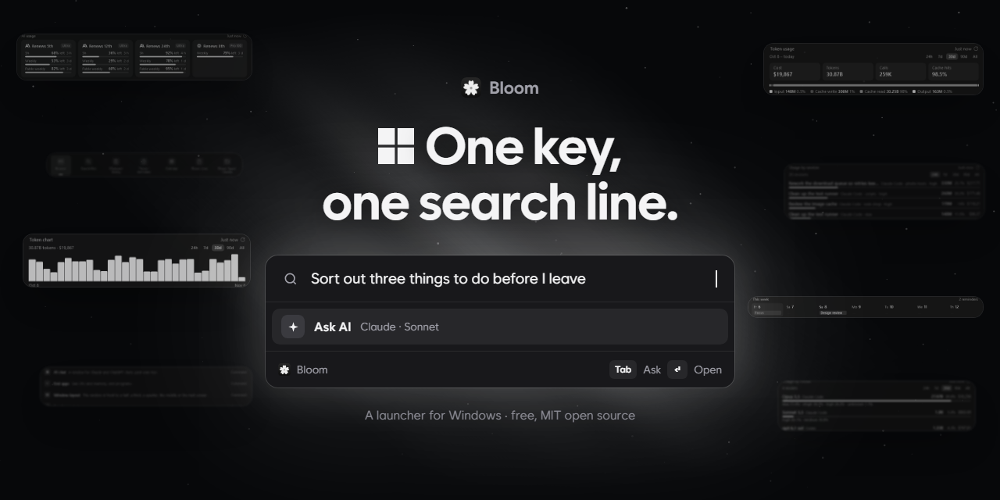
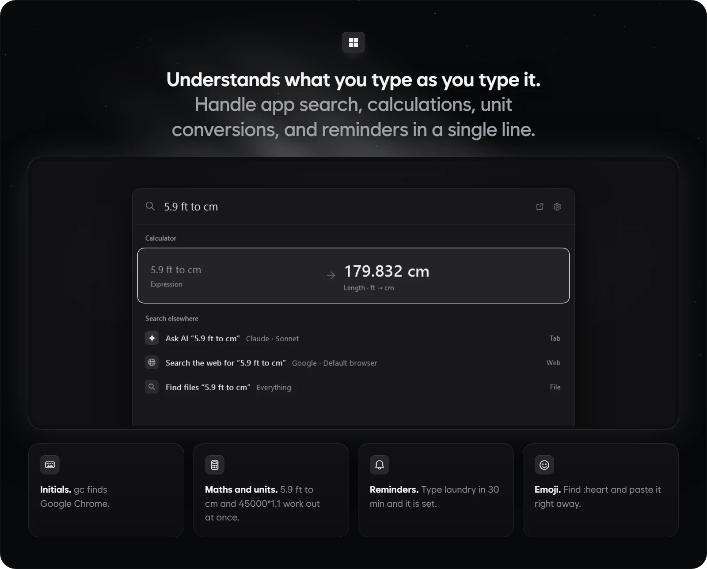
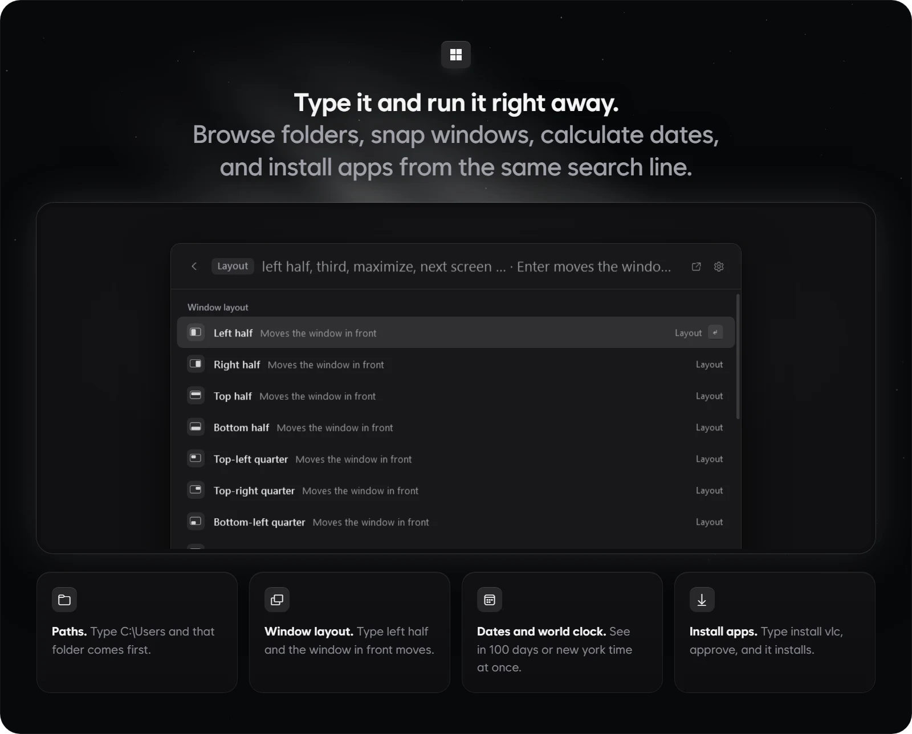
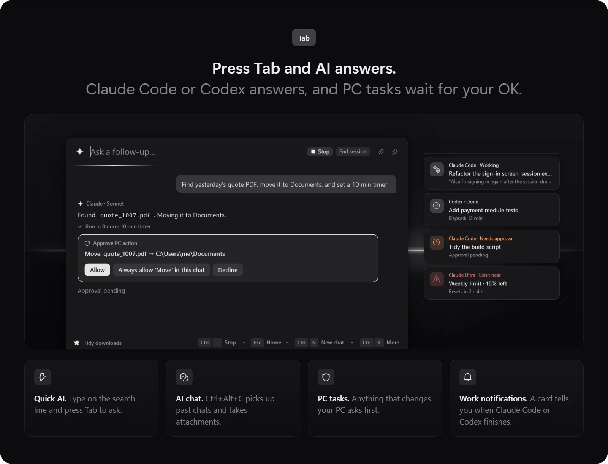
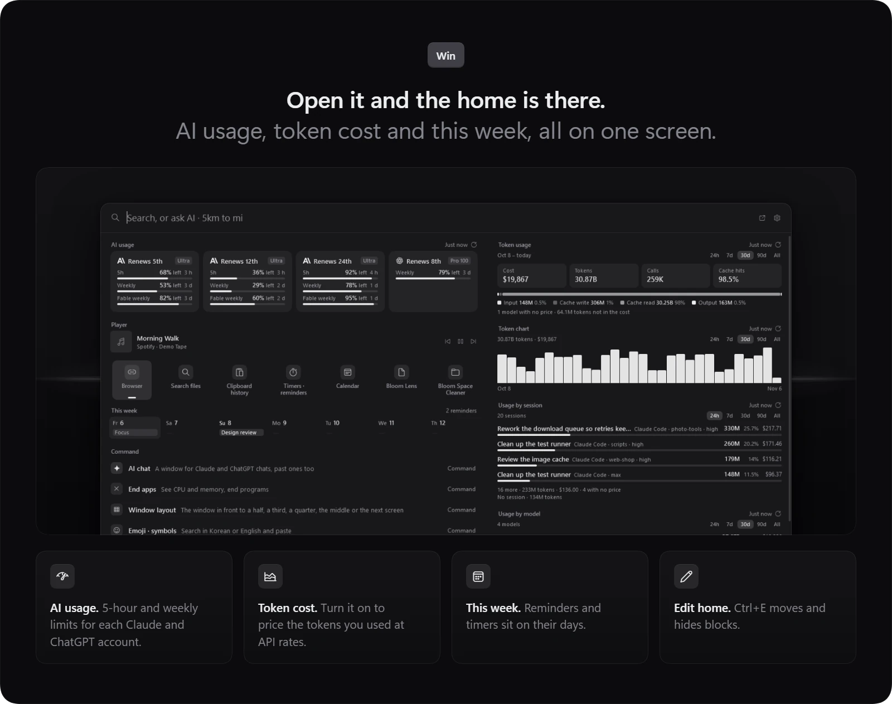
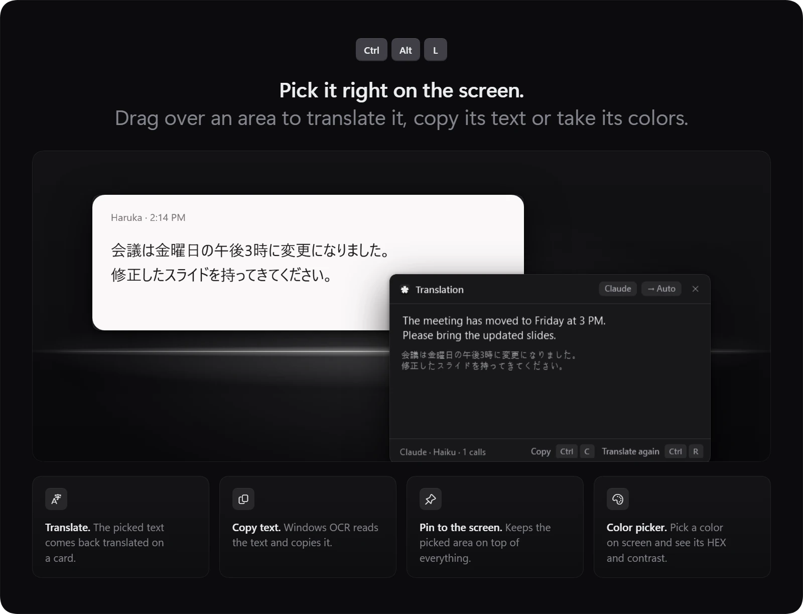
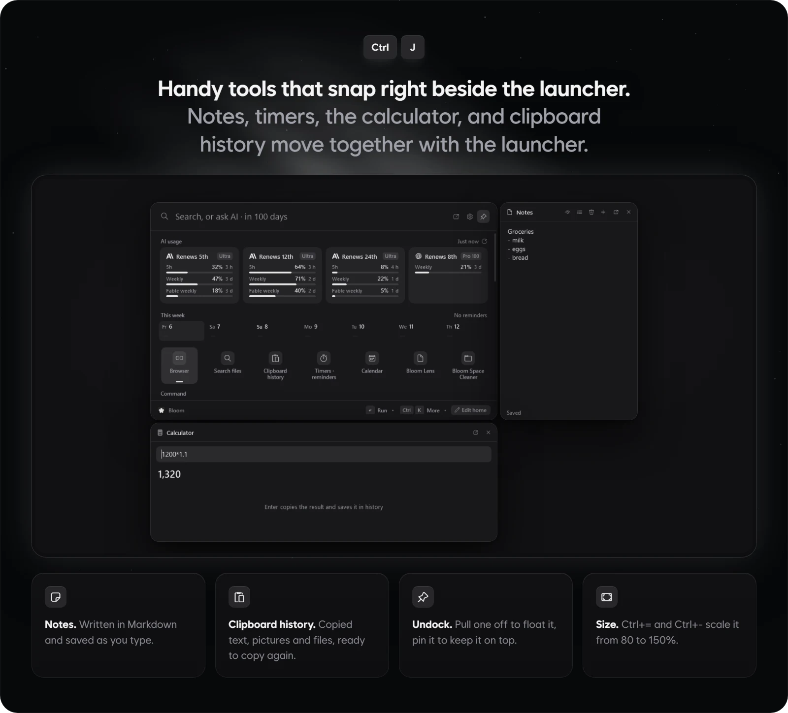
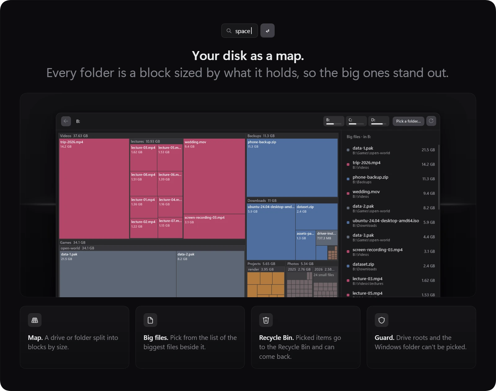
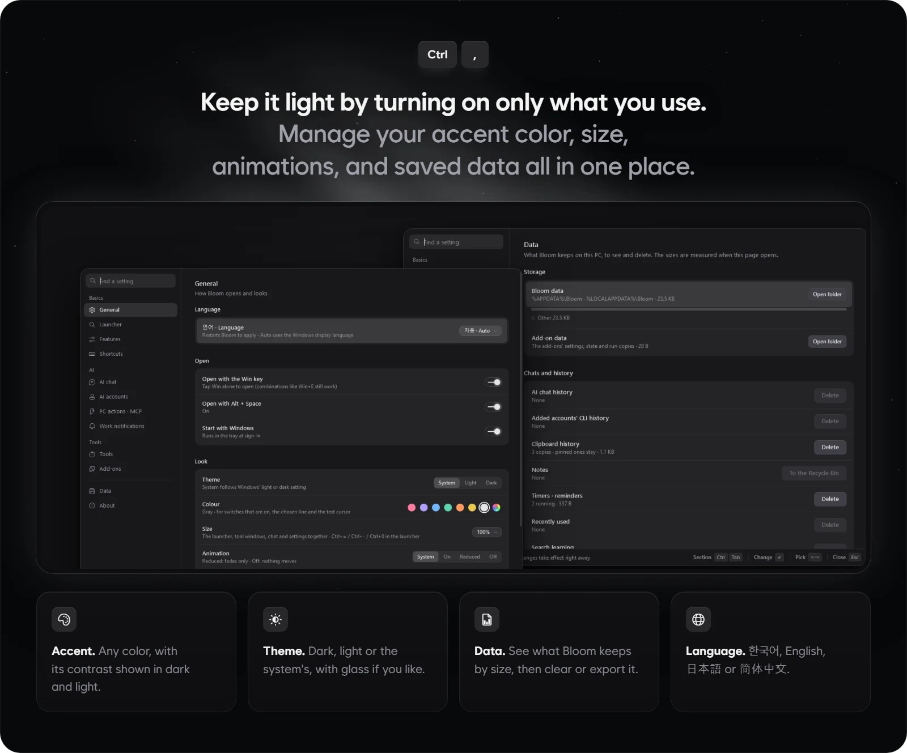
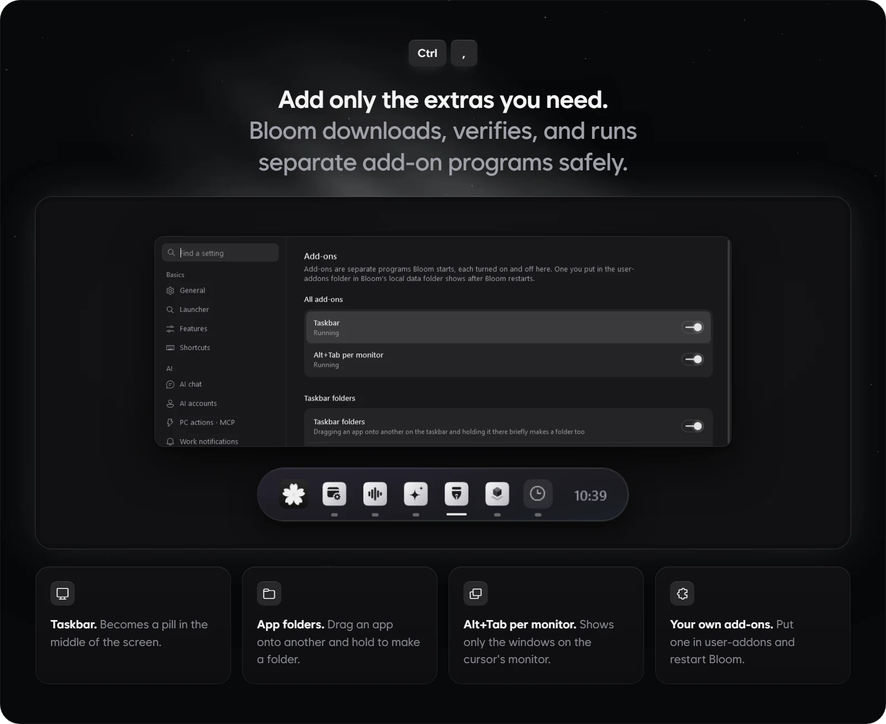

<p align="center"></p>

<p align="center">A launcher for Windows. Type what you need in the search line and press Enter to open it, or press Tab to ask AI.</p>

<p align="center">
  <a href="#download">Download</a> | <a href="#features">Features</a> | <a href="#add-ons">Add-ons</a> | <a href="#shortcuts">Shortcuts</a> | <a href="#about-the-ai-features">AI and privacy</a> | <a href="README.ko.md">한국어</a> | <a href="README.ja.md">日本語</a> | <a href="README.zh-CN.md">简体中文</a>
</p>

<p align="center">
  
</p>

<p align="center"><sub>Native WPF on .NET 10, no WebView, in English, 한국어, 日本語 and 简体中文, MIT license</sub></p>

## Why Bloom

- Press the Win key to bring up a single search line where you can launch apps, run calculations, and find files.
- Use AI right away through the Claude Code or Codex account already signed in on this PC, or with your own API key.
- Turn off any feature you don't use and it disappears from menus and shortcuts without using any memory.

## Download

**[Get Bloom for Windows](https://github.com/hyeon1035298/Bloom/releases/latest)** Download and run `BloomLauncher-win-Setup.exe` from the latest release.

You can also download and run the same installer with PowerShell.

```powershell
irm https://raw.githubusercontent.com/hyeon1035298/Bloom/main/install.ps1 | iex
```

- Runs on 64-bit Windows 10 and 11. If the .NET 10 Desktop Runtime isn't installed yet, the installer will get it for you automatically.
- Installs to `%LOCALAPPDATA%\BloomLauncher` and adds a shortcut to the Start menu.
- Because the app isn't code-signed yet, Windows may show a "Windows protected your PC" prompt during setup—click More info › Run anyway to continue.
- After launch, Bloom checks once for a newer version and applies the update the next time you start it. You can turn this off in Settings › About.
- To remove the app, go to Settings › Data › Uninstall Bloom, where you can also choose whether to delete your saved data.
- AI features require a Claude Code, Codex, or omp sign-in, or an API key. If [Everything](https://www.voidtools.com/) is installed, Bloom can search files across your entire PC in an instant.

## Features

### One search line



- Quickly find installed apps, Windows settings, and Bloom commands. You can type just the initials (`gc`), and for Korean input it also recognizes initial consonants (`ㅁㅁㅈ`) or words typed without switching the keyboard layout (`초개ㅡㄷ`).
- Type math expressions, unit conversions, or currencies like `45000*1.1`, `5.9 ft to cm`, or `100 usd` to see the answer right away, then press Enter to copy it to the clipboard.
- Set timers and reminders in plain words, such as `timer 5m` or `laundry in 30 min`.
- Find emoji by name with `:heart`, or search websites directly with a prefix like `yt cats`.
- With Everything installed, you can find any file on your PC by name right away.
- Press Ctrl+K on any search result to see all the actions you can take on it, or type `?` in an empty search line to see examples of what you can type.

### Paths, windows, dates and installs



- Type a folder path like `C:\Users` to browse its files and subfolders right inside the launcher without opening File Explorer.
- Type commands like `left half`, `maximize`, or `next screen` to snap the active window or move it to another monitor.
- Calculate dates and check world times by typing phrases like `in 100 days` or `tokyo 3pm`.
- Type `install vlc` to search winget and the Microsoft Store for an app and install it after confirming.
- Use Ctrl+K › Set a shortcut to assign your own global keyboard shortcut to any frequently used app, folder, website, or window layout.

### AI chat



- Type a question in the search line and press Tab to get an instant answer from quick AI. Press Shift+Tab to ask in a fresh chat without previous context.
- Open the dedicated AI chat window (Ctrl+Alt+C) when you want to continue a longer conversation or attach files and images.
- You can also ask AI to handle PC tasks like organizing files. Before moving files or changing anything on your PC, it shows an approval card asking you to Allow or Decline.
- Say something like "a meeting tomorrow at 3pm" and Bloom adds it to its calendar. You can save notes and start timers the same way.
- Select text in any app and press AI actions (Ctrl+Alt+A) to summarize, translate, or polish the writing and paste it right back in place.
- Work notifications pop up a card when a background Claude Code or Codex task finishes, needs your approval, or is running low on usage quota.
- Supports API keys for OpenAI, Anthropic, Gemini, OpenRouter, DeepSeek, xAI, and OpenCode Go, encrypted by Windows and stored only on this PC.

### The home



- When the search line is empty, the home view appears below it with your favorites, AI usage, this week's schedule, timers, notes, and media player.
- The AI usage block shows how much of your 5-hour and weekly quota is left for each Claude and ChatGPT account. You can add multiple accounts and monitor them side by side.
- The token block counts your local Claude Code and Codex usage logs on this PC and estimates what those tokens would cost at standard API rates. It is off by default and can be turned on whenever you need it.
- Press Ctrl+E to rearrange blocks on the home view, hide ones you don't need, or bring them back.

### Bloom Lens and the color picker



- Press Bloom Lens (Ctrl+Alt+L), drag to select a region of the screen, and press a number key to choose what to do: `1` ask, `2` translate, `3` copy text, `4` live translation, `5` pin on screen, `6` capture, or `7` color palette.
- Frequently used actions—translate (Ctrl+Alt+T) and copy text (Ctrl+Alt+O)—also have their own direct shortcuts.
- Use the color picker to sample any pixel on screen and see its HEX, RGB, and HSL values along with text contrast ratios.
- The color palette extracts the dominant colors from the selected screen area, calculated locally on your PC without using AI.

### Docked tools



- Press Ctrl+J to open small tool windows for notes, timers, the calculator, clipboard history, and the shortcut guide.
- Place a tool window near the launcher and it snaps to the side like a magnet to move together; pull it away to float it as an independent window.
- Notes support Markdown, and you can also jot one down without opening the window by typing `note buy milk` in the search line.
- Clipboard history (Ctrl+Alt+V) keeps track of text, images, and files you've copied so you can reuse them anytime.
- Press Ctrl+P to keep the launcher pinned on top of other windows, and use Ctrl+= / Ctrl+- to scale the launcher size between 80% and 150%.

### Bloom Space Cleaner



- Visualizes which files and folders take up the most space on a drive or folder as a proportional block map.
- Click blocks to drill down into subfolders, and pick large unneeded files from the list to send them straight to the Recycle Bin.
- To prevent accidental system damage, drive roots and the Windows folder cannot be selected for deletion, and anything you remove can be restored from the Recycle Bin.

### Settings



- You don't have to hunt through menus—just type a setting's name in the search line to jump straight to that page.
- Pick any accent color you like and preview how readable text looks against it in both dark and light themes.
- Turning off a feature removes it cleanly from menus and shortcuts while keeping your existing saved data intact.
- On the Data page, you can see how much space each kind of saved data uses, delete specific items, or export them as a backup.
- With custom commands, you can bind frequently used scripts, text snippets, or chained commands (`notepad ; volume 30 ; yt lofi`) to a single keyword.
- Choose your interface language from English, 한국어, 日本語, and 简体中文.
- Problem report masks your username and email address in the log, copies it to the clipboard, and opens the GitHub issue page. Bloom never sends any data on its own.

## Add-ons



Add-ons are separate programs that you can download, verify, and run from within Bloom. Their code is not built into Bloom itself, and the two official add-ons currently available are released under GPL-3.0 in their own source repositories.

### Taskbar (PillTaskbar)


- Transforms the default Windows 11 taskbar into a translucent glass pill floating at the center of the screen.
- Drag one app icon onto another on the taskbar to group them into a folder, and edit folder names and contents in Settings › Add-ons.
- Replaces the Start button with Bloom's flower button and displays the currently playing song in front of the system tray.
- Displays a remaining AI usage bar on the taskbar for each of your registered accounts.
- Turn on the auto-hide island option to hide the taskbar when idle and show a compact island bar at the top center of the screen.
- On first launch, it downloads the required symbol files (about 70 MB) once from Microsoft's symbol server.

### Alt+Tab per monitor

When you use multiple monitors, pressing Alt+Tab opens the window switcher on the monitor where your mouse cursor is and shows only the windows on that monitor.

### How add-ons are installed

- Download any add-on with a single button in Settings › Add-ons.
- Bloom installs the downloaded file only if it matches the SHA-256 hash pinned in the app.
- Newly downloaded add-ons start turned off, and turning one on first explains what the program does.
- Bloom checks for updates to your add-ons when you turn them on and whenever Bloom starts.
- If an add-on ever causes an issue, hold Shift while starting Bloom to skip all add-ons for that session.

### Your own add-ons

Place your own add-on in `%LOCALAPPDATA%\Bloom\user-addons` and restart Bloom to see it in Settings › Add-ons. It starts turned off, and Bloom verifies that its files haven't been altered against the SHA-256 hash in `addon.json` before running it.

## Shortcuts

| Keys | What it does |
| --- | --- |
| `Win` or `Alt+Space` | Open Bloom (`Win` over apps run as administrator needs Settings › General › Win key over admin apps) |
| `Tab` / `Shift+Tab` | Ask AI what is in the search line, in the same chat or a new one |
| `Ctrl+K` | Everything you can do with the picked result |
| `Ctrl+1` … `Ctrl+9` | Favorites |
| `Ctrl+J` | Tools (notes, timers, calculator, clipboard history, shortcuts) |
| `Ctrl+P` | Keep the launcher on top |
| `Ctrl+E` | Edit the home |
| `Ctrl+,` | Settings |
| `?` | In an empty search line, what Bloom understands by kind |
| `Ctrl+=` / `Ctrl+-` / `Ctrl+0` | Bigger, smaller, 100 % |
| `Esc` | Back, then clear the text, then close (the quick AI's answer keeps going) |
| `Ctrl+.` | Stop the quick AI's answer |
| `Ctrl+Alt+C` | AI chat window |
| `Ctrl+Alt+A` | AI actions |
| `Ctrl+Alt+L` | Bloom Lens |
| `1` … `7` | In Bloom Lens, ask AI, translate, copy text, live translation, pin, capture, color palette |
| `←` `→` / `−` `+` / `Enter` | In the color palette, pick a color, fewer or more colors, copy the HEX |
| `Ctrl+Alt+T` / `Ctrl+Alt+O` | Translate the screen, copy text from the screen |
| `Ctrl+Alt+V` | Clipboard history |

Change or switch off the global shortcuts on Settings › Shortcuts. Click one and press the keys, or press Backspace to turn it off. Window switching, emoji, the color picker, asking AI about the screen, live translation and capture can have one too, and they are off at first.

## About the AI features

Bloom's AI uses the official CLIs installed and signed in on this PC, or API keys you add. Sign-ins stay with those CLIs, and usage and terms are those of your own accounts. Without them only the AI features are off.

- Claude uses the [Claude Code](https://docs.anthropic.com/en/docs/claude-code) CLI (`claude`).
- ChatGPT uses the [Codex CLI](https://github.com/openai/codex) (`codex`).
- omp is optional and uses the [oh-my-pi](https://github.com/can1357/oh-my-pi) CLI (`omp`).
- API keys are encrypted by Windows, stay on this PC and go only to their own provider.

Only what you send reaches the AI, which means your question, attached files, the screen area picked with Bloom Lens, the text to translate and what the PC tool returns. Claude reads and writes files only inside that chat's folder (`%LOCALAPPDATA%\Bloom\ai\files\<chat>`). Codex and omp don't handle files themselves, so text attachments go in the message and files they make are saved from the answer.

<details>
<summary>PC actions, MCP servers, usage lookups, token logs and update checks</summary>

#### The pc tool

Bloom offers one tool, `pc`, through an MCP server that only this Windows user can open on this PC (`Bloom.exe --mcp`, a named pipe). Its five groups are switched on or off in Settings › PC actions · MCP.

- Look up apps, files (Everything), recent files, windows, timers and events, notes and custom commands. Look-ups run without asking.
- Open apps, files and sites, run a search line such as `volume 30`, and run custom commands.
- Write in Bloom's notes, start timers and put events on the calendar.
- Rename, move, copy and send files to the Recycle Bin.
- Read and write the clipboard.

Everything except look-ups waits for Allow or Decline on a card in the chat, and the result stays under the answer as ✓ or ✕. Claude Code asks through `--permission-prompt-tool stdio`. Codex and omp can't ask by themselves, so Bloom's MCP server shows the same card right before acting.

The tool definition adds about 250 to 500 input tokens per request, and switching groups off lowers that. Codex gets the server per chat run through `-c mcp_servers.bloom…` only. omp gets it in the chat's own `.omp/mcp.json` under `%LOCALAPPDATA%\Bloom\ai\omp-work`, and nothing is written to omp's own settings.

#### Other MCP servers

MCP servers already set up for Claude Code, Claude Desktop, Cursor, VS Code, Windsurf or Codex, and in the `.mcp.json` of projects opened with Claude Code, show on the same page with one switch each. They are off at first, and only the ones switched on are loaded (`--strict-mcp-config`). Each of their actions asks on the same card, and for ChatGPT a Bloom relay (`Bloom.exe --mcp-proxy`) handles that. Their settings are read from the original files each time.

#### Usage lookups

AI usage comes from `claude -p /usage`, which makes no model call, and from the limit lookup of `codex app-server`, one account at a time. Added accounts keep their own folders under `%LOCALAPPDATA%\Bloom\accounts` (`CLAUDE_CONFIG_DIR` or `CODEX_HOME`). The optional lightweight ChatGPT mode sends one HTTPS request to the endpoint Codex's own status reads, with that account's Codex sign-in. It is not an official API, and Bloom refreshes tokens only in folders it made, never in `~/.codex`. Bloom never reads Claude sign-ins.

Settings › AI accounts › Write the usage to a file (off at first) writes the percentages used, the reset times, the account names you gave and each account's taskbar choices to `%LOCALAPPDATA%\Bloom\export\ai-usage.json` for other programs on this PC, such as the taskbar add-on. No e-mail or sign-in is in it.

#### Logs and token counts

Work notifications read the local Claude Code and Codex logs (`~/.claude/sessions`, `~/.codex/sessions`), and the logs stay on this PC.

The token blocks read the Claude Code and Codex logs of every account on this PC. Bloom keeps only hourly sums per model, effort and session in `%LOCALAPPDATA%\Bloom\tokens`, with each session's title and the name of its last folder, never the messages or full paths. The first count reads all the logs once in the background, and later counts read only what was added. Claude Code deletes its logs after 30 days, so longer spans fill up from the day Bloom started counting. The cost is what the same tokens would cost at the providers' API prices, not what you paid, and Settings › AI accounts › Edit prices opens `prices.json` to change them.

#### Update checks

Update checks ask GitHub's API (`api.github.com`) for this repository's latest release and download new versions from GitHub. The request carries repository information only. Switch checking off in Settings › About.

</details>

## Install and build

<details>
<summary>Build from source, data folders and releases</summary>

To use Bloom, take the setup from [Download](#download). To build it you need Windows 10 or 11 and the [.NET 10 SDK](https://dotnet.microsoft.com/download). `tools\package.ps1` also needs the C++ build tools (Visual Studio's "Desktop development with C++") for the Win key helper.

```powershell
dotnet build src\Bloom\Bloom.csproj -c Release
# or make an installed copy
powershell -File tools\package.ps1   # → dist\app
powershell -File tools\install.ps1   # → %LOCALAPPDATA%\Programs\Bloom, Start menu shortcut
```

Data lives in `%APPDATA%\Bloom` and `%LOCALAPPDATA%\Bloom`. For development, `Bloom.exe --data <folder>` uses another data folder, and `--lang ko|en` fixes the language. Automatic updates need the setup install, so update a copy made with `tools\install.ps1` by hand.

To make a release, raise `<Version>` in `src/Bloom/Bloom.csproj`, write what changed under `## <Version>` in `CHANGELOG.md`, push, then run Actions › Release › Run workflow on GitHub. It downloads and checks every add-on in `addons/catalog.json`, runs the tests, builds, packs the setup and update packages with [Velopack](https://velopack.io) and publishes them as `v<Version>`.

</details>

## Code structure

<details>
<summary>Folders, conventions, tests and lint</summary>

Under `src/Bloom`, one folder is one feature. Big classes are split into `partial` files by topic.

| Folder | What's in it |
| --- | --- |
| `App/` | `Host` (start, shortcuts, commands, Lens, timers, custom commands, file actions), work notifications (`Notices`), updates (`Updates`, Velopack), run options, tray, the Win key hook and its helper for admin apps (`src/WinKeyHelper`, NativeAOT) |
| `App/Engine/` | What the search line shows, from the root search and home blocks to each view (files, clipboard, calendar, timers, colors) |
| `App/Mcp/` | The MCP server, the relay and the `pc` tool |
| `App/Qa/` | Off-screen capture QA (`--capture <folder> --qa-set <set> --data <folder> --lang en`) |
| `Addons/` | Add-ons as separate programs. The pinned catalog and downloads (`AddonCatalog`, `AddonDownload`), `addon.json` checks (`AddonManifest`), the hash-checked run copy (`AddonStore`), starting and stopping the host process (`AddonRunner`) and the shared names (`AddonProtocol`). Bloom never loads add-on code |
| `Core/` | Saved data (settings, favorites, usage, learning, timers, notes, colors), JSON storage, Korean search, matching, the interface language (`Lang`) |
| `Search/` | App list, calculator (sums, units, currencies), Everything, open windows, recent files, emoji and symbols, system items, custom commands, result models |
| `Ai/` | Claude Code, Codex and omp CLI sessions and chats, one-shot asks, translation, AI actions, usage (`AiUsage`), work logs (`ClaudeWatch`, `CodexWatch`) |
| `Ai/Api/` | API key chats, their providers and the MCP client for other servers |
| `Ocr/` | Picking a screen area, Windows OCR, the translation window, picking colors |
| `Music/` | The mini player, playlists and songs playing in other apps |
| `Clip/`, `Space/`, `Browser/` | Clipboard history, the disk space map, handing off to the browser |
| `Native/` | Win32 calls (System32 DLLs only), WinRT calls, system toggles (`SystemControl`), Explorer-style file operations (`ShellFiles`) |
| `Ui/Launcher/` | The launcher window, with every view's chips, hints and results in `Launcher.ViewSpecs.cs` |
| `Ui/Chat/`, `Ui/Player/` | The AI chat window and the mini player window |
| `Ui/Settings/` | The settings window, including the add-on pages and the taskbar folders editor |
| `Ui/Tools/` | Tool windows, their placement, attaching and snapping (`ToolDock`), and notes, timers, calculator and clipboard |
| `Ui/Controls/`, `Ui/Theme/` | Shared controls (`SmoothBorder` for G2 corners, `Dropdown`, `PopupMenu`, `AccentPicker`) and the theme (`Motion` for animation) |
| `tests/Bloom.Tests` | Automated tests as a console run without a test framework |

A new feature splits into `Engine.<feature>.cs` for results, one view line in `Launcher.ViewSpecs.cs` and `Core/<feature>.cs` for storage when needed.
Every piece of text on screen is written as `Tr("한국어", "English")`. Japanese and Simplified Chinese come from `src/Bloom/Assets/Lang/ja.tsv` and `zh.tsv`, keyed by the English text. `python tools/lang.py check` lists what they miss, and `todo ja` lists the texts still to translate. Search keywords and parser data keep Korean and English.
Screen text follows [docs/COPY.md](docs/COPY.md).
QA and development runs always use `--data <temporary folder>`, apart from the real data.

```powershell
# tests (exit code = failures)
dotnet run --project tests\Bloom.Tests
# lint (analyzers and formatting), zero warnings
dotnet build src\Bloom\Bloom.csproj -c Debug --no-incremental -p:AnalysisLevel=latest-recommended -p:EnforceCodeStyleInBuild=true
dotnet build tests\Bloom.Tests\Bloom.Tests.csproj -c Debug --no-incremental -p:AnalysisLevel=latest-recommended -p:EnforceCodeStyleInBuild=true
dotnet format whitespace src\Bloom\Bloom.csproj --verify-no-changes
dotnet format whitespace tests\Bloom.Tests\Bloom.Tests.csproj --verify-no-changes
```

For a bounded responsiveness probe, run the Release build with `--data <isolated-folder> --no-hook --no-tray --qa-responsive 3`. It writes `responsiveness.json` and `responsiveness.txt`.

</details>

## License

Bloom is under the MIT license. See [LICENSE](LICENSE).

Exchange rates come from [Rates By Exchange Rate API](https://www.exchangerate-api.com).

The taskbar add-on PillTaskbar ([source](https://github.com/hyeon1035298/PillTaskbar_BloomAddon)) and the Alt+Tab per monitor add-on ([source](https://github.com/hyeon1035298/AltTabPerMonitor_BloomAddon)) are separate programs under GPL-3.0, and Bloom itself stays MIT.

The OpenAI and Anthropic logos in `src/Bloom/Assets/Logos` are trademarks of their owners and are not covered by the MIT license. Bloom shows them only to mark which service an AI usage account belongs to.

Bloom is an unofficial personal project, not affiliated with Anthropic, OpenAI, voidtools or Raycast.
