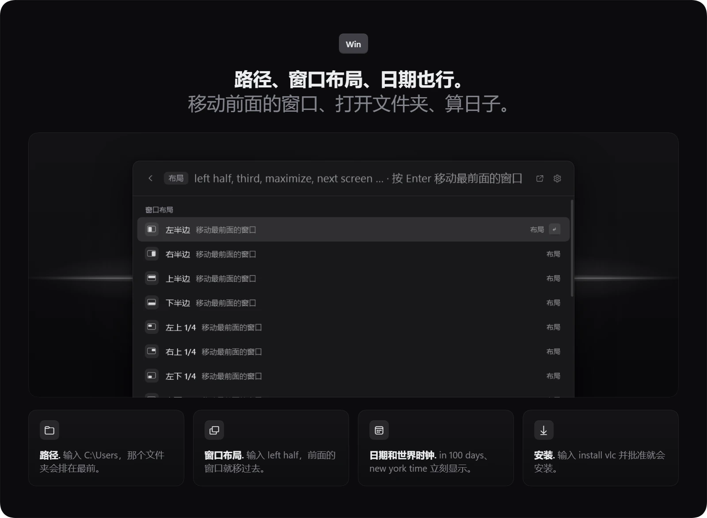

<p align="center"></p>

<p align="center">Bloom 是一款 Windows 原生启动器，在一个搜索栏里就能打开应用、计算、查找文件、和 AI 聊天，还能翻译屏幕。</p>

<p align="center">
  <a href="#下载">下载</a> | <a href="#功能">功能</a> | <a href="#加载项">加载项</a> | <a href="#快捷键">快捷键</a> | <a href="#关于-ai-功能">AI 与隐私</a> | <a href="README.md">English</a> | <a href="README.ko.md">한국어</a> | <a href="README.ja.md">日本語</a>
</p>

<p align="center">
  
</p>

<p align="center"><sub>基于 .NET 10 的原生 WPF，不使用 WebView，支持 English、한국어、日本語 和简体中文，MIT 许可证</sub></p>

## 为什么用 Bloom

- 按一个键打开，一个搜索栏能回答很多事。
- AI 使用你自己的 Claude Code 或 Codex 登录，也可以用你添加的 API 密钥。
- 关闭的功能会从菜单中消失，释放它的快捷键，也不再占用内存。

## 下载

**[下载 Windows 版 Bloom](https://github.com/hyeon1035298/Bloom/releases/latest)**，运行最新版本中的 `BloomLauncher-win-Setup.exe`。

也可以在 PowerShell 中运行下面这行，它会下载同一个安装程序并启动（[install.ps1](install.ps1)）。

```powershell
irm https://raw.githubusercontent.com/hyeon1035298/Bloom/main/install.ps1 | iex
```

- 需要 64 位的 Windows 10 或 11。电脑上没有 .NET 10 桌面运行时时，安装程序会一并安装，这一步 Windows 会请求授权。
- Bloom 只为当前账户安装，位置是 `%LOCALAPPDATA%\BloomLauncher`，并在开始菜单添加快捷方式。
- 卸载请用 设置 › 数据 › 卸载 Bloom，它会询问是否同时删除 `%APPDATA%\Bloom` 中的数据。通过 Windows 设置 › 应用 卸载时，数据会保留。
- Bloom 没有代码签名，SmartScreen 可能显示“Windows 已保护你的电脑”。请选择“更多信息”，再选“仍要运行”。
- Bloom 启动后会检查一次本仓库的最新版本。新版本在后台下载，下次启动时生效，也可以用“重启以更新”立即更新。检查更新和它的开关在 设置 › 关于 中。

## 功能

### 一个搜索栏


- 输入名称的一部分或首字母，即可打开应用、Windows 设置页面和 Bloom 命令（`gc` 打开 Google Chrome）。也能识别韩语初声（`ㅁㅁㅈ` 对应 메모장），以及忘了切换韩语输入法时打出的单词。
- 计算、单位和货币随输入实时更新，按 Enter 复制结果。可以试试 `45000*1.1`、`5!`、`5.9 ft to cm` 或 `100 usd`。
- 计时器和提醒能读懂日常的时间说法，如 `timer 5m`、`laundry in 30 min` 和 `remind me at 3pm to call`。它们会显示在日历和主页的“本周”中。
- 表情符号和符号可以用英文或韩文名称查找（`:heart`、`arrow`、`celsius`）。
- 其他内容会交给浏览器做网页搜索，加上关键词则在对应网站内搜索（`yt cats`、`gh bloom`）。也可以创建自己的网站快捷方式。
- 安装了 [Everything](https://www.voidtools.com/) 时，按文件名即时找到文件并可预览。没有它时，Bloom 从 Windows 的最近文件中查找。
- 已打开的窗口可以按标题找到，按 Enter 切换过去。
- 在任意结果上按 Ctrl+K，会列出能对它做的事，比如像资源管理器那样重命名、移动或复制文件。只输入 `?`，可以看到 Bloom 能理解的所有输入。

### 路径、窗口、日期和安装



- 输入 `C:\Users`、`~\Downloads` 或 `%APPDATA%` 这样的路径，会显示该文件夹和其中的内容。按 Enter 在资源管理器中打开。
- `left half`、`right third`、`top-left quarter`、`maximize`、`center` 和 `next screen` 会移动最前面的窗口，并且不遮挡任务栏。
- 日期和世界时钟能回答 `in 100 days`、`days until christmas`、`2026-01-01 ~ 2026-12-25` 和 `tokyo 3pm`。
- `install vlc` 在 winget 和 Microsoft Store 中搜索，先询问，再在后台安装，结果显示在卡片上。
- 用 Ctrl+K › 设置快捷键… 可以给应用、文件夹、文件、网站、命令或窗口布局指定专属的全局快捷键。
- 右键单击应用或按 Ctrl+K，可以卸载它。

### AI 聊天


- 输入问题后按 Tab，就在启动器里用快速 AI 提问。Shift+Tab 开始新聊天，按 Esc 返回时回答仍会继续。
- AI 聊天窗口（Ctrl+Alt+C）按分组保存过去的聊天，可以附加文件和图片。
- 回答来自本机已登录的 Claude Code 或 Codex CLI，安装了 [omp](https://github.com/can1357/oh-my-pi) 时也可以用它，或者使用 OpenAI、Anthropic、Gemini、OpenRouter、DeepSeek、xAI 或 OpenCode Go 的 API 密钥。密钥由 Windows 加密，只发送给对应的服务。
- 可以把电脑上的事交给 AI，比如“把昨天收到的报价单 PDF 移到文档”。每个会更改内容的操作，都要在聊天中的卡片上选择允许或拒绝。
- “把购物清单写进笔记”“25 分钟计时器”“明天下午 3 点开会”会进入 Bloom 自己的笔记、计时器和日历。
- AI 操作（Ctrl+Alt+A）在任意应用中对选中的文字做总结、翻译、润色或改写，然后粘贴回去。
- Claude Code 或 Codex 的任务开始、完成、等待批准或接近额度时，工作通知会弹出卡片并播放提示音。点击卡片会转到任务所在的窗口。打开“在通知卡片上批准”后，可以直接在卡片上允许或拒绝 Claude Code 的请求。

### 主页


搜索栏为空时显示主页，包括收藏、AI 用量、本周、计时器、最近使用、笔记、播放器和命令。

- AI 用量卡片显示 Claude 和 ChatGPT 的 5 小时与每周额度，以及 Claude 的 Fable 每周额度。每张卡片带有所属公司的标志和套餐标签，登录过期时会提供“重新登录”。
- 在 设置 › AI 账户 中，每种账户都可以添加多个。每个账户用 CLI 自己的登录方式登录，不会自动切换账户。
- 4 个 token 区块统计本机 Claude Code 和 Codex 日志中的 token，并显示按 API 价格折算的金额、图表，以及用得最多的模型和会话。它们默认关闭。
- 收藏用 Ctrl+1 到 Ctrl+9 打开，可以用文件夹分组。
- 按 Ctrl+E 编辑主页。可以拖动区块、隐藏区块、从“+ 添加区块”放回，启动器较宽时还能分成两栏。

### Bloom Lens 和取色器


- Bloom Lens（Ctrl+Alt+L）让你拖选屏幕上的一块区域，再用 1 到 7 键选择要做的事。
  - `1` 问 AI，`2` 翻译，`3` 用 Windows OCR 复制文字，`4` 在区域变化时实时翻译
  - `5` 把区域作为图片固定到屏幕，`6` 截图到剪贴板和“屏幕截图”文件夹，`7` 生成调色板
- 翻译（Ctrl+Alt+T）和复制文字（Ctrl+Alt+O）有各自的快捷键。
- 取色器用放大镜从屏幕取色，显示 HEX、RGB、HSL，以及与白色和黑色文字的对比度。
- 调色板提取区域中的主要颜色，默认 5 种，用 − 和 + 可调为 3 到 10 种。它在本机计算，不消耗 AI 用量。

### 附着的工具


- Ctrl+J 以小窗口打开笔记、计时器、计算器、剪贴板记录和快捷键。
- 把工具放到启动器旁边，它就会附着在那里，随启动器移动和隐藏。拉开后单独浮动。
- 笔记用 Markdown 书写，支持清单。在搜索栏输入 `note buy milk` 就能立即存一条。
- 剪贴板记录（Ctrl+Alt+V）保存复制过的文字、图片和文件，想保留的可以置顶。
- Ctrl+P 让启动器保持在最上层。拖动边缘可调整大小，Ctrl+= 或 Ctrl+- 把整个 Bloom 缩放到 80 % 到 150 %。
- Bloom 用自己的文档窗口打开 .md 文件，边输入边保存。

### Bloom Space Cleaner


- Bloom Space Cleaner 把驱动器或文件夹显示为一张地图，每个方块的大小与其中的内容成比例。
- 单击方块进入其中，旁边的列表可以把大文件移到回收站。
- 它只处理驱动器根目录以下、Windows 文件夹以外的内容，删除的东西都能从回收站恢复。

### 设置


- 设置共有 12 个页面，从“常规”“启动器”到“加载项”“数据”和“关于”。在搜索栏输入设置名称即可直接跳到那里。
- 强调色可以是任意颜色。选择器会显示它在深色和浅色主题下的对比度，强调色只用在已开启的东西上。
- “数据”页面列出 Bloom 在本机保存的内容和大小，可以逐项删除，也可以重置 Bloom。
- 在“功能”中可以关闭不用的功能，已保存的数据会保留。
- 自定义命令用关键词运行脚本、粘贴文本片段（`{date}`、`{clipboard}`），或依次运行多行搜索（`notepad ; volume 30 ; yt lofi`）。
- 外观可以跟随深色、浅色或系统主题，并有动画和玻璃效果的设置。GPU 绘制是实验功能，默认关闭。
- 界面提供 English、한국어、日本語 和简体中文，默认跟随 Windows。无论界面语言是什么，搜索词、时间和单位都用英语或韩语输入。
- 把设置导出为一个文件，就能搬到另一台电脑。设置 › 关于 › 问题报告 会复制版本和最近的日志（隐藏用户名和电子邮件地址），然后打开 GitHub 的 issue 页面。Bloom 本身不发送任何内容。

## 加载项


加载项是独立的程序，由 Bloom 下载、校验、启动，并通过文件与它通信。Bloom 里没有它们的任何代码，所以 Bloom 仍是 MIT。下面两个加载项都采用 GPL-3.0，各有自己的源代码仓库。

### 任务栏（PillTaskbar）

PillTaskbar 把 Windows 11 的任务栏变成居中的玻璃胶囊。开启后，它的设置位于 设置 › 加载项。

- 任务栏文件夹可以新建、重命名、设置图标、添加和移出应用、调整顺序，也可以取消分组。把一个应用拖到另一个应用上停留片刻，也会生成文件夹。
- 自动的“运行中文件夹”会收集没有固定但正在运行的应用。
- 外观可以调整大小、背景，以及显示为 Bloom 花朵、点击打开 Bloom 的开始按钮。
- 胶囊末端是托盘图标、24 小时制或 12 小时制的时钟，以及正在播放的歌曲。
- AI 用量为每个账户显示一项额度，可以选 5 小时、每周或 Fable 每周，并设置标签和图标颜色。
- 自动隐藏小岛会隐藏任务栏，在屏幕顶部中央显示一个黑色或白色的浮岛。

首次启动时，它会从 Microsoft 的符号服务器下载任务栏的符号文件（约 70 MB）。如果资源管理器反复崩溃，Bloom 会关闭这个加载项并告知原因。

### 按显示器 Alt+Tab

有多台显示器时，Alt+Tab 和 Win+Alt+Tab 会在光标所在的显示器上打开，并且只列出那台显示器上的窗口。

### 加载项的安装方式

- 在 设置 › 加载项 中，每个加载项只需一个“下载”按钮，并显示进度。
- 只有当 zip 的 SHA-256 与当前 Bloom 固定的值一致，并且每个文件都与 `addon.json` 相符时，Bloom 才会安装。下载失败时不会留下任何文件，并说明原因。
- 更新的 Bloom 固定了更新的版本时，同一行会出现“更新”。
- 加载项默认关闭，第一次开启时会说明它的作用。
- 如果 Windhawk 中正在运行同一个模组，状态行会说明情况和处理办法。
- Bloom 启动时按住 Shift，这一次会跳过加载项。加载项和“随 Windows 启动”都开启时，会用你自己的登录任务更早启动 Bloom。

### 自己的加载项

放在 `%LOCALAPPDATA%\Bloom\user-addons` 中的加载项，重启后会出现在 设置 › 加载项。它默认关闭，第一次开启时会提醒它不是 Bloom 制作或校验的。它的文件仍会按其 `addon.json` 中的 SHA-256 校验。

## 快捷键

| 按键 | 作用 |
| --- | --- |
| `Win` 或 `Alt+Space` | 打开 Bloom（要在以管理员身份运行的应用上用 `Win`，需开启 设置 › 常规 › 在管理员应用上也使用 Win 键） |
| `Tab` / `Shift+Tab` | 把搜索栏中的内容问 AI，在同一个聊天或新聊天中 |
| `Ctrl+K` | 所选结果能做的所有事 |
| `Ctrl+1` … `Ctrl+9` | 收藏 |
| `Ctrl+J` | 工具（笔记、计时器、计算器、剪贴板记录、快捷键） |
| `Ctrl+P` | 让启动器保持在最上层 |
| `Ctrl+E` | 编辑主页 |
| `Ctrl+,` | 设置 |
| `?` | 在空搜索栏中按类别列出 Bloom 能理解的输入 |
| `Ctrl+=` / `Ctrl+-` / `Ctrl+0` | 放大、缩小、100 % |
| `Esc` | 返回，再清除输入，再关闭（快速 AI 的回答会继续） |
| `Ctrl+.` | 停止快速 AI 的回答 |
| `Ctrl+Alt+C` | AI 聊天窗口 |
| `Ctrl+Alt+A` | AI 操作 |
| `Ctrl+Alt+L` | Bloom Lens |
| `1` … `7` | 在 Bloom Lens 中，问 AI、翻译、复制文字、实时翻译、固定到屏幕、截图、调色板 |
| `←` `→` / `−` `+` / `Enter` | 在调色板中，选择颜色、减少或增加颜色、复制 HEX |
| `Ctrl+Alt+T` / `Ctrl+Alt+O` | 翻译屏幕、复制屏幕上的文字 |
| `Ctrl+Alt+V` | 剪贴板记录 |

全局快捷键可以在 设置 › 快捷键 中更改或关闭。单击一项后按下按键，按 Backspace 则关闭它。切换窗口、表情符号、取色器、就屏幕问 AI、实时翻译和截图也可以设置快捷键，它们默认关闭。

## 关于 AI 功能

Bloom 的 AI 使用本机已安装并登录的官方 CLI，或你添加的 API 密钥。登录凭据留在这些 CLI 中，用量和条款以你自己的账户为准。没有它们时，只有 AI 功能不可用。

- Claude 使用 [Claude Code](https://docs.anthropic.com/en/docs/claude-code) CLI（`claude`）。
- ChatGPT 使用 [Codex CLI](https://github.com/openai/codex)（`codex`）。
- omp 是可选的，使用 [oh-my-pi](https://github.com/can1357/oh-my-pi) CLI（`omp`）。
- API 密钥由 Windows 加密，留在本机，只发送给对应的服务。

发送给 AI 的只有你发出的内容，也就是你的问题、附件、用 Bloom Lens 选中的屏幕区域、要翻译的文字，以及电脑工具返回的结果。Claude 只在该聊天的文件夹（`%LOCALAPPDATA%\Bloom\ai\files\<chat>`）内读写文件。Codex 和 omp 不直接处理文件，所以文本附件会放进消息里，它们生成的文件从回答中取出保存。

<details>
<summary>电脑操作、MCP 服务器、用量查询、token 日志和检查更新</summary>

#### pc 工具

Bloom 通过一个只有本机当前 Windows 用户能打开的 MCP 服务器（`Bloom.exe --mcp`，命名管道）提供一个工具 `pc`。它的 5 个分组可以在 设置 › 电脑操作 · MCP 中分别开关。

- 查询应用、文件（Everything）、最近的文件、窗口、计时器和日程、笔记以及自定义命令。查询无需确认。
- 打开应用、文件和网站，运行 `volume 30` 这样的搜索栏输入，运行自定义命令。
- 写入 Bloom 的笔记，启动计时器，在日历中添加日程。
- 重命名、移动、复制文件，以及把文件移到回收站。
- 读取和写入剪贴板。

除查询外的所有操作，都要在聊天中的卡片上选择允许或拒绝，结果以 ✓ 或 ✕ 留在回答下方。Claude Code 通过 `--permission-prompt-tool stdio` 询问。Codex 和 omp 无法自行询问，所以由 Bloom 的 MCP 服务器在执行前显示同样的卡片。

工具定义每次请求约增加 250 到 500 个输入 token，关闭分组可以减少。Codex 只在每次聊天运行时通过 `-c mcp_servers.bloom…` 获得这个服务器。omp 则写在 `%LOCALAPPDATA%\Bloom\ai\omp-work` 下该聊天自己的 `.omp/mcp.json` 中，不会写入 omp 自身的设置。

#### 其他 MCP 服务器

为 Claude Code、Claude Desktop、Cursor、VS Code、Windsurf 或 Codex 配置的 MCP 服务器，以及用 Claude Code 打开的项目的 `.mcp.json` 中的服务器，会显示在同一页面，每个一个开关。它们默认关闭，只加载已开启的服务器（`--strict-mcp-config`）。它们的每个操作都在同样的卡片上询问，ChatGPT 由 Bloom 的中继（`Bloom.exe --mcp-proxy`）处理。它们的设置每次都从原始文件读取。

#### 用量查询

AI 用量来自 `claude -p /usage`（不调用模型）和 `codex app-server` 的额度查询，每次查询一个账户。添加的账户在 `%LOCALAPPDATA%\Bloom\accounts` 下有各自的文件夹（`CLAUDE_CONFIG_DIR` 或 `CODEX_HOME`）。可选的 ChatGPT 轻量方式会用该账户的 Codex 登录，向 Codex 自己的状态页读取的地址发送一次 HTTPS 请求。这不是官方 API，Bloom 只在自己创建的文件夹中刷新令牌，从不在 `~/.codex` 中刷新。Bloom 从不读取 Claude 的登录信息。

设置 › AI 账户 › 将用量写入文件（默认关闭）会把已用百分比、重置时间、你起的账户名称和每个账户的任务栏选项写入 `%LOCALAPPDATA%\Bloom\export\ai-usage.json`，供本机其他程序读取，比如任务栏加载项。其中不含电子邮件地址和登录信息。

#### 日志和 token 统计

工作通知读取本机的 Claude Code 和 Codex 日志（`~/.claude/sessions`、`~/.codex/sessions`），日志不会离开本机。

token 区块读取本机所有账户的 Claude Code 和 Codex 日志。Bloom 只在 `%LOCALAPPDATA%\Bloom\tokens` 中保存按模型、effort 和会话的每小时合计，以及每个会话的标题和最后一级文件夹名，从不保存消息内容和完整路径。第一次统计在后台把所有日志读一遍，之后只读新增的部分。Claude Code 会删除 30 天前的日志，所以更长的时间范围从 Bloom 开始统计的那天起逐渐填满。金额是同样的 token 按各家 API 价格计算的结果，不是你实际支付的费用。设置 › AI 账户 › 编辑价格表 会打开 `prices.json`，可以修改价格。

#### 检查更新

检查更新时会向 GitHub API（`api.github.com`）查询本仓库的最新版本，并从 GitHub 下载新版本。请求中只有仓库信息。可以在 设置 › 关于 中关闭检查。

</details>

## 安装与构建

<details>
<summary>从源代码构建、数据文件夹和发布</summary>

只想使用 Bloom 的话，请从[下载](#下载)获取安装程序。自行构建需要 Windows 10 或 11 和 [.NET 10 SDK](https://dotnet.microsoft.com/download)。`tools\package.ps1` 还需要 C++ 生成工具（Visual Studio 的“使用 C++ 的桌面开发”），用于 Win 键助手。

```powershell
dotnet build src\Bloom\Bloom.csproj -c Release
# 或者生成安装用副本
powershell -File tools\package.ps1   # → dist\app
powershell -File tools\install.ps1   # → %LOCALAPPDATA%\Programs\Bloom，开始菜单快捷方式
```

数据保存在 `%APPDATA%\Bloom` 和 `%LOCALAPPDATA%\Bloom`。开发时，`Bloom.exe --data <文件夹>` 使用另一个数据文件夹，`--lang ko|en` 固定界面语言。自动更新只适用于安装程序版本，用 `tools\install.ps1` 生成的副本需要手动更新。

发布时，提高 `src/Bloom/Bloom.csproj` 中的 `<Version>`，在 `CHANGELOG.md` 的 `## <Version>` 下写明变更，推送后在 GitHub 运行 Actions › Release › Run workflow。它会下载并校验 `addons/catalog.json` 中的每个加载项，运行测试和构建，用 [Velopack](https://velopack.io) 打包安装程序和更新包，并以 `v<Version>` 发布。

</details>

## 代码结构

<details>
<summary>文件夹、约定、测试和 lint</summary>

`src/Bloom` 下一个文件夹对应一个功能。较大的类按主题拆分成多个 `partial` 文件。

| 文件夹 | 内容 |
| --- | --- |
| `App/` | `Host`（启动、快捷键、命令、Lens、计时器、自定义命令、文件操作）、工作通知（`Notices`）、更新（`Updates`，Velopack）、启动选项、托盘、Win 键钩子及其管理员应用助手（`src/WinKeyHelper`，NativeAOT） |
| `App/Engine/` | 搜索栏显示的内容，从根搜索和主页区块到各个视图（文件、剪贴板、日历、计时器、颜色） |
| `App/Mcp/` | MCP 服务器、中继和 `pc` 工具 |
| `App/Qa/` | 屏幕外截图 QA（`--capture <文件夹> --qa-set <集合> --data <文件夹> --lang en`） |
| `Addons/` | 作为独立程序运行的加载项。固定的目录和下载（`AddonCatalog`、`AddonDownload`）、`addon.json` 校验（`AddonManifest`）、经过哈希校验的运行副本（`AddonStore`）、宿主进程的启动和停止（`AddonRunner`）以及共用名称（`AddonProtocol`）。Bloom 从不加载加载项的代码 |
| `Core/` | 保存的数据（设置、收藏、使用记录、学习、计时器、笔记、颜色）、JSON 存储、韩语搜索、匹配、界面语言（`Lang`） |
| `Search/` | 应用列表、计算器（计算、单位、货币）、Everything、已打开的窗口、最近的文件、表情符号和符号、系统项目、自定义命令、结果模型 |
| `Ai/` | Claude Code、Codex 和 omp 的 CLI 会话与聊天、一次性提问、翻译、AI 操作、用量（`AiUsage`）、工作日志（`ClaudeWatch`、`CodexWatch`） |
| `Ai/Api/` | API 密钥聊天、各服务的实现，以及连接其他服务器的 MCP 客户端 |
| `Ocr/` | 选择屏幕区域、Windows OCR、翻译窗口、取色 |
| `Music/` | 迷你播放器、播放列表和其他应用中正在播放的歌曲 |
| `Clip/`、`Space/`、`Browser/` | 剪贴板记录、磁盘空间地图、交给浏览器 |
| `Native/` | Win32 调用（仅 System32 的 DLL）、WinRT 调用、系统开关（`SystemControl`）、与资源管理器相同的文件操作（`ShellFiles`） |
| `Ui/Launcher/` | 启动器窗口，所有视图的标签、提示和结果都在 `Launcher.ViewSpecs.cs` 中 |
| `Ui/Chat/`、`Ui/Player/` | AI 聊天窗口和迷你播放器窗口 |
| `Ui/Settings/` | 设置窗口，包括加载项页面和任务栏文件夹编辑器 |
| `Ui/Tools/` | 工具窗口、它们的摆放、附着和吸附（`ToolDock`），以及笔记、计时器、计算器和剪贴板 |
| `Ui/Controls/`、`Ui/Theme/` | 共用控件（G2 圆角的 `SmoothBorder`、`Dropdown`、`PopupMenu`、`AccentPicker`）和主题（动画在 `Motion`） |
| `tests/Bloom.Tests` | 不使用测试框架、以控制台程序运行的自动测试 |

新功能拆分为负责结果的 `Engine.<功能>.cs`、`Launcher.ViewSpecs.cs` 中的一行视图，以及需要存储时的 `Core/<功能>.cs`。
屏幕上的所有文字都写成 `Tr("한국어", "English")`。日文和简体中文来自 `src/Bloom/Assets/Lang/ja.tsv` 和 `zh.tsv`，以英文文本为键。`python tools/lang.py check` 列出缺失项，`todo ja` 列出待翻译的文本。搜索关键词和解析数据保留韩语和英语。
界面文字遵循 [docs/COPY.md](docs/COPY.md)。
QA 和开发运行始终使用 `--data <临时文件夹>`，与真实数据分开。

```powershell
# 测试（退出码 = 失败数）
dotnet run --project tests\Bloom.Tests
# lint（分析器和格式），零警告
dotnet build src\Bloom\Bloom.csproj -c Debug --no-incremental -p:AnalysisLevel=latest-recommended -p:EnforceCodeStyleInBuild=true
dotnet build tests\Bloom.Tests\Bloom.Tests.csproj -c Debug --no-incremental -p:AnalysisLevel=latest-recommended -p:EnforceCodeStyleInBuild=true
dotnet format whitespace src\Bloom\Bloom.csproj --verify-no-changes
dotnet format whitespace tests\Bloom.Tests\Bloom.Tests.csproj --verify-no-changes
```

要做有时限的响应速度测试，用 `--data <独立文件夹> --no-hook --no-tray --qa-responsive 3` 运行 Release 版本。它会写出 `responsiveness.json` 和 `responsiveness.txt`。

</details>

## 许可证

Bloom 采用 MIT 许可证，详见 [LICENSE](LICENSE)。

汇率数据来自 [Rates By Exchange Rate API](https://www.exchangerate-api.com)。

任务栏加载项 PillTaskbar（[源代码](https://github.com/hyeon1035298/PillTaskbar_BloomAddon)）和按显示器 Alt+Tab 加载项（[源代码](https://github.com/hyeon1035298/AltTabPerMonitor_BloomAddon)）是采用 GPL-3.0 的独立程序，Bloom 本身仍采用 MIT。

`src/Bloom/Assets/Logos` 中的 OpenAI 和 Anthropic 标志是其各自所有者的商标，不在 MIT 许可证范围内。Bloom 只用它们标明 AI 用量账户属于哪个服务。

Bloom 是非官方的个人项目，与 Anthropic、OpenAI、voidtools 和 Raycast 无关。
