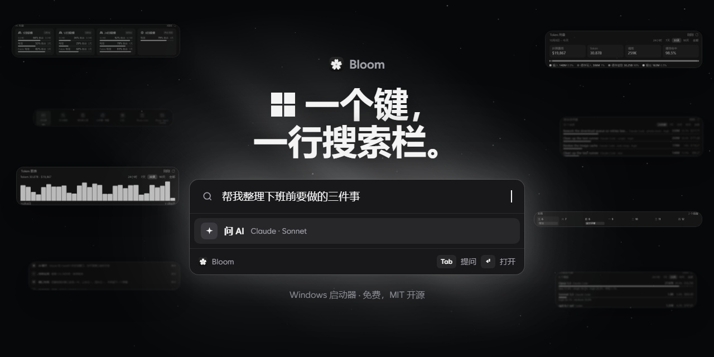
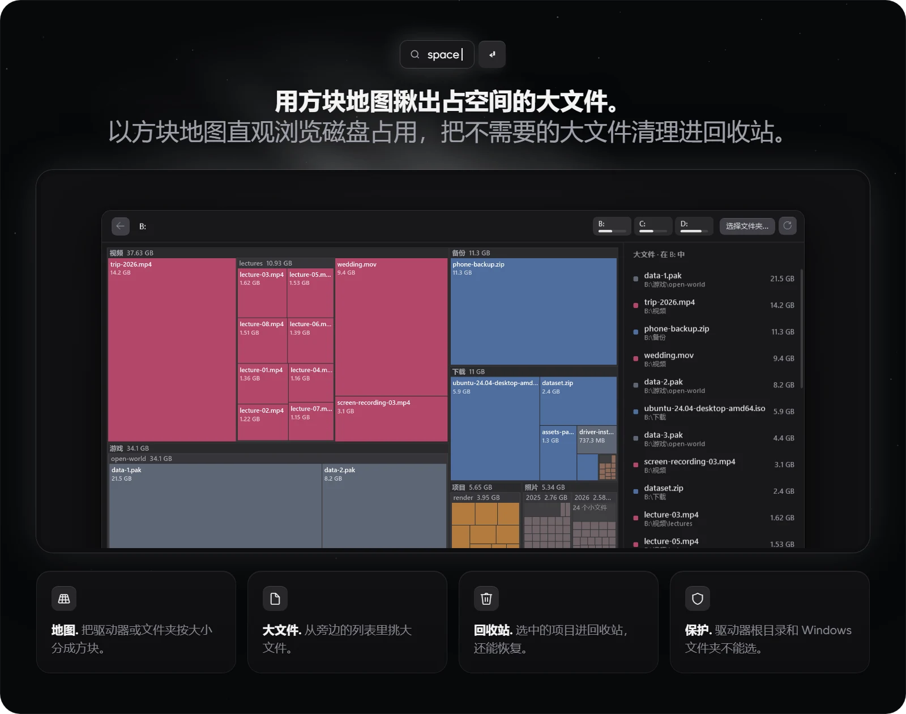
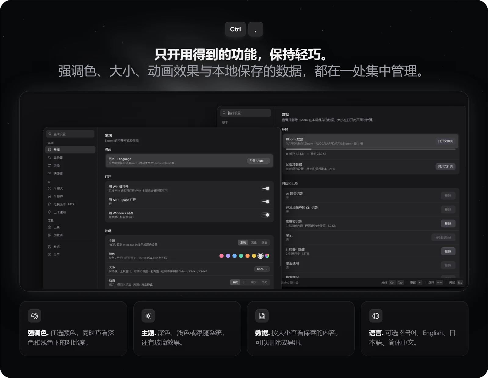
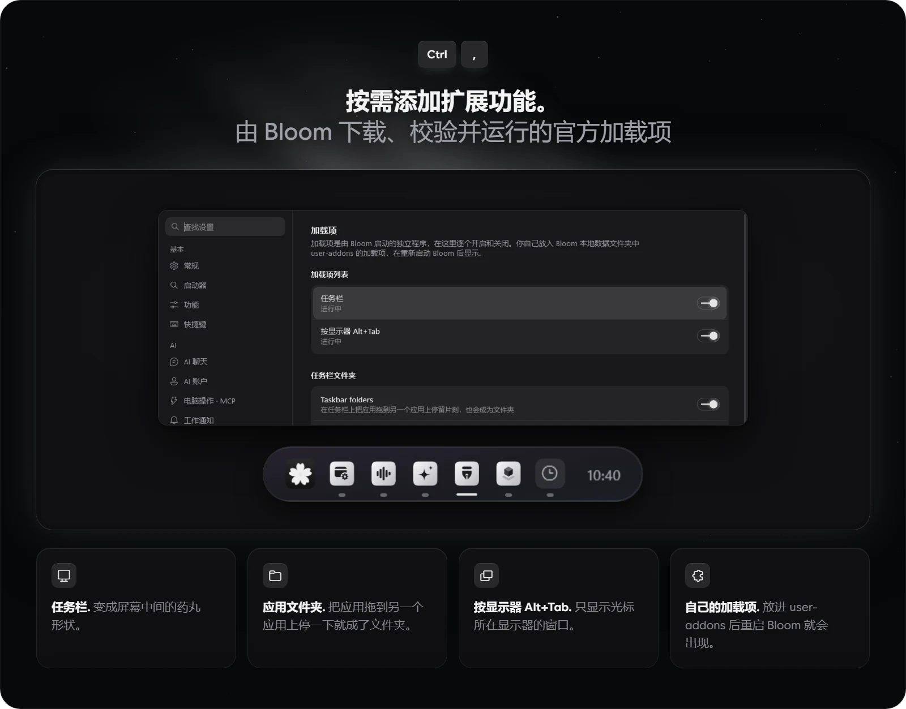
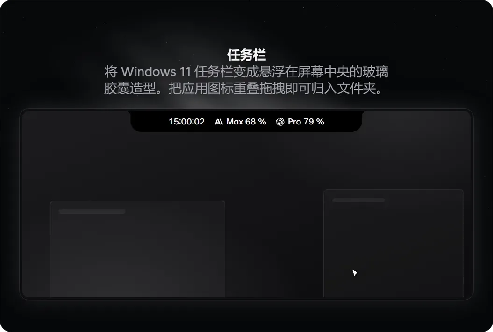
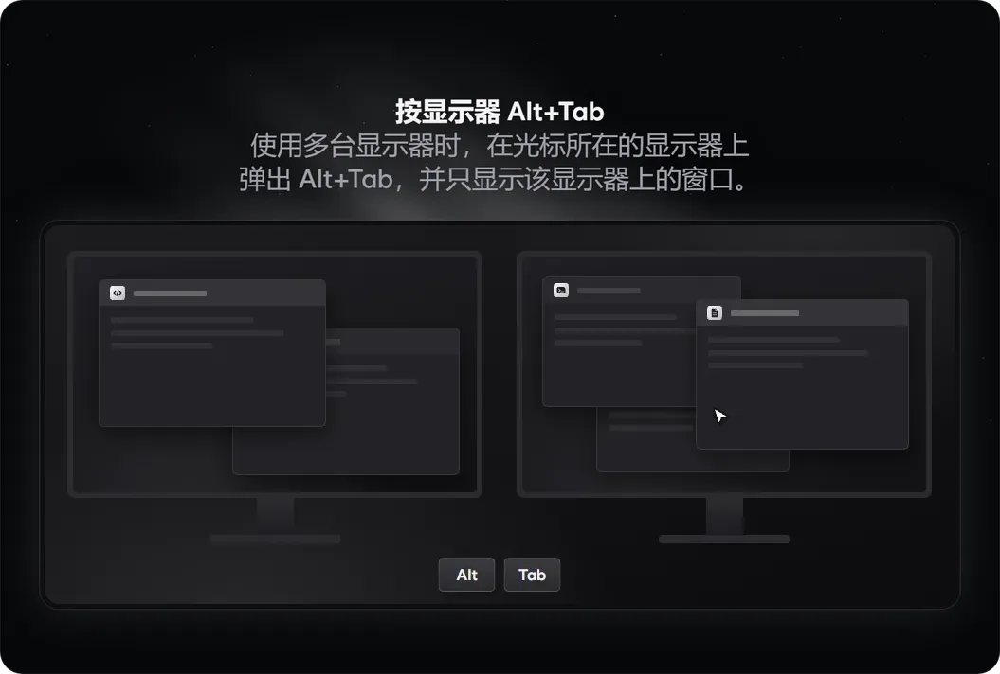

<p align="center"></p>

<p align="center">Windows 启动器。在搜索栏输入想做的事，按 Enter 立即打开，或者按 Tab 直接问 AI。</p>

<p align="center">
  <a href="#下载">下载</a> | <a href="#功能">功能</a> | <a href="#加载项">加载项</a> | <a href="#快捷键">快捷键</a> | <a href="#关于-ai-功能">AI 与隐私</a> | <a href="README.md">English</a> | <a href="README.ko.md">한국어</a> | <a href="README.ja.md">日本語</a>
</p>

<p align="center">
  
</p>

<p align="center"><sub>基于 .NET 10 的原生 WPF，不使用 WebView，支持 English、한국어、日本語 和简体中文，MIT 许可证</sub></p>

## 为什么用 Bloom

- 按一下 Win 键即可呼出搜索栏，在一行里搞定启动应用、计算和查找文件。
- 直接接入这台电脑上已登录的 Claude Code 或 Codex，或填入自己的 API 密钥，马上就能使用 AI 功能。
- 不用的功能关掉后会从菜单和快捷键中彻底移除，不占一点内存。

## 下载

**[下载 Windows 版 Bloom](https://github.com/hyeon1035298/Bloom/releases/latest)** 从最新发布页下载并运行 `BloomLauncher-win-Setup.exe` 即可。

也可以用下方的 PowerShell 命令下载并运行同一个安装程序。

```powershell
irm https://raw.githubusercontent.com/hyeon1035298/Bloom/main/install.ps1 | iex
```

- 支持 64 位 Windows 10 和 11。如果电脑上还没有安装 .NET 10 桌面运行时，安装程序会自动一并安装。
- 安装在 `%LOCALAPPDATA%\BloomLauncher` 文件夹下，并在开始菜单创建快捷方式。
- 由于目前尚未进行代码签名，安装时如果弹出“Windows 已保护你的电脑”，点击 更多信息 › 仍要运行 即可。
- 启动后会检查一次是否有新版本，并在下次启动时自动完成更新。如果不需要，可以在 设置 › 关于 中关闭。
- 卸载请前往 设置 › 数据 › 卸载 Bloom，在那里可以选择是否一并清除保存的数据。
- 使用 AI 功能需要登录 Claude Code、Codex 或 omp，或者配置 API 密钥。如果安装了文件搜索工具 [Everything](https://www.voidtools.com/)，就能瞬间搜索整台电脑上的文件。

## 功能

### 一个搜索栏


- 快速查找已安装的应用、Windows 设置和 Bloom 命令。支持只输英文首字母（`gc`），如果使用韩语输入，还能识别初声（`ㅁㅁㅈ`）或忘记切换输入法时打出的字符（`초개ㅡㄷ`）。
- 输入 `45000*1.1`、`5.9 ft to cm`、`100 usd` 这样的算式、单位或汇率即可实时算出结果，按 Enter 就能复制到剪贴板。
- 直接输入 `timer 5m` 或 `laundry in 30 min` 这样的日常表达，就能设好计时器和提醒。
- 输入 `:heart` 查找表情符号，或者像 `yt cats` 这样加上前缀直接搜索指定网站。
- 安装 Everything 后，按文件名就能秒搜电脑里的任何文件。
- 在搜索结果上按 Ctrl+K 会列出对该项目可执行的所有操作；在空搜索栏里输入 `?` 则能一览支持的输入示例。
- 输入 `C:\Users` 这样的文件夹路径，不用专门打开资源管理器，就能直接在启动器里查看里面的文件和子文件夹。
- 输入 `left half`、`maximize`、`next screen` 等指令，把当前窗口贴靠到半屏或移到另一台显示器。
- 输入 `in 100 days` 或 `tokyo 3pm`，轻松推算日期和查看世界各地的时间。
- 输入 `install vlc` 即可在 winget 和 Microsoft Store 中查找应用，经过确认后直接安装。
- 通过 Ctrl+K › 设置快捷键，可以为常用的应用、文件夹、网站或窗口布局绑定专属的全局快捷键。

### AI 聊天


- 在搜索栏输入问题并按 Tab，快速 AI 就会当场作答；按 Shift+Tab 则是不带上下文开启一段新对话。
- 需要深入多轮对话或上传文件、图片时，可以打开独立的 AI 聊天窗口（Ctrl+Alt+C）。
- 整理文件等电脑操作也能交给 AI 处理。凡是涉及移动文件或改动内容的动作，执行前都会弹出确认卡片让你选择允许或拒绝。
- 对它说一句“明天下午 3 点开会”，日程就会自动记入 Bloom 日历。记笔记和设计时器也一样说句话就能搞定。
- 在其他应用里选中一段文字，按下 AI 操作（Ctrl+Alt+A），就能直接完成总结、翻译或润色，并原位替换回去。
- 开启任务通知后，当交给 Claude Code 或 Codex 的任务完成、等待批准或额度快用完时，都会弹出卡片提醒你。
- API 密钥支持 OpenAI、Anthropic、Gemini、OpenRouter、DeepSeek、xAI 和 OpenCode Go，由 Windows 加密并仅保存在这台电脑上。

### 主页


- 当搜索栏为空时，下方会展开主页，集中显示收藏、AI 用量、本周日程、计时器、笔记和媒体播放器。
- AI 用量块会按账户显示 Claude 和 ChatGPT 的 5 小时额度和每周额度还剩多少，支持添加多个账户同屏查看。
- Token 块会统计这台电脑上 Claude Code 和 Codex 的本地使用记录，并按官方 API 价格折算出相当于多少费用。该区块默认关闭，需要时可以随时开启。
- 按 Ctrl+E 可以自由调整主页各个区块的排列顺序，或者隐藏、恢复区块。

### Bloom Lens 和取色器


- 按下 Bloom Lens（Ctrl+Alt+L）并用鼠标框选屏幕区域后，按数字键即可选择操作：`1` 提问、`2` 翻译、`3` 复制文字、`4` 实时翻译、`5` 固定在屏幕上、`6` 截图、`7` 调色板。
- 最常用的翻译（Ctrl+Alt+T）和复制文字（Ctrl+Alt+O）还配有独立快捷键，按一下就能一步直达。
- 用取色器点击屏幕上的任意颜色，即可查看 HEX、RGB、HSL 色值以及文字可读性（对比度）。
- 调色板会从所选屏幕区域提取主要颜色，完全在这台电脑本地计算，不经过 AI。

### 附着的工具


- 按 Ctrl+J 可以打开笔记、计时器、计算器、剪贴板历史和快捷键说明小窗口。
- 把工具窗口移近启动器，它就会像磁铁一样吸附在旁边并随启动器一起移动；拉开后又能作为独立窗口单独摆放。
- 笔记支持 Markdown 语法，不想打开窗口时，直接在搜索栏输入 `note buy milk` 也能随手记下一条。
- 剪贴板历史（Ctrl+Alt+V）会把你复制过的文字、图片和文件都存下来，随时可以翻出来再用。
- 按 Ctrl+P 可将启动器置顶在所有窗口之上，按 Ctrl+= / Ctrl+- 可在 80%～150% 之间缩放启动器大小。

### Bloom Space Cleaner



- 将驱动器或文件夹中各个文件和子文件夹占用的空间，按比例绘制成一目了然的方块地图。
- 点击方块即可层层进入子文件夹查看，并从大文件列表中挑出不需要的文件直接移入回收站。
- 为防止误删重要系统文件，驱动器根目录和 Windows 文件夹被设为不可选，删除的文件也随时能从回收站恢复。

### 设置



- 不用在设置菜单里一层层翻找，直接在搜索栏输入设置项名称就能直达对应页面。
- 可以随心挑选喜欢的强调色，并同时预览它在深色和浅色主题下的文字对比度。
- 关掉不用的功能后，它会从菜单和快捷键中干净地移除，而此前保存的数据会完好保留。
- 在数据页面可以查看各类已保存数据占用的空间，按需单独清除或导出为备份文件。
- 在自定义命令中，可以把常用的脚本、文本片段或串联起来的一组命令（`notepad ; volume 30 ; yt lofi`）绑定到一个关键词上，一键执行。
- 界面语言可在 English、한국어、日本語、简体中文 之间切换。
- 点击问题报告会自动隐去日志中的用户名和邮箱地址，将日志复制到剪贴板并打开 GitHub issue 页面。Bloom 绝不会私自向外发送任何数据。

## 加载项



加载项是可以在 Bloom 内下载、校验并运行的独立程序。加载项的代码不包含在 Bloom 本体中，目前提供的 5 个官方加载项均采用 GPL-3.0 许可证，在各自的独立仓库中开源。

### 任务栏（PillTaskbar）



- 将 Windows 11 默认任务栏变成悬浮在屏幕中央的半透明玻璃胶囊造型。
- 在任务栏上把一个应用图标拖到另一个图标上就能建好文件夹，并可在 设置 › 加载项 中编辑文件夹名称和内容。
- 开始按钮会变成 Bloom 的花朵按钮，系统托盘前方则会显示当前正在播放的音乐。
- 可以为每个已添加的账户在任务栏上并排显示一条 AI 剩余用量条。
- 开启自动隐藏岛后，平时任务栏会自动收起，并在屏幕顶部中央显示一个小巧的岛条。
- 首次启动时会从 Microsoft 符号服务器下载一次运行所需的符号文件（约 70 MB）。

### 按显示器 Alt+Tab



使用多台显示器时，按下 Alt+Tab 会在鼠标光标所在的显示器上弹出窗口切换列表，并且只显示当前显示器上的窗口。

### 内存清理


- 任务栏时钟旁的内存条显示内存使用率。点一下打开窗口，一键释放内存。
- 还可以挑出占用内存多的程序并结束它。

### 显示器亮度调节


- 时钟旁的显示器图标显示亮度。一个滑块调所有显示器，在图标上滚动滚轮也能调。
- 可以用快捷键调亮度，离开时让屏幕变暗。

### 咖啡


- 打开时钟旁的咖啡杯，电脑和屏幕就不会休眠。
- 可以一直开到关闭，也可以设定时间。右键点咖啡杯即可开关。

### 加载项的安装方式

- 在 设置 › 加载项 中点一下按钮即可轻松下载。
- 只有当下载的文件与内置的 SHA-256 哈希值完全一致时才会执行安装。
- 新下载的加载项默认处于关闭状态，开启前会先向你说明它的具体作用。
- 每次开启加载项以及启动 Bloom 时，都会检查是否有新版本。
- 万一某个加载项引起问题，只需在启动 Bloom 时按住 Shift 键，当次运行就会跳过所有加载项。

### 自己的加载项

把自制的加载项放进 `%LOCALAPPDATA%\Bloom\user-addons` 文件夹并重启 Bloom，它就会出现在 设置 › 加载项 列表中。初始同样为关闭状态，运行时会根据 `addon.json` 中的 SHA-256 哈希校验文件是否被篡改。

## 快捷键

| 按键 | 作用 |
| --- | --- |
| `Win` 或 `Alt+Space` | 打开 Bloom（要在以管理员身份运行的应用上用 `Win`，需开启 设置 › 常规 › 在管理员应用上也使用 Win 键） |
| `Tab` / `Shift+Tab` | 把搜索栏中的内容问 AI，在同一个聊天或新聊天中 |
| `Ctrl+K` | 所选结果能做的所有事 |
| `Ctrl+1` … `Ctrl+9` | 收藏 |
| `Ctrl+J` | 工具（笔记、计时器、计算器、剪贴板记录、快捷键） |
| `Ctrl+P` | 让启动器保持在最上层 |
| `Ctrl+E` | 编辑主页 |
| `Ctrl+,` | 设置 |
| `?` | 在空搜索栏中按类别列出 Bloom 能理解的输入 |
| `Ctrl+=` / `Ctrl+-` / `Ctrl+0` | 放大、缩小、100 % |
| `Esc` | 返回，再清除输入，再关闭（快速 AI 的回答会继续） |
| `Ctrl+.` | 停止快速 AI 的回答 |
| `Ctrl+Alt+C` | AI 聊天窗口 |
| `Ctrl+Alt+A` | AI 操作 |
| `Ctrl+Alt+L` | Bloom Lens |
| `1` … `7` | 在 Bloom Lens 中，问 AI、翻译、复制文字、实时翻译、固定到屏幕、截图、调色板 |
| `←` `→` / `−` `+` / `Enter` | 在调色板中，选择颜色、减少或增加颜色、复制 HEX |
| `Ctrl+Alt+T` / `Ctrl+Alt+O` | 翻译屏幕、复制屏幕上的文字 |
| `Ctrl+Alt+V` | 剪贴板记录 |

全局快捷键可以在 设置 › 快捷键 中更改或关闭。单击一项后按下按键，按 Backspace 则关闭它。切换窗口、表情符号、取色器、就屏幕问 AI、实时翻译和截图也可以设置快捷键，它们默认关闭。

## 关于 AI 功能

Bloom 的 AI 使用本机已安装并登录的官方 CLI，或你添加的 API 密钥。登录凭据留在这些 CLI 中，用量和条款以你自己的账户为准。没有它们时，只有 AI 功能不可用。

- Claude 使用 [Claude Code](https://docs.anthropic.com/en/docs/claude-code) CLI（`claude`）。
- ChatGPT 使用 [Codex CLI](https://github.com/openai/codex)（`codex`）。
- omp 是可选的，使用 [oh-my-pi](https://github.com/can1357/oh-my-pi) CLI（`omp`）。
- API 密钥由 Windows 加密，留在本机，只发送给对应的服务。

发送给 AI 的只有你发出的内容，也就是你的问题、附件、用 Bloom Lens 选中的屏幕区域、要翻译的文字，以及电脑工具返回的结果。Claude 只在该聊天的文件夹（`%LOCALAPPDATA%\Bloom\ai\files\<chat>`）内读写文件。Codex 和 omp 不直接处理文件，所以文本附件会放进消息里，它们生成的文件从回答中取出保存。

<details>
<summary>电脑操作、MCP 服务器、用量查询、token 日志和检查更新</summary>

#### pc 工具

Bloom 通过一个只有本机当前 Windows 用户能打开的 MCP 服务器（`Bloom.exe --mcp`，命名管道）提供一个工具 `pc`。它的 5 个分组可以在 设置 › 电脑操作 · MCP 中分别开关。

- 查询应用、文件（Everything）、最近的文件、窗口、计时器和日程、笔记以及自定义命令。查询无需确认。
- 打开应用、文件和网站，运行 `volume 30` 这样的搜索栏输入，运行自定义命令。
- 写入 Bloom 的笔记，启动计时器，在日历中添加日程。
- 重命名、移动、复制文件，以及把文件移到回收站。
- 读取和写入剪贴板。

除查询外的所有操作，都要在聊天中的卡片上选择允许或拒绝，结果以 ✓ 或 ✕ 留在回答下方。Claude Code 通过 `--permission-prompt-tool stdio` 询问。Codex 和 omp 无法自行询问，所以由 Bloom 的 MCP 服务器在执行前显示同样的卡片。

工具定义每次请求约增加 250 到 500 个输入 token，关闭分组可以减少。Codex 只在每次聊天运行时通过 `-c mcp_servers.bloom…` 获得这个服务器。omp 则写在 `%LOCALAPPDATA%\Bloom\ai\omp-work` 下该聊天自己的 `.omp/mcp.json` 中，不会写入 omp 自身的设置。

#### 其他 MCP 服务器

为 Claude Code、Claude Desktop、Cursor、VS Code、Windsurf 或 Codex 配置的 MCP 服务器，以及用 Claude Code 打开的项目的 `.mcp.json` 中的服务器，会显示在同一页面，每个一个开关。它们默认关闭，只加载已开启的服务器（`--strict-mcp-config`）。它们的每个操作都在同样的卡片上询问，ChatGPT 由 Bloom 的中继（`Bloom.exe --mcp-proxy`）处理。它们的设置每次都从原始文件读取。

#### 用量查询

AI 用量来自 `claude -p /usage`（不调用模型）和 `codex app-server` 的额度查询，每次查询一个账户。添加的账户在 `%LOCALAPPDATA%\Bloom\accounts` 下有各自的文件夹（`CLAUDE_CONFIG_DIR` 或 `CODEX_HOME`）。可选的 ChatGPT 轻量方式会用该账户的 Codex 登录，向 Codex 自己的状态页读取的地址发送一次 HTTPS 请求。这不是官方 API，Bloom 只在自己创建的文件夹中刷新令牌，从不在 `~/.codex` 中刷新。Bloom 从不读取 Claude 的登录信息。

设置 › AI 账户 › 将用量写入文件（默认关闭）会把已用百分比、重置时间、你起的账户名称和每个账户的任务栏选项写入 `%LOCALAPPDATA%\Bloom\export\ai-usage.json`，供本机其他程序读取，比如任务栏加载项。其中不含电子邮件地址和登录信息。

#### 日志和 token 统计

工作通知读取本机的 Claude Code 和 Codex 日志（`~/.claude/sessions`、`~/.codex/sessions`），日志不会离开本机。

token 区块读取本机所有账户的 Claude Code 和 Codex 日志。Bloom 只在 `%LOCALAPPDATA%\Bloom\tokens` 中保存按模型、effort 和会话的每小时合计，以及每个会话的标题和最后一级文件夹名，从不保存消息内容和完整路径。第一次统计在后台把所有日志读一遍，之后只读新增的部分。Claude Code 会删除 30 天前的日志，所以更长的时间范围从 Bloom 开始统计的那天起逐渐填满。金额是同样的 token 按各家 API 价格计算的结果，不是你实际支付的费用。设置 › AI 账户 › 编辑价格表 会打开 `prices.json`，可以修改价格。

#### 检查更新

检查更新时会向 GitHub API（`api.github.com`）查询本仓库的最新版本，并从 GitHub 下载新版本。请求中只有仓库信息。可以在 设置 › 关于 中关闭检查。

</details>

## 安装与构建

<details>
<summary>从源代码构建、数据文件夹和发布</summary>

只想使用 Bloom 的话，请从[下载](#下载)获取安装程序。自行构建需要 Windows 10 或 11 和 [.NET 10 SDK](https://dotnet.microsoft.com/download)。`tools\package.ps1` 还需要 C++ 生成工具（Visual Studio 的“使用 C++ 的桌面开发”），用于 Win 键助手。

```powershell
dotnet build src\Bloom\Bloom.csproj -c Release
# 或者生成安装用副本
powershell -File tools\package.ps1   # → dist\app
powershell -File tools\install.ps1   # → %LOCALAPPDATA%\Programs\Bloom，开始菜单快捷方式
```

数据保存在 `%APPDATA%\Bloom` 和 `%LOCALAPPDATA%\Bloom`。开发时，`Bloom.exe --data <文件夹>` 使用另一个数据文件夹，`--lang ko|en` 固定界面语言。自动更新只适用于安装程序版本，用 `tools\install.ps1` 生成的副本需要手动更新。

发布时，提高 `src/Bloom/Bloom.csproj` 中的 `<Version>`，在 `CHANGELOG.md` 的 `## <Version>` 下写明变更，推送后在 GitHub 运行 Actions › Release › Run workflow。它会下载并校验 `addons/catalog.json` 中的每个加载项，运行测试和构建，用 [Velopack](https://velopack.io) 打包安装程序和更新包，并以 `v<Version>` 发布。

</details>

## 代码结构

<details>
<summary>文件夹、约定、测试和 lint</summary>

`src/Bloom` 下一个文件夹对应一个功能。较大的类按主题拆分成多个 `partial` 文件。

| 文件夹 | 内容 |
| --- | --- |
| `App/` | `Host`（启动、快捷键、命令、Lens、计时器、自定义命令、文件操作）、工作通知（`Notices`）、更新（`Updates`，Velopack）、启动选项、托盘、Win 键钩子及其管理员应用助手（`src/WinKeyHelper`，NativeAOT） |
| `App/Engine/` | 搜索栏显示的内容，从根搜索和主页区块到各个视图（文件、剪贴板、日历、计时器、颜色） |
| `App/Mcp/` | MCP 服务器、中继和 `pc` 工具 |
| `App/Qa/` | 屏幕外截图 QA（`--capture <文件夹> --qa-set <集合> --data <文件夹> --lang en`） |
| `Addons/` | 作为独立程序运行的加载项。固定的目录和下载（`AddonCatalog`、`AddonDownload`）、`addon.json` 校验（`AddonManifest`）、经过哈希校验的运行副本（`AddonStore`）、宿主进程的启动和停止（`AddonRunner`）以及共用名称（`AddonProtocol`）。Bloom 从不加载加载项的代码 |
| `Core/` | 保存的数据（设置、收藏、使用记录、学习、计时器、笔记、颜色）、JSON 存储、韩语搜索、匹配、界面语言（`Lang`） |
| `Search/` | 应用列表、计算器（计算、单位、货币）、Everything、已打开的窗口、最近的文件、表情符号和符号、系统项目、自定义命令、结果模型 |
| `Ai/` | Claude Code、Codex 和 omp 的 CLI 会话与聊天、一次性提问、翻译、AI 操作、用量（`AiUsage`）、工作日志（`ClaudeWatch`、`CodexWatch`） |
| `Ai/Api/` | API 密钥聊天、各服务的实现，以及连接其他服务器的 MCP 客户端 |
| `Ocr/` | 选择屏幕区域、Windows OCR、翻译窗口、取色 |
| `Music/` | 迷你播放器、播放列表和其他应用中正在播放的歌曲 |
| `Clip/`、`Space/`、`Browser/` | 剪贴板记录、磁盘空间地图、交给浏览器 |
| `Native/` | Win32 调用（仅 System32 的 DLL）、WinRT 调用、系统开关（`SystemControl`）、与资源管理器相同的文件操作（`ShellFiles`） |
| `Ui/Launcher/` | 启动器窗口，所有视图的标签、提示和结果都在 `Launcher.ViewSpecs.cs` 中 |
| `Ui/Chat/`、`Ui/Player/` | AI 聊天窗口和迷你播放器窗口 |
| `Ui/Settings/` | 设置窗口，包括加载项页面和任务栏文件夹编辑器 |
| `Ui/Tools/` | 工具窗口、它们的摆放、附着和吸附（`ToolDock`），以及笔记、计时器、计算器和剪贴板 |
| `Ui/Controls/`、`Ui/Theme/` | 共用控件（G2 圆角的 `SmoothBorder`、`Dropdown`、`PopupMenu`、`AccentPicker`）和主题（动画在 `Motion`） |
| `tests/Bloom.Tests` | 不使用测试框架、以控制台程序运行的自动测试 |

新功能拆分为负责结果的 `Engine.<功能>.cs`、`Launcher.ViewSpecs.cs` 中的一行视图，以及需要存储时的 `Core/<功能>.cs`。
屏幕上的所有文字都写成 `Tr("한국어", "English")`。日文和简体中文来自 `src/Bloom/Assets/Lang/ja.tsv` 和 `zh.tsv`，以英文文本为键。`python tools/lang.py check` 列出缺失项，`todo ja` 列出待翻译的文本。搜索关键词和解析数据保留韩语和英语。
界面文字遵循 [docs/COPY.md](docs/COPY.md)。
QA 和开发运行始终使用 `--data <临时文件夹>`，与真实数据分开。

```powershell
# 测试（退出码 = 失败数）
dotnet run --project tests\Bloom.Tests
# lint（分析器和格式），零警告
dotnet build src\Bloom\Bloom.csproj -c Debug --no-incremental -p:AnalysisLevel=latest-recommended -p:EnforceCodeStyleInBuild=true
dotnet build tests\Bloom.Tests\Bloom.Tests.csproj -c Debug --no-incremental -p:AnalysisLevel=latest-recommended -p:EnforceCodeStyleInBuild=true
dotnet format whitespace src\Bloom\Bloom.csproj --verify-no-changes
dotnet format whitespace tests\Bloom.Tests\Bloom.Tests.csproj --verify-no-changes
```

要做有时限的响应速度测试，用 `--data <独立文件夹> --no-hook --no-tray --qa-responsive 3` 运行 Release 版本。它会写出 `responsiveness.json` 和 `responsiveness.txt`。

</details>

## 许可证

Bloom 采用 MIT 许可证，详见 [LICENSE](LICENSE)。

汇率数据来自 [Rates By Exchange Rate API](https://www.exchangerate-api.com)。

任务栏加载项 PillTaskbar（[源代码](https://github.com/hyeon1035298/PillTaskbar_BloomAddon)）和按显示器 Alt+Tab 加载项（[源代码](https://github.com/hyeon1035298/AltTabPerMonitor_BloomAddon)）是采用 GPL-3.0 的独立程序，Bloom 本身仍采用 MIT。

`src/Bloom/Assets/Logos` 中的 OpenAI 和 Anthropic 标志是其各自所有者的商标，不在 MIT 许可证范围内。Bloom 只用它们标明 AI 用量账户属于哪个服务。

Bloom 是非官方的个人项目，与 Anthropic、OpenAI、voidtools 和 Raycast 无关。
