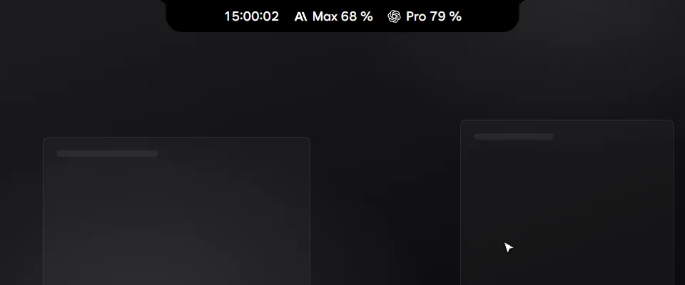
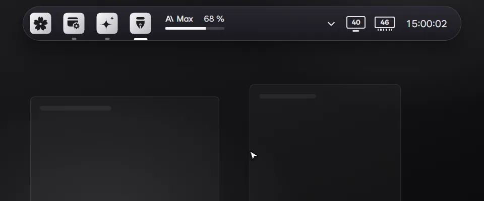
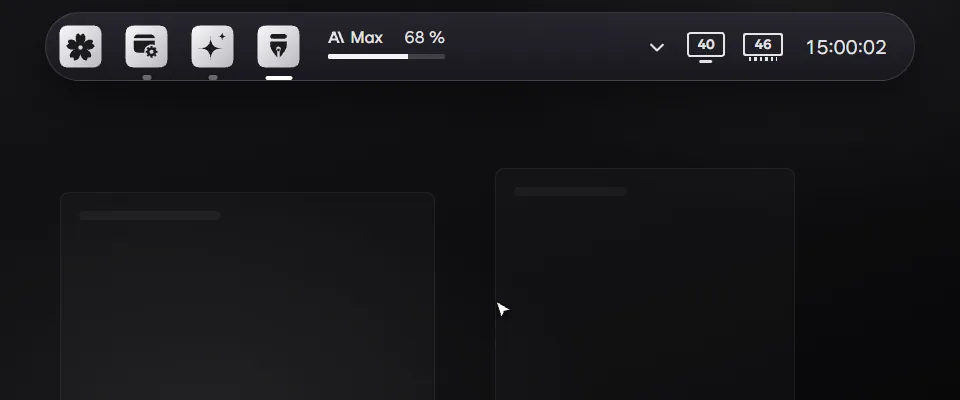
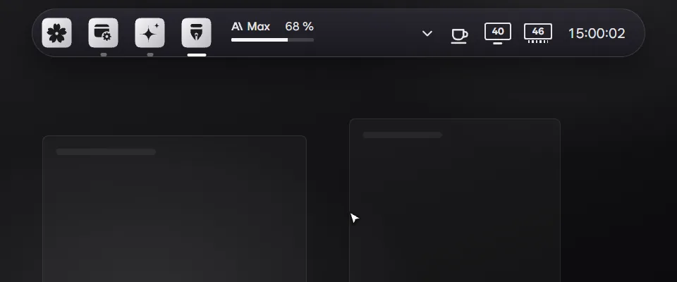
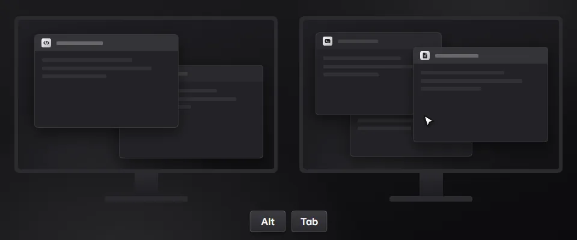

- Taskbar add-on: point at the island to open the pill taskbar. Folders get fourteen icons that follow the taskbar's light or dark look.

- Memory Clean add-on: a RAM module next to the clock shows the use. Click it and Clean now frees memory.

- Monitor Brightness add-on: a monitor next to the clock shows the brightness. One slider moves every monitor, and the wheel over the icon changes it too.

- Coffee add-on: a coffee cup next to the clock keeps the computer and the screen awake, until turned off or for a set time. Right-click the cup to turn it on or off.

- Alt+Tab per monitor add-on: Alt+Tab opens on the monitor under the cursor, with only that monitor's windows.
- In Bloom, click a picture to open that add-on in Settings › Add-ons.
- Screen recording: pick an area with Bloom Lens and record it to MP4, with system sound and the microphone.
- Settings › Add-ons: an overview with a moving picture of each add-on, and a page for each.
- Add-ons run as programs of their own and follow Bloom's theme and glass setting.
- Add-ons update themselves from their latest release, without waiting for a new Bloom.
- Hide a result from search and home with Ctrl+K › Hide from search. Settings › Hidden items brings it back.
- My AI commands: saved prompts with steps and schedules. The notification center keeps finished tasks, limits, approvals and command results in one place.
- Bloom uses less memory.
- Fixed: Bloom Lens draws the picked area and its bar on every monitor, clear of the island.

### 한국어

- 작업표시줄 애드온: 아일랜드에 포인터를 올리면 알약 작업표시줄이 펼쳐집니다. 폴더 아이콘 14종이 생겼고, 작업표시줄의 라이트·다크에 맞춰 바뀝니다.

- 메모리 정리 애드온: 시계 옆 램 모듈에 사용량이 나옵니다. 누르고 지금 정리를 누르면 메모리를 비웁니다.

- 모니터 밝기 애드온: 시계 옆 모니터 모양에 밝기가 나옵니다. 슬라이더 하나로 모든 모니터를 함께 바꾸고, 아이콘 위에서 휠을 돌려도 바뀝니다.

- 커피 애드온: 시계 옆 커피잔으로 PC와 화면이 잠들지 않게 합니다. 끌 때까지나 정한 시간 동안 깨어 있고, 컵을 오른쪽 클릭하면 켜고 끕니다.

- 모니터별 Alt+Tab 애드온: Alt+Tab이 커서가 있는 모니터에 뜨고 그 모니터의 창만 보입니다.
- Bloom에서 그림을 누르면 설정 › 애드온의 그 애드온으로 갑니다.
- 화면 녹화: Bloom Lens로 범위를 골라 시스템 소리, 마이크와 함께 MP4로 녹화합니다.
- 설정 › 애드온: 애드온마다 움직이는 그림이 있는 개요와 애드온별 페이지가 생겼습니다.
- 애드온이 따로 된 프로그램으로 돌고, Bloom의 테마와 유리 효과를 따릅니다.
- 애드온은 새 Bloom을 기다리지 않고 자기 최신 릴리스로 스스로 업데이트됩니다.
- Ctrl+K › 검색에서 숨기기로 결과를 검색과 홈에서 숨깁니다. 설정 › 숨긴 항목에서 되돌립니다.
- 내 AI 명령: 자주 쓰는 프롬프트를 단계와 일정과 함께 저장합니다. 알림 센터가 작업 완료, 한도, 승인 대기, 명령 결과를 한곳에 모읍니다.
- Bloom이 메모리를 덜 씁니다.
- 고침: Bloom Lens가 고른 범위와 막대를 모든 모니터에, 아일랜드를 피해 그립니다.
