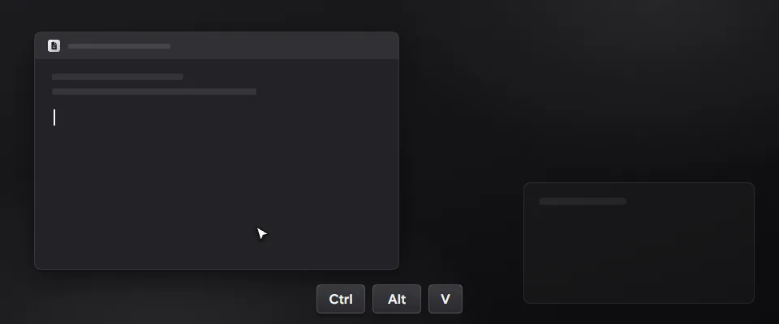

- Snippets: the clipboard view (Ctrl+Alt+V) has a Snippets tab next to History. Click a saved text or press Enter to paste it into the window in front.
- Keep a copied text with Ctrl+K › Save as a snippet. Settings › Shortcuts can give the Snippets tab a key of its own.
- Menus open and move without lag when GPU drawing is off.
- Icons sit in the middle of their tiles.

### 한국어

- 상용구: 클립보드 화면(Ctrl+Alt+V)의 기록 옆에 상용구 탭이 생겼습니다. 저장한 글을 누르거나 Enter를 누르면 앞의 창에 붙여넣습니다.
- 복사한 글은 Ctrl+K › 상용구로 저장으로 남깁니다. 설정 › 단축키에서 상용구 탭을 바로 여는 키를 정할 수 있습니다.
- GPU로 그리기를 꺼도 메뉴가 끊김 없이 열리고 움직입니다.
- 아이콘이 칸 가운데에 놓입니다.
