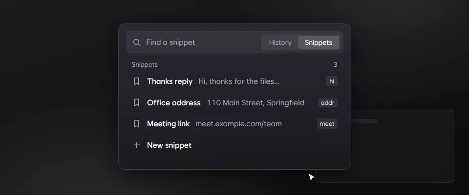
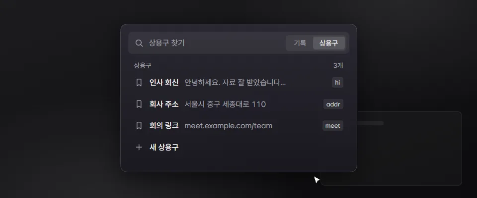

- Snippets: drag one up or down in the Snippets tab to change the order.
- Update history: Settings › About lists every version since 1.0.0. Pick one to see what changed. The notes come from GitHub when you open them, so Bloom no longer carries them.
- In Settings, the mouse's back button goes from a sub-page, such as an add-on's page, to the page above it.
- Fixed: at a larger size, a snippet's right-click menu stays inside the clipboard view instead of running past its left edge.

### 한국어

- 상용구: 상용구 탭에서 항목을 위아래로 끌어 순서를 바꿉니다.
- 업데이트 기록: 설정 › 정보에서 1.0.0부터의 버전을 골라 바뀐 점을 봅니다. 기록은 열 때 GitHub에서 불러오므로 Bloom 안에 더는 담지 않습니다.
- 설정의 하위 페이지(애드온 페이지 등)에서 마우스 뒤로 버튼을 누르면 위 페이지로 돌아갑니다.
- 고침: 크기를 키워도 상용구 우클릭 메뉴가 클립보드 화면 왼쪽 밖으로 잘리지 않습니다.
