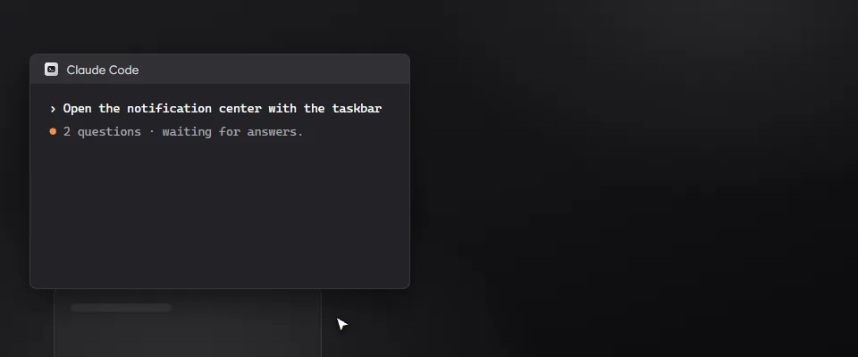
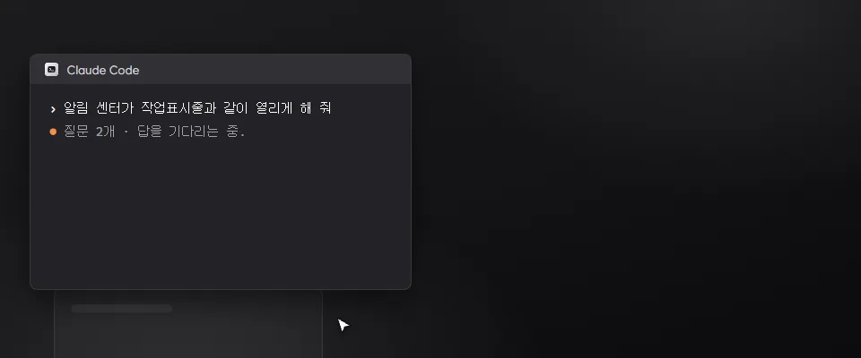

- When Claude Code asks you a question, its approval card shows the question and the choices. Pick one or several, or type your own answer, and it goes back to Claude Code.
- Windows notifications: other apps' banners can show as Bloom's cards instead. Turn it on in Settings › Work notifications. It needs PillTaskbar 0.2.13 or later, and a click on the card opens Windows' notification center.
- Settings › Add-ons is easier to read. Choices show as small pictures, every line has a plain name and a short note, and programs to leave out can be picked from the ones running now.
- Fixed: number fields in the add-on settings show their range on one line.

### 한국어

- Claude Code가 질문하면 승인 카드에 질문과 선택지가 나옵니다. 하나나 여러 개를 고르거나 직접 답을 적으면 Claude Code로 전해집니다.
- Windows 알림: 다른 앱의 알림 배너를 Bloom 카드로 대신 띄울 수 있습니다. 설정 › 작업 알림에서 켜며, PillTaskbar 0.2.13 이상이 필요합니다. 카드를 누르면 Windows 알림 센터가 열립니다.
- 설정 › 애드온이 읽기 쉬워졌습니다. 선택지는 작은 그림으로 고르고, 줄마다 쉬운 이름과 짧은 설명이 붙고, 제외할 프로그램은 지금 실행 중인 것에서 고릅니다.
- 고침: 애드온 설정의 숫자 칸 범위가 한 줄로 나옵니다.
