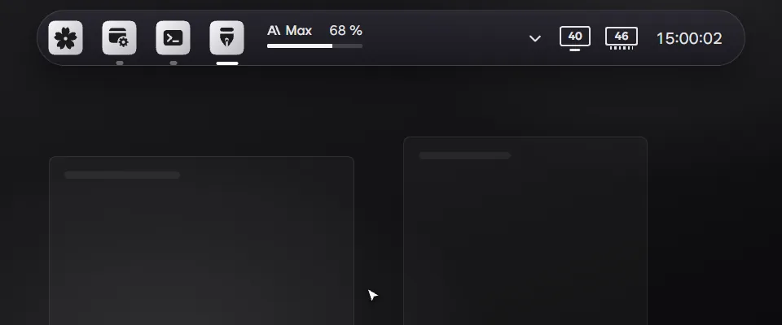

- A click on a Claude Code or Codex card can open that session's chat on the taskbar instead of its app. Pick it under Clicking a card in Settings › Work notifications. It needs PillTaskbar 0.2.14 or later.
- Checking for updates in Settings › About checks the add-ons too, and the ones turned on update right away.
- Add-ons now bring their own words and pictures for Settings › Add-ons, so an add-on update alone can change its page. An add-on not yet updated shows its settings by their plain schema names until it is.

### 한국어

- Claude Code와 Codex 카드를 누르면 앱 대신 작업표시줄에서 그 세션의 대화를 열 수 있습니다. 설정 › 작업 알림의 카드를 누르면에서 고르며, PillTaskbar 0.2.14 이상이 필요합니다.
- 설정 › 정보에서 업데이트를 확인하면 애드온도 함께 확인하고, 켜 둔 애드온은 바로 업데이트합니다.
- 설정 › 애드온의 이름, 설명, 그림을 이제 애드온이 직접 싣습니다. 애드온만 업데이트해도 그 페이지가 바뀌고, 아직 업데이트하지 않은 애드온은 그때까지 기본 이름으로 보입니다.
