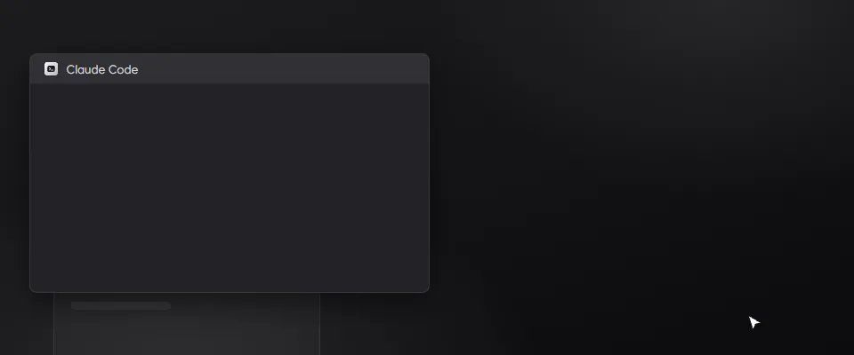

- New 'Task Cards' add-on: Shows what each Claude Code session is working on as a card, and lets you answer approvals and questions right from the card. Works even when another monitor is in fullscreen.
- In Settings › Add-ons › Task Cards, pick a monitor by name and choose the card position on its preview.
- T3 Code integration: Finds the running T3 Code thread and opens it directly from notifications or cards. Send messages to the active turn, answer questions, or stop it from the card. Antigravity threads are view-only.
- Added T3 to AI Chat so you can view and continue T3 Code threads.
- Add-ons: Check and update all add-ons at once with a single Check for Updates button.

### 한국어

- 새 애드온 '작업 카드': Claude Code 세션마다 지금 하는 일을 카드로 보여 주고, 승인과 질문에 카드에서 바로 답합니다. 다른 모니터가 전체 화면이어도 동작합니다.
- 설정 › 애드온 › 작업 카드에서 모니터를 이름으로 고르고, 그 모니터 그림 위에서 자리를 정합니다.
- T3 Code 연결: 세션이 돌고 있는 T3 Code 스레드를 찾아 알림이나 카드에서 바로 엽니다. 카드에서 그 턴에 글을 보내고, 질문에 답하고, 멈출 수 있습니다. Antigravity 스레드는 보기만 됩니다.
- AI 채팅에 T3 쪽이 생겨 T3 Code 스레드를 보며 이어서 대화합니다.
- 애드온: 업데이트 확인 단추 하나로 모든 애드온을 한 번에 확인하고 업데이트합니다.
