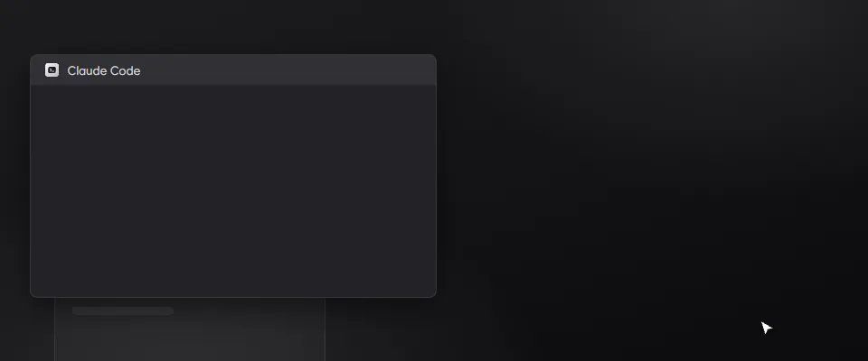

- New add-on, Run Card: a live card for each Claude Code session shows what it is doing, and its approvals and questions are answered on the card. It also works while another monitor is full screen.
- Settings › Add-ons › Run Card picks its monitor by name and its place on a picture of that monitor.
- T3 Code link: Bloom finds the T3 Code thread a session runs in and opens T3 there from a notice or a card. Cards can type into its turn, answer its question and stop it. Antigravity threads are view-only.
- AI chat has a T3 side that lists T3 Code's threads and carries on in them.
- Add-ons: one Check for updates button checks every add-on and updates them all at once.

### 한국어

- 새 애드온 '작업 카드': Claude Code 세션마다 지금 하는 일을 카드로 보여 주고, 승인과 질문은 카드에서 답합니다. 다른 모니터가 전체 화면이어도 동작합니다.
- 설정 › 애드온 › 작업 카드에서 모니터를 이름으로 고르고, 그 모니터 그림 위에서 자리를 고릅니다.
- T3 Code 연결: 세션이 돌고 있는 T3 Code 스레드를 찾아 알림이나 카드에서 T3를 그 자리로 엽니다. 카드에서 그 턴에 글을 보내고, 질문에 답하고, 멈출 수 있습니다. Antigravity 스레드는 보기만 합니다.
- AI 채팅에 T3 쪽이 생겨 T3 Code의 스레드를 보고 이어서 대화합니다.
- 애드온: 업데이트 확인 단추 하나로 모든 애드온을 확인하고 한 번에 업데이트합니다.
