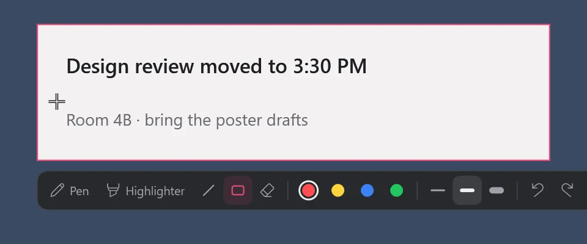
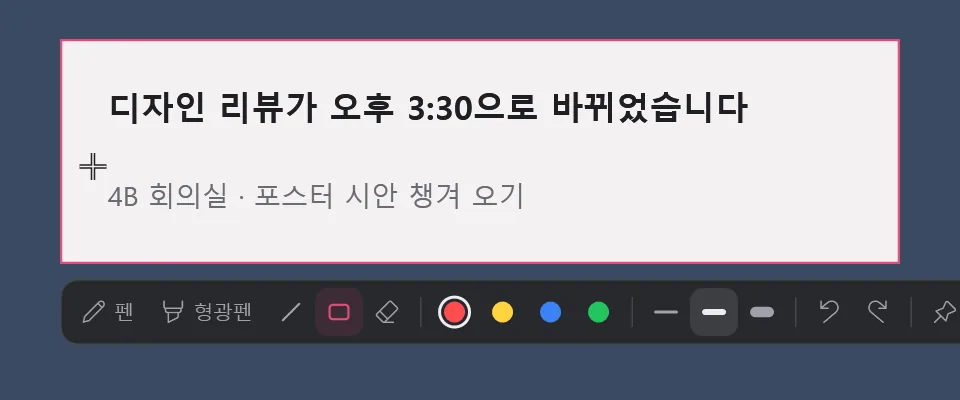

- Bloom Lens: Draw straight lines (L) and rectangles (R) on the picked area, in the pen's color and size. Hold Shift for 45° steps or a square.
- Fixed: With the taskbar add-on at the bottom of the screen, the screen recording bar opened off the screen. It now shows above the island.
- Notification cards keep clear of the island and the taskbar at the bottom of the screen.
- Add-ons: The island comes back after a graphics driver reset instead of staying black, and add-on panels open on the right monitor when an auto-hidden taskbar sits at the bottom.

### 한국어

- Bloom Lens: 고른 범위에 직선(L)과 사각형(R)을 펜의 색과 굵기로 그립니다. Shift를 누르면 직선은 45° 단위로, 사각형은 정사각형으로 그려집니다.
- 고침: 작업표시줄 애드온을 화면 아래에 두면 화면 녹화 막대가 화면 밖에 열렸습니다. 이제 아일랜드 위에 뜹니다.
- 알림 카드가 화면 아래의 아일랜드와 작업표시줄을 가리지 않습니다.
- 애드온: 그래픽 드라이버가 다시 시작된 뒤 아일랜드가 검게 남지 않고 돌아옵니다. 자동으로 숨는 작업표시줄을 아래에 두어도 애드온 창이 맞는 모니터에 열립니다.
